# Aether3D

[](https://github.com/Murisixz/Aether3D/actions/workflows/tests.yml)
[](LICENSE)

**Aether3D** is an open-source, AI-native, code-first 3D engine. Every operation
is available through a small, predictable Python API and a JSON-speaking CLI,
so it can be driven reliably by people and AI coding agents alike, with no
graphical interface required.

> **Status: v0.20.0 (animation, cameras, lighting, path tracing and film output).**
> Aether3D provides:
>
> - a scene graph with transforms and hierarchy;
> - the native `.aether` project format;
> - standards-compliant **glTF 2.0 / GLB import and export**;
> - structured **geometry inspection**;
> - a programmable **polygon modeling engine** (selection, transforms,
>   extrude, inset, rounded multi-segment bevels, loop cuts, knife and bisect,
>   bridges and hole filling, slides, dissolves, sweeps, shrinkwrap, normals
>   tools, cleanup, subdivision, merging, splitting, validation, undo);
> - **sculpting**: 15 brushes with masks, symmetry and pressure as data, dynamic
>   topology, isotropic and voxel remeshing, symmetrize and exact validity tiers,
>   from Python, JSON scripts, the CLI and MCP -- one stroke one undo step, a
>   million-vertex mesh in interactive time;
> - **texturing**: automatic UV unwrapping (charts, LSCM and SLIM, packing),
>   projections, island tools and exact UV diagnostics; 16-bit layered painted
>   textures painted in 3D (across seams, through a camera with occlusion, in
>   UV space) with symmetry, masks and blend modes; baking of normal, AO,
>   curvature, thickness, height, ID and material maps from high-resolution
>   sources on the CPU or GPU, with MikkTSpace tangents shared by the baker,
>   every renderer and glTF;
> - a **non-destructive procedural geometry engine**: parametric primitives,
>   modifier stacks (transform, mirror, array, solidify, Catmull–Clark
>   subdivision, bevel, solid booleans), typed parameters with safe
>   expressions and rules, dependency tracking, caching, and undo;
> - **cameras, lights and Aether3D's own CPU renderer**: perspective and
>   orthographic cameras with lenses (focal length, sensor, shift, f-stop, focus, aperture
>   blades), directional, point, spot and area lights (squares, rectangles, disks,
>   ellipses, spread) in Aether3D's units or Blender's watts, colour temperatures, light
>   linking, image environments (HDR files and built-ins), studio light rigs solved on a
>   subject, solid colors, clipping, depth testing, antialiasing, depth of field, and
>   PNG output, all without Blender, a GPU or a GUI;
> - a **GPU rendering backend** (optional): real, headless GPU rasterization
>   through wgpu on Vulkan, Metal or Direct3D 12, with MSAA, directional
>   shadow maps, adapter discovery and selection, and automatic CPU fallback;
> - **materials, textures and procedural shaders** on both renderers:
>   physically based metallic-roughness materials, PNG/JPEG image textures
>   (with Aether3D's own safe PNG decoder), procedural node graphs (noise,
>   fbm, voronoi, bricks, wood, ...), normal maps, alpha masks, emission,
>   presets, several materials per mesh (face groups), and glTF material
>   import and export;
> - a **path tracer** (`backend="path"` on the CPU, `backend="gpu_path"` on
>   the GPU, which traces the same paths): global illumination, ray-traced shadows and
>   reflections, glass (rough dielectrics, total internal reflection), emissive surfaces
>   that light the scene, spot and area lights with MIS, importance-sampled HDR
>   environments, Owen-scrambled Sobol' samples, pixel filters, adaptive sampling, an
>   opt-in denoiser that says it is biased, ambient occlusion, render passes and motion
>   vectors, on a BVH ray tracing core (software traversal; hardware ray tracing is not
>   used or claimed), with reproducible seeds;
> - **film output**: a filmic view transform with a path to white (fitted to
>   measurements of Blender's AgX), 16-bit PNG and OpenEXR masters with passes,
>   resumable 60 fps frame sequences with real motion blur and depth of field, and video
>   assembled by FFmpeg from Aether3D's frames (H.264, preset slow, CRF 10; lossless
>   FFV1 masters);
> - an **operations history**: every change -- from Python, scripts or the
>   command line -- can be undone and redone exactly, with transactions,
>   checkpoints, memory limits, and histories saved with projects;
> - **spatial queries**: exact, read-only answers about where things are --
>   bounds, object discovery by tags and metadata, ray casts, nearest points,
>   containment, overlaps, regions, camera picking and projection, lines of
>   sight, visibility and spatial relations -- from Python, JSON and the CLI;
> - **scene plans**: one declarative JSON document builds or changes a whole scene --
>   shared meshes and materials, reusable prefabs, patterns (grids, arrays, rings,
>   scatters) with per-instance variation, edits, spatial checks -- checked as a whole
>   and applied as one undo step; 10,000 objects in about 0.1 s;
> - an **MCP server** for AI agents (`aether3d mcp serve`): Claude Code and other MCP
>   clients build, inspect, fix, preview, save and export scenes through tools, inside
>   a workspace folder, with no network exposure;
> - **visual feedback and automatic corrections**: observe renders (images, object ids,
>   depth, measured facts per object), check them against stated expectations and an
>   agent's own visual evaluations, and correct what is wrong with verified, undoable
>   steps -- by hand, in a budgeted loop, from Python, the CLI or MCP. Every finding says
>   whether it was measured or judged; the engine never claims to have seen anything.
>   Lighting is measured on the subject from the scene's lights (lighting ratio,
>   separation from the background, lights without effect) and corrected with verified
>   fill, key and rim changes;
> - **precision modeling and CAD**: units and tolerances, parametric sketches solved
>   under constraints and dimensions (exact DOF, redundancy and conflict analysis), solid
>   parts built from features (extrudes, revolves, sweeps, lofts, holes, fillets,
>   chamfers, shells, patterns, booleans) on an exact B-rep with persistent face names,
>   assemblies with mates and clash detection, exact measurements and mass properties,
>   drawings (plans, sections, elevations, isometric views with hidden lines; SVG, DXF,
>   PNG), and STEP and DXF exchange;
> - **architecture and BIM**: levels, walls with exact joins, doors and windows from
>   families, rooms found from the walls, slabs, roofs, stairs checked against your
>   criteria, columns and beams, IFC base quantities, schedules, and IFC4 export and
>   import validated with IfcOpenShell;
> - **animation, rigging and cinematics**: keyframes on exact F-curves (every
>   interpolation and Penner easing, five handle types with weighted tangents, exact
>   derivatives to jerk, cycle-aware loops, modifiers, continuity and overshoot reports,
>   keyframe reduction, baking, SVG/PNG graphs with labelled keys, handles, extrema and
>   discontinuities; Blender-compatible automatic handles measured against Blender,
>   generator, function and cycles modifiers, timing operations -- ease, hold,
>   anticipation, overshoot, retime, offset cycles), world-space motion diagnostics
>   (jumps, acceleration steps, jitter, snaps, pole flips, loop seams, framing, focus),
>   quaternion tracks, clips with layers, masks, smooth transitions and strips, skeletons with FK, IK (two-bone with poles, FABRIK, CCD) and constraints,
>   rigid attachments, linear and dual-quaternion skinning, morph targets, editable motion
>   generators (idle, walk, run, jump, superhero landing, wave, head turns), foot
>   contacts and planting, mirroring, root motion, retargeting, camera moves (dolly,
>   truck, crane, orbit, follow, zoom, focus pulls), shot framing by shot size and shot
>   sequences, frame rendering with real motion blur, and glTF animation, skin and morph
>   import/export -- all headless, from Python, JSON scripts, the CLI and MCP;
> - **character rigging**: unrigged meshes rigged automatically (landmarks measured on
>   the mesh with confidences, fingers included; a Rigify-like humanoid with split twist
>   bones, stylized, blocky and quadruped templates, swing-twist limits, IK and gaze
>   controls), bone heat skin weights (as Blender's Automatic Weights) computed, edited,
>   mirrored and transferred to clothing as data, linear, dual quaternion and blended
>   skinning with surface-following normals and optional delta mush (native kernels) and
>   corrective shapes, structural rig editing with undo, IK/FK switching that keeps the
>   pose, pose commands (reach, the clavicle's share of a raised arm, finger curls, foot
>   roll...), deformation diagnostics with creases and folds over everyday and stress
>   pose suites with verified automatic fixes, and Minecraft-style characters animated by
>   rigid object transforms with no bones at all;
> - **procedural worlds**: landscapes generated from a small JSON definition -- eroded
>   multiscale terrain with rivers and lakes, climate and 16 blending biomes, 29
>   vegetation species, volumetric caves and overhangs, structures and settlements joined
>   by roads and bridges, and Minecraft-style block worlds with original pixel-art
>   textures -- streamed with crack-free level of detail and byte-bounded caches, queried
>   exactly, edited with undo, identical to the bit on every platform, and driven from
>   Python, world scripts, the CLI and MCP;
> - **incremental rendering and optional native kernels**: renders update only what
>   changed since the last one (a 10,000-object GPU frame in 7-8 ms when nothing
>   changed), and the optional `aether3d-native` package (Rust) traces rays, builds
>   transform hierarchies, skins meshes (linear, dual quaternion, blended), filters PNG
>   rows, triangulates polygons, runs the hydrology sweeps of world generation, the
>   geodesic distances of skin weighting and delta mush with exactly the results of the
>   NumPy code
>   ([docs/PERFORMANCE.md](docs/PERFORMANCE.md)).
>
> All of it is scriptable from Python and from declarative JSON on the CLI.
> Physics is not part of this release. Procedural worlds (Stage 16) were built after
> Stage 17 and ship as 0.18.0; there is no 0.16.0. Character rigging (Stage 18) ships as
> 0.19.0 and its revision, measured against Blender, as 0.19.1; animation, lighting and
> film output (Stage 19) as 0.20.0. See the [changelog](CHANGELOG.md).

## Quick start

```python
from aether3d import Scene

scene = Scene("First Scene")

cube = scene.add_cube(name="Cube", size=2)
cube.position = (0, 0, 1)

sphere = scene.add_sphere(name="Sphere", radius=1)
sphere.position = (3, 0, 1)

scene.save("example.aether")

loaded_scene = Scene.load("example.aether")
```

Hierarchy and world-space queries:

```python
pivot = scene.add_object(name="Pivot", position=(3, 0, 1))
pivot.rotation_euler = (0, 0, 90)  # degrees, XYZ order
moon = scene.add_sphere(name="Moon", radius=0.25, parent=pivot, position=(2, 0, 0))

moon.world_position  # ≈ (3, 2, 1)
moon.set_parent(None, keep_world_transform=True)
scene.get(moon.id) is scene.get_by_name("Moon")  # True
```

A complete, runnable example lives in [`examples/first_scene.py`](examples/first_scene.py).

### glTF import/export and geometry inspection

```python
from aether3d import Scene, import_gltf

result = scene.export("world.glb")  # glTF 2.0 binary (or "world.gltf")
imported = Scene.import_file("world.glb")  # object ids survive the round trip

report = imported.inspect_geometry()  # bounds, areas, degeneracies, topology...
report.status  # "ok" | "warning" | "error"
report.to_dict()  # JSON-compatible

result = import_gltf("model.gltf")  # scene + node map + diagnostics
for d in result.diagnostics:
    print(d.code, d.severity, d.location, d.message)
```

- **Exact conversion.** Aether3D's +Z-up space converts exactly to glTF's
  +Y-up space, using the same convention as Blender.
- **Unsupported content is reported, never silently dropped.**
  - Materials and textures are imported and exported (glTF's
    metallic-roughness model).
  - Other non-geometric content (animations, cameras, …) is skipped and
    listed in the diagnostics.
  - Content whose loss would change geometry (skins, morph targets, points
    and lines) is refused unless you pass `allow_lossy=True`.
- **Verified exports.** Output is checked with the official Khronos glTF
  Validator.

See [docs/GLTF.md](docs/GLTF.md) and [docs/INSPECTION.md](docs/INSPECTION.md).
[`examples/gltf_roundtrip.py`](examples/gltf_roundtrip.py) builds a town
scene, exports it, validates it, imports it back, and verifies every property.

### Mesh editing

```python
from aether3d import Scene

scene = Scene()
crate = scene.add_cube("Crate", size=2)

with crate.edit_mesh() as edit:  # commits on success, discards on error
    top = edit.select_faces(normal=((0, 0, 1), 1), expect=1)
    edit.inset_faces(top, 0.2)
    edit.extrude_faces(top, -0.1)  # a recessed lid
    edge = edit.select_edges(nearest=(1, 1, 0))  # exactly one edge, or an error
    edit.bevel_edges(edge, 0.05)
    report = edit.validate()  # topology checks before committing
```

- **Editable topology.** The engine works on BMesh-style polygon topology with
  stable vertex, edge and face ids.
- **Safe operations.** Every operation is atomic and undoable, reports exactly
  which ids it created and removed, and fails with a stable error code instead
  of producing broken geometry.
- **Faithful attributes.** UVs and normals are preserved or interpolated, and
  any loss is reported.
- **Instancing respected.** Editing one object never changes another object
  that shares its mesh, unless asked to.

See [docs/EDITING.md](docs/EDITING.md).
[`examples/minecraft_hero.py`](examples/minecraft_hero.py) models a blocky
hero and sword entirely with editing operations, validates them, exports a
GLB, and checks it with the Khronos validator and, optionally, Blender.

### Advanced modeling and sculpting

```python
from aether3d import Scene, create_sphere

scene = Scene()
head = scene.add_object("Head", mesh=create_sphere(1.0, 64, 32))
with head.sculpt() as s:  # one undo step when the block ends
    s.voxel_remesh(0.04)  # an even base without poles
    s.remesh(0.045, iterations=3)
    s.stroke(
        {
            "brush": {"kind": "clay", "radius": 0.25, "strength": 0.3, "symmetry": "x"},
            "path": [[0.3, -0.9, 0.3], [0.5, -0.8, 0.4]],
        }
    )
print(s.result.report.summary["tier"])  # solid: closed, outward, no self-intersection
```

- **Modeling tools.** Rounded bevels with profiles, knife and bisect cuts, bridges and
  hole filling, slides, dissolves, sweeps, shrinkwrap and normals tools, each an
  atomic, undoable `EditableMesh` operation that refuses what it cannot do exactly.
- **Sculpting.** Draw, clay, inflate, flatten, scrape, pinch, crease, layer, grab,
  elastic (Kelvinlets), snake hook, twist, smooth and mask brushes; masks, automasking,
  symmetry and pressure as data; brush settings in world units under any transform.
- **Topology on demand.** Dynamic topology that keeps UVs, seams, groups and hard edges;
  isotropic remeshing; voxel remeshing that fuses overlapping parts; symmetrize.
- **Measured validity.** Tiers (`valid` < `manifold` < `closed` < `solid`) decided with
  exact predicates; `require=` refuses a result below its tier before anything changes.
- **For agents.** Sculpt scripts (atomic, with limits), `aether3d sculpt`, the MCP tools
  `run_script` and `inspect_mesh`, and the visual feedback check `mesh_validity`.

See [docs/MODELING.md](docs/MODELING.md) and the examples
[`hard_surface.py`](examples/hard_surface.py),
[`organic_sculpt.py`](examples/organic_sculpt.py),
[`remesh_validity.py`](examples/remesh_validity.py) and
[`mcp_sculpt_agent.py`](examples/mcp_sculpt_agent.py) (renders in `examples/output/`).

### UV mapping, texture painting and baking

```python
from aether3d import Scene, create_sphere

scene = Scene()
ball = scene.add_object("Ball", mesh=create_sphere(1.0, 64, 32))
unwrap = ball.unwrap(resolution=1024, padding=8)  # one undo step
uvs = ball.uv_report(resolution=1024)
print(unwrap["charts"], uvs["flipped_triangles"], uvs["overlapping_triangles"])  # 2 0 0

paint = scene.add_painted_texture("Paint", 1024, 1024, background="#3d6fb5")
paint.add_layer("Ink")
material = scene.create_material("Painted", base_color="#ffffff")
material.set_texture("base_color", paint)
ball.material = material

# A stroke in world space across the ball (radius in world units): one undo step.
stroke = ball.paint(paint, {"radius": 0.15, "color": "#f2c230"}, [[0, -1, 0.3], [0.7, -0.7, 0.3]])
print(stroke["dabs"], stroke["tiles"])  # 34 12
print(scene.history.entries[-1].label)  # Paint stroke (paint) on 'Ball'

# Bake normals and ambient occlusion from a detailed source onto the ball's UVs, and
# bind them to its material (one undo step).
scene.add_object("Detail", mesh=create_sphere(1.0, 256, 128))
result = scene.bake(ball, ["Detail"], ["normal", "ao"], resolution=512, apply=True, backend="cpu")
maps = sorted(result.report["applied"]["textures"])
print(result.report["miss_fraction"], maps)  # 0.0 ['ao', 'normal']
```

- **UVs.** `unwrap` cuts charts at hard edges, groups and seams, flattens them without
  flips (LSCM, then SLIM), splits until the stretch is low and packs them with padding;
  projections, island tools (move, rotate, align, stitch, texel density, pack) and a UV
  report that tells flips and unintended overlaps from deliberately stacked islands.
- **Painting.** Painted textures with layers, blend modes, opacity and masks (16 bits,
  64 x 64 tiles); brushes (paint, erase, blur, smudge, clone, mask) in world space across
  UV seams, through a camera with occlusion, or in UV space; symmetry, pressure, material
  strokes over several textures; one stroke, one undo step.
- **Baking.** Normal (MikkTSpace, the renderers' own inverse), AO, thickness, curvature,
  height, position, ID and material maps from high-resolution sources, cage-based,
  supersampled, padded, CPU or GPU; `apply=True` binds them; texture transfer after a
  remesh.
- **For agents.** Texture scripts (atomic JSON), `aether3d texture run|report|bake`, the
  MCP tools `run_script`, `inspect_uvs` and `inspect_texture`, and the feedback check
  `uv_quality`.

See [docs/TEXTURING.md](docs/TEXTURING.md) and the examples
[`texturing_hard_surface.py`](examples/texturing_hard_surface.py),
[`texturing_organic_paint.py`](examples/texturing_organic_paint.py),
[`texturing_bake.py`](examples/texturing_bake.py),
[`texturing_pbr.py`](examples/texturing_pbr.py) and
[`mcp_texture_agent.py`](examples/mcp_texture_agent.py) (renders in `examples/output/`).

### Precision modeling, CAD and buildings

```python
from aether3d import Scene

scene = Scene()
doc = scene.cad
doc.set_units(length="mm")
doc.parameter("width", "80 mm")

sketch = doc.sketch("Profile")  # on the XY plane
lines = sketch.rectangle((0, 0), (80, 40))  # four lines, horizontal and vertical
sketch.constrain("fix", "p1")
sketch.dimension("length", lines[0], value="=width")
sketch.dimension("length", lines[1], value="40 mm")
print(doc.info("Profile")["status"])  # fully_constrained

part = doc.part("Plate")
part.extrude(sketch, 10, id="base")  # 10 mm, the document's unit
part.hole(
    "base:end",
    [[20, 20, 10], [60, 20, 10]],
    8,
    kind="counterbore",
    cbore_diameter=14,
    cbore_depth=4,
    id="holes",
)
part.fillet([{"edge": ["base:end", "base:side/r2"]}], 3, id="round")
m = part.measure("main")
print(m["valid"], round(m["volume"], 3))  # True 30088.053

doc.parameter("width", "100 mm")  # everything downstream regenerates
print(round(part.measure("main")["volume"], 3))  # 38088.053
gap = doc.measure(
    {"part": "Plate", "face": "holes.0:rev/wall.0"}, {"part": "Plate", "face": "holes.1:rev/wall.0"}
)
print(round(gap["axis_distance"], 9))  # 40.0

doc.drawing("Top", "top", ["Plate"])
svg = doc.result("Top").to_svg()  # also .to_dxf(), .to_png(dpi)
step = doc.export_step(["Plate"])  # exact B-rep, AP214
print(step.splitlines()[0], len(doc.import_step(step, name="Copy")))  # ISO-10303-21; 1
```

- **Exact, not approximated.** Parts are boundary representations on exact planes,
  quadrics, tori and NURBS; meshes are derived for display within a stated chord. Mass
  properties are integrated on the exact surfaces. Booleans use Manifold for robust
  topology and reconstruct an exact B-rep from it (no claim of exact surface-surface
  booleans).
- **Parametric.** Parameters and expressions with units drive sketches, features,
  buildings and drawings; a change regenerates only what depends on it, as one undo
  step. Constraint conflicts are refused with the constraints named.
- **Buildings.** Walls with exact joins, families of doors and windows, rooms from the
  walls, slabs, roofs, stairs (checked against criteria you give -- no building code is
  assumed), columns, beams; quantities, schedules, plans and IFC4.
- **Exchange.** STEP (exact solids), IFC4, DXF, SVG and PNG; imports are untrusted data
  with strict limits; Open CASCADE, IfcOpenShell and ezdxf validate the output in the
  tests (optional).
- **For agents.** CAD scripts (atomic JSON with `expect` checks), `aether3d cad
  run|info|export|import`, the MCP tools `run_script`, `inspect_cad`, `import_cad` and
  `export_scene`, the scene-plan operation `cad`, and the feedback checks `cad_valid` and
  `cad_dimension`.

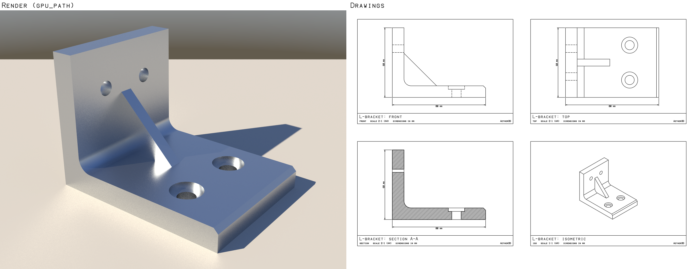

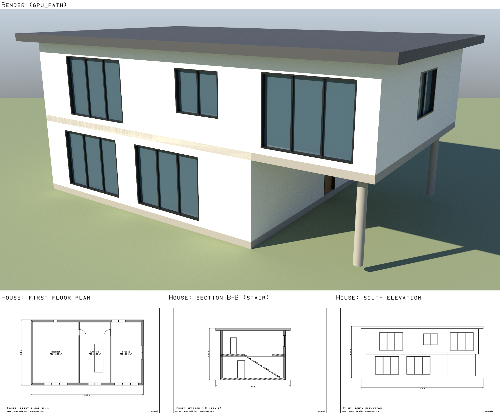

See [docs/CAD.md](docs/CAD.md), [docs/BUILDINGS.md](docs/BUILDINGS.md) and the examples
[`cad_bracket.py`](examples/cad_bracket.py), [`cad_floor_plan.py`](examples/cad_floor_plan.py),
[`cad_modern_house.py`](examples/cad_modern_house.py),
[`cad_grid_building.py`](examples/cad_grid_building.py) and
[`mcp_cad_agent.py`](examples/mcp_cad_agent.py) (outputs in `examples/output/`: renders,
drawings, STEP, IFC, DXF, schedules).

### Animation, rigging and cinematics

```python
from aether3d import Scene

scene = Scene()
ball = scene.add_sphere("Ball", radius=0.25, position=(0, 0, 1))
anim = scene.animation
anim.set_timeline(fps=24, start=0, end=2)

# A bounce that loops: keys in seconds; automatic handles are smooth and never overshoot.
anim.set_channel(
    ball, "transform.position.z", [(0, 1.0), (0.5, 0.25), (1, 1.0)], extrapolation="cycle"
)
print(round(anim.evaluate(1.5).position[0][2], 6))  # 0.25
print(ball.position)  # (0.0, 0.0, 1.0): authored state stays the rest pose
report = anim.curve_report(ball, "transform.position.z")
print(len(report["discontinuities"]), len(report["overshoot"]))  # 0 0
print(round(report["velocity"]["max"], 2))  # 2.25 (m/s, the velocity's peak)

# A rig, and an editable generated walk whose feet are measured, not assumed.
hero = scene.add_object("Hero", position=(2, 0, 0))
anim.add_rig(
    hero,
    [
        {"name": "Hips", "position": [0, 0, 0.75]},
        {"name": "Body", "parent": "Hips", "tail": [0, 0, 0.75]},
        {"name": "Head", "parent": "Body", "position": [0, 0, 0.75], "tail": [0, 0, 0.5]},
        {"name": "Arm.L", "parent": "Body", "position": [0.375, 0, 0.625], "tail": [0, 0, -0.75]},
        {"name": "Arm.R", "parent": "Body", "position": [-0.375, 0, 0.625], "tail": [0, 0, -0.75]},
        {"name": "Leg.L", "parent": "Hips", "position": [0.125, 0, 0], "tail": [0, 0, -0.75]},
        {"name": "Leg.R", "parent": "Hips", "position": [-0.125, 0, 0], "tail": [0, 0, -0.75]},
    ],
)
walk = anim.generate(hero, "walk")  # a clip of ordinary keys, played as the action
feet = anim.foot_contacts(hero, ["Leg.L", "Leg.R"])
print(walk["clip"], max(f["sliding_max"] for f in feet["feet"].values()) < 0.005)  # Walk True

# Render any time: the evaluated pose, without changing the scene.
image = scene.render(time=0.4, width=320, height=180, backend="cpu", frame=True)
print(image.image.shape)  # (180, 320, 3)
```

- **Authored and evaluated.** The scene saves rest values and the animation document;
  evaluating a time is pure (no history step, nothing kept between frames, seekable), and
  rendering at a time is bit for bit rendering an applied pose.
- **The graph editor as mathematics.** Constant, linear, Bezier and Penner easings;
  free, aligned, vector, auto and auto-clamped handles (no overshoot, guaranteed);
  weighted tangents with monotone time inversion; exact velocity, acceleration and jerk;
  cycle-aware loops; ten modifiers; key operations; exact continuity, extrema and
  overshoot reports; keyframe reduction within a tolerance; SVG and PNG graphs.
- **Rigs and motion.** Skeletons, FK, IK, constraints, attachments, linear (native) and
  dual-quaternion skinning, morph targets; layers and strips with masks and crossfades;
  generated motions written as editable keys; foot contacts measured and planted;
  mirroring, root motion and retargeting.
- **Cinematics.** Arc-length paths, dolly, truck, crane, pan, tilt, roll, zoom, orbits,
  damped follows, shot sequences with cuts and blends, timecode; real motion blur, and
  no depth of field (not claimed).
- **For agents.** Animation scripts (atomic JSON), `aether3d animation
  run|info|report|graph|render|schema`, the MCP tools `run_script` and
  `inspect_animation`, the scene-plan operation `animation`, and the feedback checks
  `foot_contacts` and `animation_continuity` with opt-in corrections.

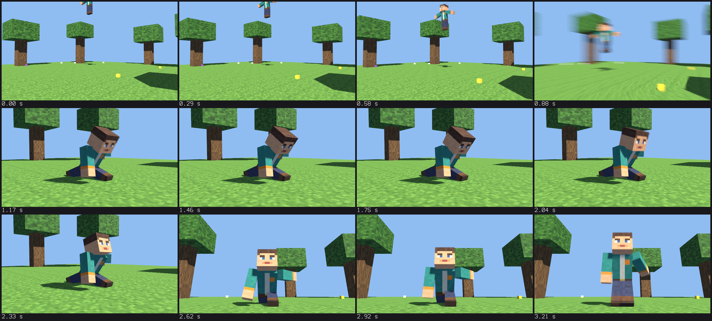

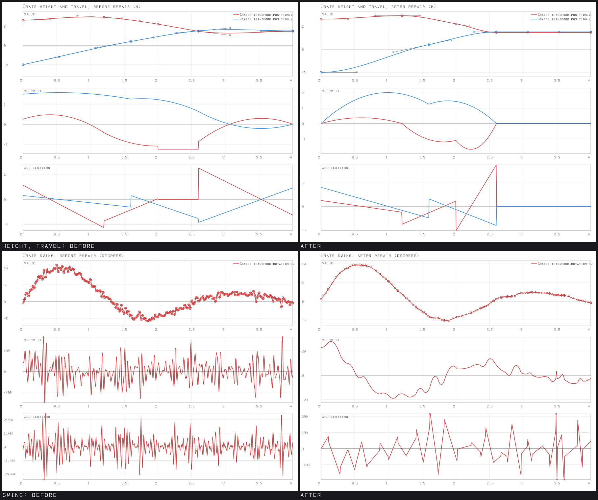

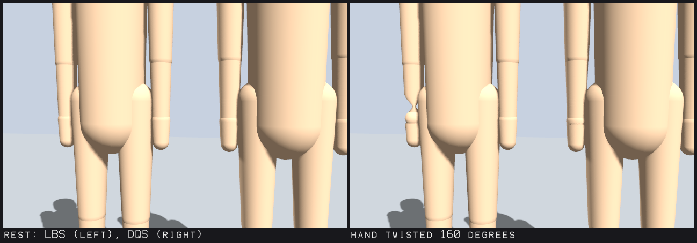

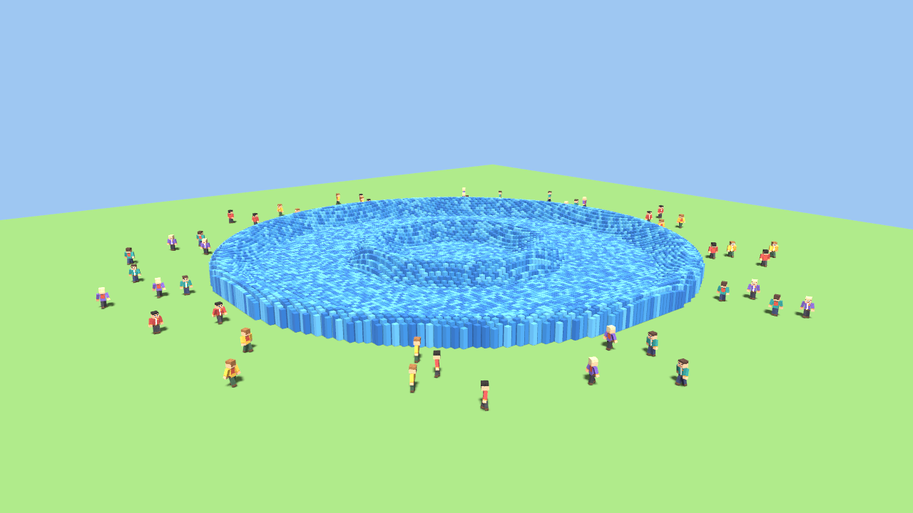

See [docs/ANIMATION.md](docs/ANIMATION.md) and the examples
[`animation_minecraft.py`](examples/animation_minecraft.py),
[`animation_curve_repair.py`](examples/animation_curve_repair.py),
[`animation_skinned_character.py`](examples/animation_skinned_character.py),
[`animation_cinematics.py`](examples/animation_cinematics.py),
[`animation_large_scene.py`](examples/animation_large_scene.py) and
[`animation_mcp_agent.py`](examples/animation_mcp_agent.py) (outputs in
`examples/output/animation/`).

### Character rigging

A mesh with no skeleton becomes a rigged, weighted, controllable character in one call
(`scene.animation.autorig(body)`): landmarks measured on the mesh (each with a
confidence and the method that placed it; fingers when the mesh shows them), a
Rigify-like skeleton (a four-joint torso, clavicles, split twist bones, pelvis bones,
three joints per finger) with swing-twist limits, IK targets, poles and a gaze, and bone
heat weights -- which deform the test figure as Blender's Automatic Weights do, where
v0.19.0's collapsed its elbows and knees. Weights are edited, mirrored and transferred to
clothing as data; deformation is linear, dual quaternion or blended skinning with
surface-following normals, optional delta mush and corrective shapes; `diagnose_rig`
measures creases, folds, stretch and collapse over everyday and stress pose suites
(`aether3d rig test`) and `apply_rig_fix` keeps only the fixes that measurably help;
`ik_fk` switches limbs without a jump and `pose_character` turns "reach there, look at
that, crouch, raise the arm, make a fist, roll onto the toes" into keys. Clothing and
armour follow the body without moving its joints. Minecraft-style characters keep their
own workflow: `generate_rigid` animates a hierarchy of solid parts by their object
transforms, with no armature, skin or weights.

See [docs/CHARACTER_RIGGING.md](docs/CHARACTER_RIGGING.md) and the showcases
[`rigging_autorig.py`](examples/rigging_autorig.py) (an unrigged mesh rigged, checked and
animated), [`rigging_deformation.py`](examples/rigging_deformation.py) (v0.19.0, the
revision and Blender's weights under the stress poses), [`rigging_ikfk.py`](examples/rigging_ikfk.py)
(hands and feet on targets, switches that keep the pose),
[`rigging_outfit.py`](examples/rigging_outfit.py) (a character of separate meshes and
attachments), [`rigging_minecraft_rigid.py`](examples/rigging_minecraft_rigid.py) (rigid
parts, no bones), [`rigging_world.py`](examples/rigging_world.py) (both kinds in a
procedural world) and [`rigging_roundtrip.py`](examples/rigging_roundtrip.py) (`.aether`
and GLB round trips), with outputs in `examples/output/rigging/`.

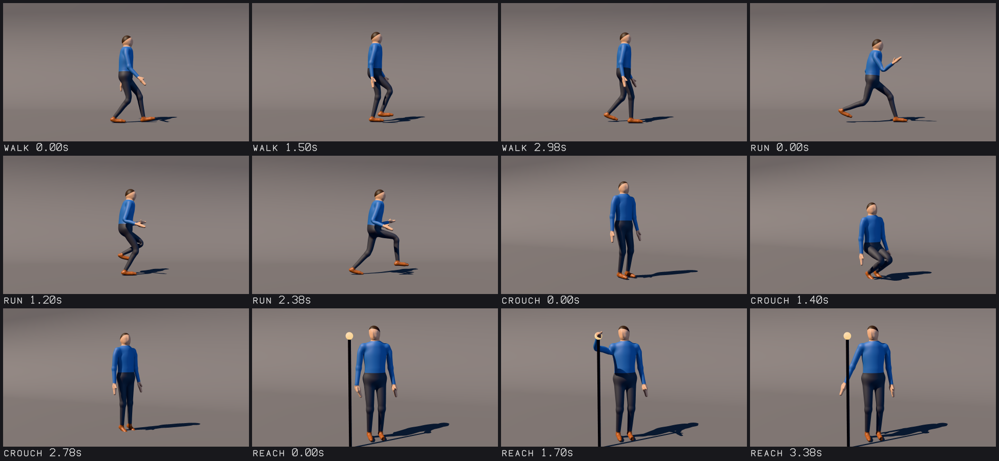

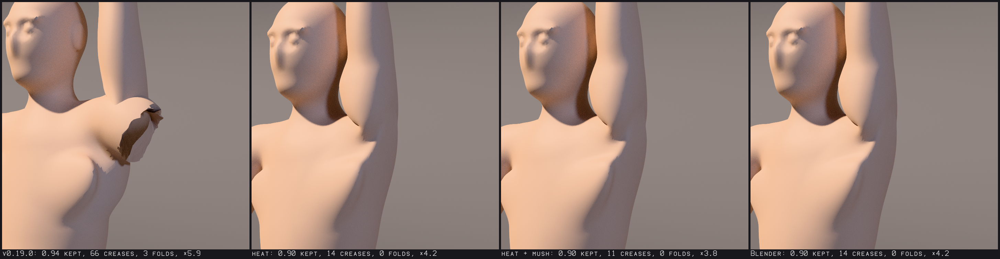

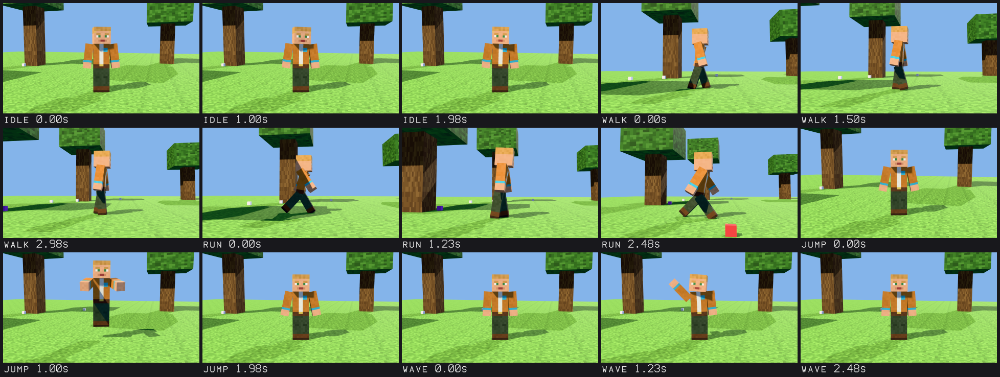

### Procedural worlds

```python
from aether3d import Scene

scene = Scene("Hills")
hills = scene.worlds.create("Hills", "temperate", seed=4, size=2048)  # nothing generated yet
print(hills.info()["mode"])  # terrain
print(round(hills.height(100.0, -50.0), 3))  # 333.989 (exact; the same on every platform)
print(hills.biome_at(100.0, -50.0))  # temperate_forest

# A flat, dry site; a house on it (its foundation follows the natural ground) and a yard.
site = hills.find_sites(1, radius=10.0, max_slope=12.0, spacing=80.0)[0]
x, y = site["at"]
hills.place_structure({"id": "inn", "kind": "house", "at": [x, y], "floors": 2})
hills.add_feature({"type": "clear", "id": "yard", "shape": {"circle": [x, y, 45.0]}})
print(len(hills.structures()), len(scene.history.entries))  # 1 3

g = hills.height(x, y)
scene.add_camera("Cam", position=(x - 24, y - 30, g + 9), look_at=(x, y, g + 3), far=4000)
scene.add_directional_light("Sun", direction=(0.5, 0.6, -0.4), intensity=1.6)
scene.world.atmosphere.configure(enabled=True, sun="Sun", ambient="hemisphere")
image = scene.render(width=320, height=180, backend="cpu")  # generated here, for this view
print(image.image.shape)  # (180, 320, 3)
scene.save("hills.aether")  # the definition and edits, never generated geometry
```

- **A definition, not a mesh.** A world is a validated JSON definition (seed, extent,
  terrain recipe, climate, biomes, hydrology, caves, vegetation, structures, streaming)
  plus sparse edits; everything else is generated lazily for what a render, query or
  export needs, cached within a memory budget, and identical to the bit on every
  platform, with or without the native kernels.
- **Landscapes.** Fractal, ridged and eroded noise with domain warping; a regional
  hydrology stage (priority flood, drainage, stream-power erosion, sediment, thermal
  relaxation) that carves valleys and traces rivers and lakes; climate with lapse rate
  and rain shadows; 16 biomes blended by temperature and moisture, declared as data;
  29 original vegetation species with three levels of detail; caves and overhangs as a
  signed distance field meshed by marching cubes near the camera.
- **Block worlds.** The same fields as Minecraft-style blocks: 58 kinds with original
  16 x 16 pixel-art textures, greedy meshing with ambient occlusion, block trees, caves,
  ores, structures stamped in blocks, block edits saved with the project.
- **Structures.** Houses, towers, castles, ruins, wells and bridges on foundations that
  follow the natural ground; site finding, villages, castles on high ground, roads with
  bridges -- frozen into the definition, one undo step.
- **Massive and streamed.** Bounded worlds up to 2,000 km and unbounded ones; a quadtree
  of tiles refined by screen-space error, stitched and skirted (no cracks), byte-bounded
  caches, measured memory, float64 coordinates and camera-relative rendering far from
  the origin; animated cameras drive streaming and frames render identically in any
  order.
- **For agents.** World scripts (atomic JSON), `aether3d world
  run|info|sample|export|presets|blocks|schema|guide`, the MCP tools `run_script` and
  `inspect_world`, and glTF export of finite regions.

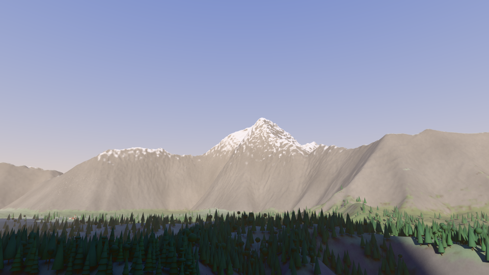

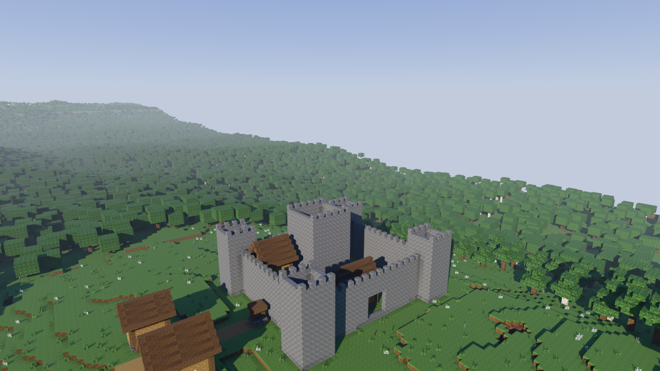

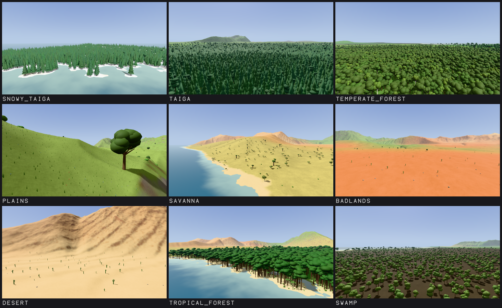

See [docs/WORLDS.md](docs/WORLDS.md) and the showcases
[`worlds_alpine_valley.py`](examples/worlds_alpine_valley.py),
[`worlds_block_world.py`](examples/worlds_block_world.py),
[`worlds_streaming.py`](examples/worlds_streaming.py),
[`worlds_biomes.py`](examples/worlds_biomes.py),
[`worlds_caves.py`](examples/worlds_caves.py) and
[`worlds_character.py`](examples/worlds_character.py) (outputs in
`examples/output/worlds/`).

### Procedural geometry

```python
from aether3d import Expr, Scene

scene = Scene()
scene.procedural.add_parameter("count", 5, min=1, max=50)
crate = scene.add_geometry("Crates", "box", width=1, depth=1, height=1)
crate.add_modifier("bevel", width=0.08, limit="all")
crate.add_modifier("array", count=Expr("count"), relative_offset=(1.2, 0, 0))
row = scene.add_object("Row", geometry=crate)  # row.mesh is the evaluated result

scene.procedural.set_parameter("count", 8)  # regenerates; invalid values are refused
scene.procedural.undo()
```

- **Non-destructive.** Objects use the *evaluated* result of a geometry
  definition (a source plus a modifier stack); the base definitions are
  never modified. Stacks can be reordered, disabled, edited and baked.
- **Parametric.** Typed, range-checked parameters; safe expressions
  (`{"expr": "floor(width / 2)"}`) that are never Python `eval`; and rules
  that reject invalid combinations.
- **Safe and fast.** Every change is an atomic, undoable transaction.
  Dependency cycles are detected. Content-addressed caching recomputes only
  what changed, and shares meshes between instances.
- **Persistent and exportable.** Definitions are saved in `.aether` format
  version 2 (version 1 projects still load). Exports always use the current
  evaluation.
- **Booleans** use [Manifold](https://github.com/elalish/manifold), an
  optional dependency: `pip install "aether3d[boolean]"`.

See [docs/PROCEDURAL.md](docs/PROCEDURAL.md).
[`examples/minecraft_castle.py`](examples/minecraft_castle.py) builds a
parametric Minecraft-style castle (configurable width, wall height, tower
count and radius, gate size, and detail density), then saves, reloads,
modifies, validates and exports it, and checks the GLB with the Khronos
validator and, optionally, Blender.

### Rendering


*Rendered by Aether3D's own CPU rasterizer, with its materials:
[`examples/minecraft_castle_render.py`](examples/minecraft_castle_render.py),
1920×1080 at 3×3 samples per pixel, about 25 s. The GPU backend renders it
with 4× MSAA in under 0.05 s.*

```python
from aether3d import Scene

scene = Scene()
scene.add_plane("Ground", size=20).color = "#6f9b4f"
scene.add_cube("Crate", size=2, position=(0, 0, 1)).color = "#c0392b"
camera = scene.add_camera("Camera", fov=40)  # becomes the active camera
camera.frame(direction=(-0.5, 1.0, -0.45))  # fit everything in view
scene.add_directional_light("Sun", direction=(-0.4, 0.6, -1.0), intensity=2.0)
result = scene.render(width=640, height=360)
result.save("crate.png")  # a real PNG, written by Aether3D
```

- **A real renderer.** The pipeline runs camera projection, homogeneous
  clipping, exact watertight fixed-point rasterization, an order-independent
  depth test, and perspective-correct deferred shading. Supersampling is
  averaged in linear light, and the PNG encoder is Aether3D's own.
- **Scenes from every stage render.** That includes static meshes, imported
  glTF, edited meshes, and procedural objects, which render their current
  evaluation without being baked.
- **Persistent setup.** Cameras, lights, colors, materials, the background
  and render settings are saved in the project (`.aether` format).
- **Verified.** Correctness is checked against analytic results and an
  independent ray caster. Blender, as an external check, agreed with the
  Stage 5 castle's silhouette on all but 2 of 2,073,600 pixels.

See [docs/RENDERING.md](docs/RENDERING.md).
[`examples/first_render.py`](examples/first_render.py) and
[`examples/hero_render.py`](examples/hero_render.py) render more scenes.

### Materials and textures


*The same castle in Aether3D 0.6's flat colors and with 0.7's materials:
image textures with a normal map, procedural textures and emissive torches.*

```python
stone = scene.create_material("Stone", roughness=0.85)
stone.set_texture("base_color", "textures/bricks.png", coordinates="object", scale=0.5)
stone.set_texture("normal", "textures/bricks_normal.png", coordinates="object", scale=0.5)
wall.material = stone

scene.create_material("Lawn", preset="grass")  # procedural: no images, no UVs
scene.assign_material(ground, "Lawn")

roof = scene.create_material("Roof", base_color="#9c3a27", roughness=0.7)
roof.set_procedural_texture("roughness", {"type": "fbm", "scale": 8, "octaves": 4})
scene.assign_material(tower, roof, group=1)  # one face group of a mesh
```

- **Two shading models.** The default is glTF's physically based
  metallic-roughness BRDF (GGX). An object's own color is exactly a
  `"simple"` material, so existing scenes render unchanged.
- **Textures.**
  - PNG (decoded by Aether3D itself) and JPEG (Pillow) images, with mipmaps,
    sRGB handling, wrap modes and filtering.
  - Mapped by UV, or by object or world coordinates with triplanar
    projection, so procedural meshes need no UVs.
  - Normal maps and alpha masks.
- **Procedural textures** are node graphs stored as data: noise, fbm,
  voronoi, bricks, tiles, wood, ramps, math, bump and more. They are
  evaluated per sample on the CPU and by a shader interpreter on the GPU,
  never baked unless you ask. Presets give stone, brick, wood, metal, grass
  and fabric.
- **Everywhere.** Materials are:
  - saved in projects (`.aether` format, since version 4), with texture paths
    relative to the project;
  - imported from and exported to glTF;
  - scriptable with `aether3d material ...`, `aether3d texture ...` and JSON
    scene scripts.
- **Safe with untrusted files.** Image limits are checked before decoding,
  paths stay inside the project, malformed images are reported, and graphs
  are validated data, never code.

See [docs/MATERIALS.md](docs/MATERIALS.md).
[`examples/hero_render.py`](examples/hero_render.py) gives the blocky hero
fabric, a diamond blade and a grass block with per-face-group materials.

### Undo, redo and transactions

Every change to a scene is a step of `scene.history`, whichever way it is made.
Undo gives back the exact scene: the same project document, the same Python
objects, the same renders.

```python
crate = scene.add_cube(name="Crate")
crate.position = (2, 0, 0.5)
with scene.transaction("Build the gate"):  # one step, all or nothing
    scene.add_cube(name="Post A", position=(-1, 3, 1))
    scene.add_cube(name="Post B", position=(1, 3, 1))
scene.history.checkpoint("gate")
scene.merge("props.glb", allow_lossy=True)  # importing into a scene: undoable too
scene.history.undo()  # the props are gone
scene.history.goto("gate")
scene.save("yard.aether", history=True)  # a later session can undo
```

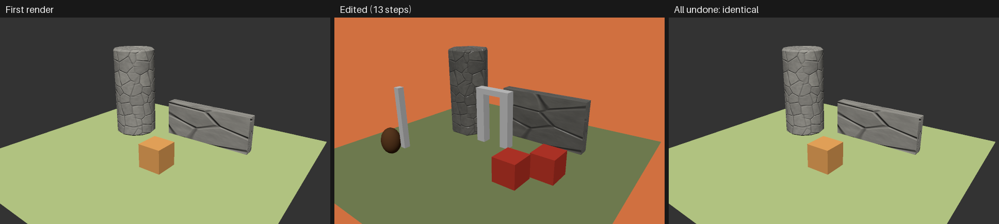

*[`examples/history_undo.py`](examples/history_undo.py) makes 13 changes, then undoes
them: the render equals the first one, pixel for pixel.*

On the command line, a project with a history file records every change, and
`aether3d history undo PROJECT` undoes the last one. See
[docs/HISTORY.md](docs/HISTORY.md).

### Spatial queries

Ask a scene where things are. Answers are exact (computed from the triangles in
world space, through hierarchies, mirrored scales and instances) and read-only.

```python
from aether3d import Scene
from aether3d.spatial import Box

scene = Scene("Yard")
scene.add_plane(name="Ground", size=20)
crate = scene.add_cube(name="Crate", size=1, position=(2, 0, 0.5))
crate.tags = ["prop"]
scene.add_camera("Cam", position=(0, -8, 3), look_at=(0, 0, 0.5))

hit = scene.raycast((2, 0, 10), (0, 0, -1))  # the first surface below a point
print(hit.object.name, hit.position, hit.normal, hit.uv)  # Crate (2.0, 0.0, 1.0) ...
print(scene.closest_point((2, 0, 5)).distance)  # point-to-surface distance: 4.0
print(scene.contains_point("Crate", (2, 0, 0.5)).state)  # inside (open meshes: undefined)
touching = scene.overlaps()  # exact contacts (the crate rests on the ground), not boxes
in_yard = scene.query_region(Box((-5, -5, 0), (5, 5, 3)))  # Ground and Crate
picked = scene.pick(640, 360)  # what the camera shows at a pixel
print(scene.relation("Crate", "Ground").above)  # True; also near, inside, in front of, ...
props = scene.find_objects(tags="prop", region=Box((0, -1, 0), (3, 1, 2)))  # [Crate]
```

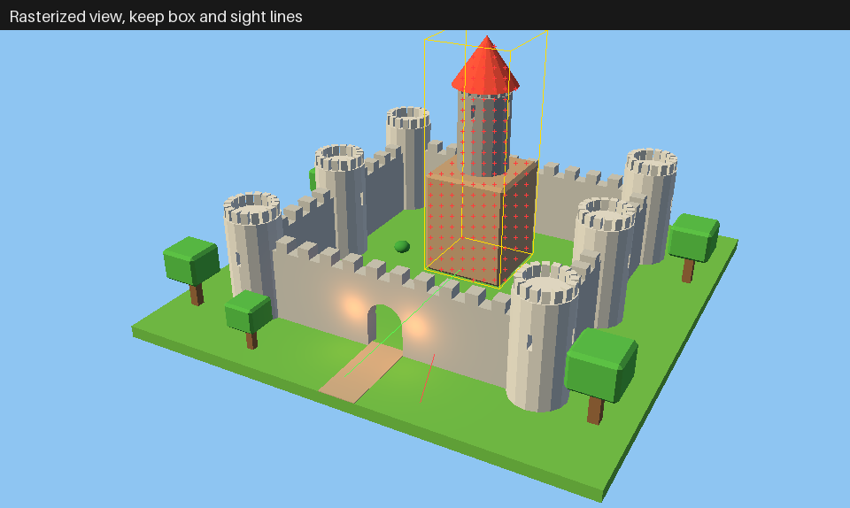

*[`examples/castle_spatial.py`](examples/castle_spatial.py) inspects the castle: a
height map from rays, exact contacts, relations, sight lines through the gate, and
picks that agree with the rasterizer's object ids.
[`examples/hero_picking.py`](examples/hero_picking.py) picks and probes the blocky
hero.*

Objects carry `tags` and `metadata` for discovery. On the command line:
`aether3d query raycast castle.aether origin=0,0,30 direction=0,0,-1 --json`. See
[docs/SPATIAL.md](docs/SPATIAL.md).

### Scene plans: whole scenes in one call

A scene plan is one JSON document that builds or changes a scene: checked as a whole,
applied as one undo step, all or nothing. Thousands of objects cost one call.

```python
from aether3d import Scene

scene = Scene("Courtyard")
result = scene.execute_plan(
    {
        "format": "aether3d.scene-plan",
        "version": 1,
        "label": "Courtyard",
        "materials": {"stone": {"preset": "stone"}},
        "meshes": {"block": {"primitive": "cube", "size": 1}},
        "objects": {
            "ground": {"mesh": {"primitive": "plane", "size": 40}, "color": "#4f7f3a"},
            "wall": {
                "mesh": "@block",
                "material": "@stone",
                "position": [-5, 0, 0.5],
                "grid": {"count": [11, 1, 3]},
                "where": {"expr": "not (x >= 4 and x <= 6 and z <= 1)"},  # a gate
            },
            "pillars": {
                "mesh": {"primitive": "cylinder", "radius": 0.3, "depth": 3},
                "circle": {"count": 8, "radius": 6, "z": 1.5},
            },
            "cam": {
                "camera": {"fov": 45},
                "position": [14, -16, 9],
                "look_at": [0, 0, 1],
                "active": True,
            },
        },
        "queries": [{"query": "overlaps", "objects": "@pillars", "against": "@wall"}],
    }
)
result.counts["objects"], result.queries[0]["result"]  # (37, []): nothing collides
scene.history.undo()  # the whole plan, one step
```

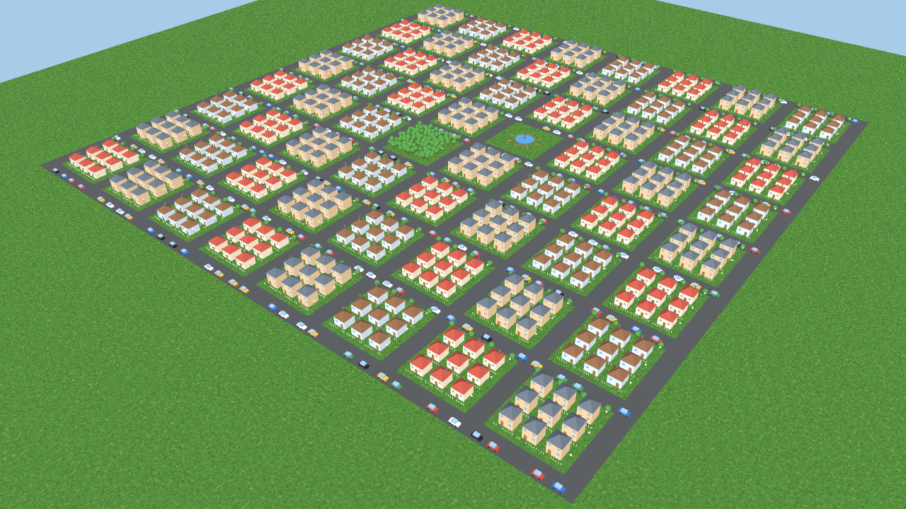

*[`examples/village.py`](examples/village.py) builds a village of 11,270 objects from
reusable houses, trees, lamps and cars with one plan in about 0.35 s, then paints one
door (0.4 ms, one object changed) and renders it on the GPU in 20 instanced draw calls.
[`examples/plan_basics.py`](examples/plan_basics.py) shows checks, errors, edits,
retries and undo. The format: [docs/SCENE_PLANS.md](docs/SCENE_PLANS.md), with
benchmarks against per-object creation.*

### AI agents: the MCP server

```bash
pip install -e ".[mcp]"
claude mcp add aether3d -- aether3d mcp serve --workspace "$PWD"   # Claude Code
```

The server gives MCP clients 28 tools -- `execute_scene_plan`, `spatial_query`,
`render_preview` (the GPU rasterizer when it works, the CPU one otherwise, and it says
which; at any animation `time`), `history`, `scene_save`, `export_scene` (glTF with
skeletons, skins, morph targets and animations, and STEP, IFC, DXF, SVG and PNG of CAD
items), `run_script` (edit, procedural, scene, sculpt, texture, CAD, animation and world
scripts), `inspect_mesh`, `inspect_uvs`, `inspect_texture`, `inspect_cad`, `import_cad`,
`inspect_animation`, `inspect_world`, `inspect_rig`, the visual feedback tools (`observe_scene`,
`diagnose_scene`, `propose_corrections`, `apply_corrections`, `feedback_loop`), ... -- plus the
plan, feedback, sculpting, texturing, CAD, animation, rigging and worlds guides, their JSON
Schemas and example
plans as resources. It speaks stdio only, keeps every file inside the workspace, and
never runs code from its arguments.

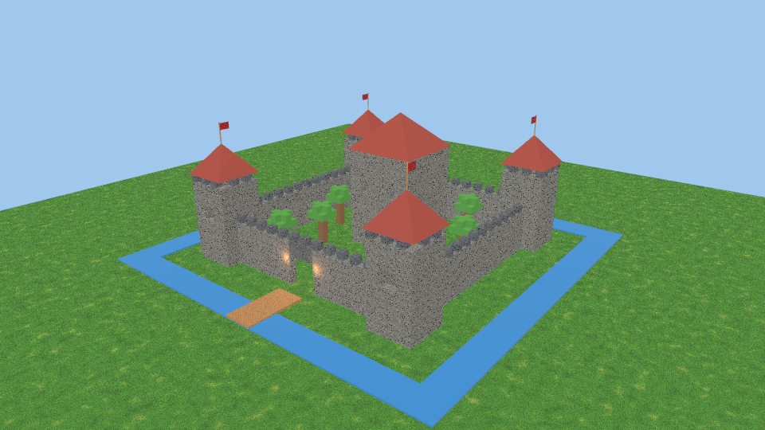

*[`examples/mcp_castle_agent.py`](examples/mcp_castle_agent.py) runs an agent's whole
loop as MCP tool calls; [`examples/mcp_client.py`](examples/mcp_client.py) is a minimal
client. See [docs/MCP.md](docs/MCP.md).*

### Visual feedback: look, check, correct

```python
from aether3d import FeedbackSession, Scene

scene = Scene("Corner")
scene.add_plane("Floor", size=8)
scene.add_cube("Table", size=1, position=(0, 0, 0.5))
scene.add_cube("Vase", size=0.2, position=(0.1, 0.1, 1.4))  # 0.3 m above the table
scene.add_camera("Camera", position=(3, -4, 2.5), look_at=(0, 0, 0.7))
scene.add_directional_light("Sun", direction=(-0.4, 0.6, -1.0), intensity=1.5)

expectations = {
    "format": "aether3d.expectations",
    "version": 1,
    "views": {"main": {"camera": "Camera"}},
    "checks": [
        {"check": "rests_on", "objects": "Vase", "support": "Table"},
        {"check": "visible", "objects": ["Table", "Vase"], "in_frame": True},
    ],
}
feedback = FeedbackSession(scene, expectations)
finding = feedback.diagnose().findings[0]  # one render, then the checks
print(finding.code, finding.basis, round(finding.magnitude, 3))  # FLOATING geometry 0.3
report = feedback.run()  # propose, apply (one undo step), verify on a new render
print(report.stop_reason)  # accepted
```

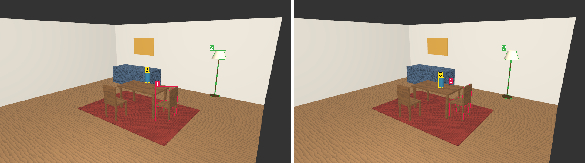

*[`examples/feedback_room.py`](examples/feedback_room.py): a room built by one plan with
three mistakes -- a vase floating over the table, a chair sunk into the rug, a lamp inside
the back wall -- found on the triangles and the render, corrected in one verified step,
measured again independently, and undone and redone through the history.
[`examples/feedback_composition.py`](examples/feedback_composition.py) fixes a camera aimed
past its subject, too far away and three stops underexposed;
[`examples/mcp_feedback_agent.py`](examples/mcp_feedback_agent.py) does it over MCP. Facts
(`geometry`, `render`, `scene`) and judgments (`heuristic`, `vision`, `agent`) are kept
apart: a model's evaluation of an image is a checked document grounded in the render's
object ids, and its suggestions always wait for approval. See
[docs/FEEDBACK.md](docs/FEEDBACK.md).*

### GPU rendering

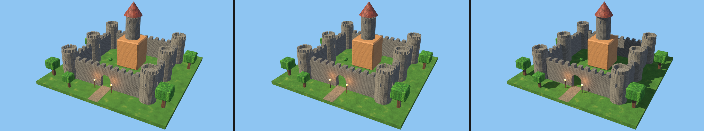

*The same scene and camera, with materials, rendered by Aether3D's CPU
renderer, its GPU backend, and the GPU backend with a sun shadow map
([`examples/gpu_render.py`](examples/gpu_render.py)).*

```python
result = scene.render(backend="gpu", width=1920, height=1080, samples=2, shadows=True)
print(result.backend["adapter"]["name"])  # e.g. NVIDIA GeForce RTX 4060 Laptop GPU
```

- **Real GPU rendering.** WGSL shaders, instanced draw calls, a hardware depth
  buffer, MSAA, shadow maps and framebuffer readback run on Vulkan, Metal or
  Direct3D 12 through [wgpu](https://github.com/pygfx/wgpu-py). No window or
  display is needed.
- **Same scenes, same results.** The GPU renders everything the CPU renderer
  does. It matches the CPU pixel for pixel in parity mode (the CPU's sample
  positions) up to sub-pixel edge snapping. The castle at 1080p shows the
  same object at 100% of pixels.
- **Fast.** Measured on an RTX 4060 Laptop GPU with 4 samples per pixel:
  - the castle at 1080p renders in 44 ms instead of 1.24 s (28×);
  - at 4K, 89 ms instead of 4.5 s (51×);
  - a 1M-triangle mesh at 1080p takes 47 ms (22×);
  - 10,000 objects take 0.21 s (9×);
  - the castle with its materials, at 1080p: 37 ms instead of 11.7 s.

  Shadows cost a few milliseconds.
- **Honest fallback and discovery.**
  - `backend="auto"` uses the GPU when it works, else the CPU, and says why.
  - `backend="gpu"` never silently falls back.
  - `aether3d gpu info --check` lists the adapters, selects one, renders a
    verified test image and reports the result.

See [docs/GPU.md](docs/GPU.md) for installation (`pip install "aether3d[gpu]"`,
Python 3.11+), adapters, shadows, verification and benchmarks.

### Path tracing

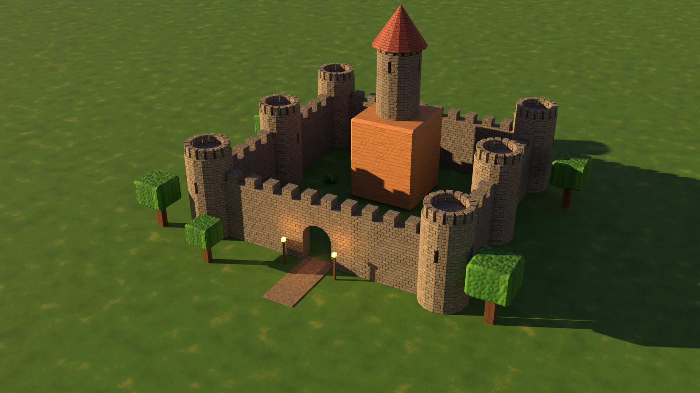

*The textured procedural castle lit by a low sun, a sky and its torches,
path traced by Aether3D on the GPU (`backend="gpu_path"`, an RTX 4060
Laptop GPU: 1920x1080, 512 samples per pixel, 2.4 minutes;
[`examples/gpu_path_showcase.py`](examples/gpu_path_showcase.py)).*

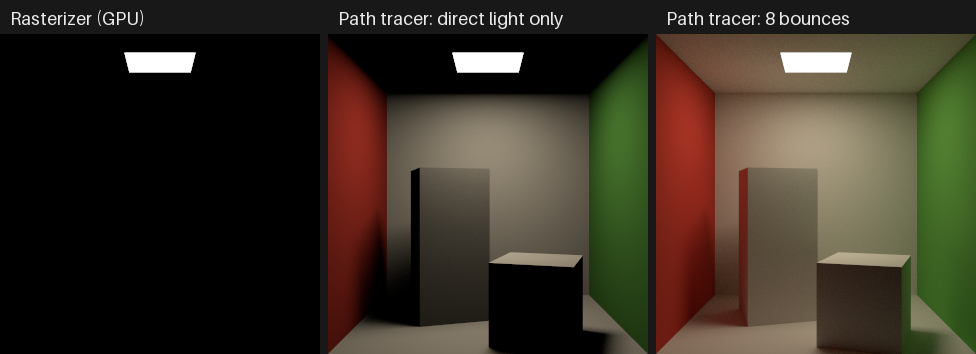

```python
scene.world.environment = {"type": "sky", "intensity": 0.9}
scene.get_by_name("Sun").light.angle = 0.53  # the sun's size: soft shadows
result = scene.render(
    backend="path",
    width=960,
    height=540,
    path={"samples": 64, "bounces": 4, "seed": 1},
    ao=True,
    tonemap="neutral",
)
result.save("castle.png")
result.save("castle.hdr")
print(result.backend["device"], result.stats["noise"], sorted(result.passes))
```

- **Real light transport.**
  - Rays traced through a BVH over the scene's own geometry.
  - Light bounces between surfaces: the Cornell box's walls tint each other.
  - Metals reflect the scene; emissive surfaces light their surroundings.
  - Shadows soften with the size of the light.
  - Next-event estimation with multiple importance sampling and Russian
    roulette.
- **The same materials.** Textures, normal maps, procedural graphs and face
  groups are evaluated by the rasterizer's own code. Lights keep their
  meaning: a standard material under an unshadowed light renders as on the
  rasterizers (a test checks it to 1e-6).
- **Inspectable and reproducible.**
  - Passes: direct, indirect, albedo, normal, depth, AO, sample count and
    variance.
  - Statistics: rays, BVH, noise and timings.
  - The same seed gives the same image bit for bit, in one process or in
    several.
- **Verified against references, not appearances.** The tests check:
  - analytic radiometry (furnaces, the interreflection series, the
    inverse-square law, form factors);
  - a brute-force BVH reference;
  - a mirror against a mirrored camera;
  - a Cornell box, AO against its closed form, and material parity with the
    rasterizer.
- **On the CPU or the GPU.** `backend="path"` runs in NumPy on the CPU
  (forked processes on Linux). `backend="gpu_path"` runs the same path
  tracer in a wgpu compute kernel (on Vulkan and Metal; on Direct3D 12 it
  needs the DXC compiler). It traces the same paths as the CPU (same
  random numbers; images agree to float32 rounding), 51 to 65 times faster
  on an RTX 4060 than on eight CPU processes. Traversal is software; no
  hardware ray tracing is used. Reports say which ran (`backend["device"]`).
- **Honest about speed.** The path tracer is much slower than the
  rasterizers. At 640x360 with 16 samples and 4 bounces, the textured castle
  takes 15.5 s on 8 CPU processes, against 1.4 s on the CPU rasterizer and
  0.03 s on the GPU rasterizer. At 1920x1080 with 64 samples it takes 18 s
  on the GPU path tracer and 15.6 minutes on the CPU (see
  [docs/RENDER_QUALITY.md](docs/RENDER_QUALITY.md#performance)).

## Command-line interface

```console
$ aether3d new world.aether --name "My World"
$ aether3d validate world.aether
$ aether3d inspect examples/first_scene.aether
Scene "First Scene" (5 objects, format v1)
├── Cube  [d0da5f96-…]  pos=(0, 0, 1)  mesh=24v/12t
├── Sphere  [f9788aa5-…]  pos=(3, 0, 1)  mesh=561v/960t
├── Ground  [efddd1b2-…]  pos=(0, 0, 0)  mesh=4v/2t
└── Pivot  [c1181286-…]  pos=(3, 0, 1)  rot_euler=(0, 0, 90)
    └── Moon  [8122a0f9-…]  pos=(2, 0, 0)  mesh=561v/960t
```

Interchange and geometry analysis:

```console
$ aether3d export world.aether world.glb       # .aether (or .gltf) -> .glb / .gltf
$ aether3d import model.gltf model.aether      # add --allow-lossy to drop unsupported content
$ aether3d topology world.aether --object Crate --json     # polygon topology + validation
$ aether3d edit world.aether script.json --json            # declarative JSON edit script
$ aether3d sculpt run head.aether shape.json --json        # sculpt script (atomic, one undo step)
$ aether3d sculpt check head.aether --require closed       # validity tiers (exit 3 if below)
$ aether3d texture run crate.aether paint.json --json      # texture script (atomic, one undo step)
$ aether3d texture report crate.aether --require-clean     # UV diagnostics (exit 3 on flips/overlaps)
$ aether3d texture bake crate.aether --target Low --source High --map normal --map ao --out maps
$ aether3d cad run part.aether bracket.json --json         # CAD script (atomic; exit 3 if an expect fails)
$ aether3d cad info part.aether Bracket                    # one CAD item's report
$ aether3d cad export part.aether bracket.step --item Bracket   # STEP, IFC, DXF, SVG or PNG by suffix
$ aether3d cad import part.aether supplier.step --name Bought   # STEP, IFC or DXF
$ aether3d animation run scene.aether walk.json --json      # animation script (atomic)
$ aether3d animation report scene.aether --kind contacts --target Hero --feet Foot.L --feet Foot.R
$ aether3d animation render scene.aether frames/ --contact-sheet sheet.png --video walk.mp4
$ aether3d export scene.aether hero.glb --animation clips   # skins, morphs, animations
$ aether3d world run valley.aether valley.json --json       # world script (atomic)
$ aether3d world sample valley.aether --at 120,-40 --json   # exact height, biome, water
$ aether3d world export valley.aether valley.glb --region=-250,-250,250,250   # glTF of a region
$ aether3d world presets                                    # presets, biomes, species
$ aether3d procedural run castle.aether build.json         # declarative procedural script
$ aether3d procedural set castle.aether tower_count=8      # change parameters (validated)
$ aether3d procedural inspect castle.aether --evaluate     # parameters, nodes, stacks
$ aether3d procedural types --json                         # primitive/modifier schemas
$ aether3d execute-plan castle.aether plan.json --json     # a scene plan: one atomic step
$ aether3d plan validate plan.json                         # check a plan without a project
$ aether3d mcp serve --workspace .                         # the MCP server (stdio)
$ aether3d feedback observe room.aether --out obs/ --images image,annotated --json  # look
$ aether3d feedback check room.aether --expect room.expect.json   # exit code 3: not accepted
$ aether3d feedback loop room.aether --expect room.expect.json    # correct, verify, repeat
$ aether3d camera add castle.aether --frame --fov 30      # camera framed on everything
$ aether3d light add castle.aether --direction 0.5 0.6 -0.8 --intensity 2.4
$ aether3d object set castle.aether Keep --color "#8c7356"
$ aether3d material create castle.aether Stone --preset stone      # procedural material
$ aether3d history start castle.aether         # record changes: castle.aether.history
$ aether3d history undo castle.aether          # undo the last change (show, redo, goto, ...)
$ aether3d scene merge castle.aether props.glb # import a file into a project (undoable)
$ aether3d material assign castle.aether Stone "Curtain Wall"
$ aether3d material texture castle.aether Stone normal --image textures/stone_normal.png
$ aether3d material validate castle.aether --json                  # exit code 3 on errors
$ aether3d export castle.aether castle.glb --bake-textures 1024     # procedural -> PNG on request
$ aether3d render castle.aether -o castle.png --width 1920 --height 1080
$ aether3d render model.glb -o preview.png --frame          # any project or glTF, no setup
$ aether3d gpu info --check                                 # GPU adapters + a verified test render
$ aether3d render castle.aether -o castle.png --backend gpu --shadows --width 1920 --height 1080
$ aether3d render castle.aether -o castle_path.png --backend path --spp 64 --bounces 4 --tonemap neutral
$ aether3d render castle.aether -o castle_gpu_path.png --backend gpu_path --spp 1024 --bounces 6   # on the GPU
$ aether3d render castle.aether -o castle_ao.png --backend path --ao-only --ao-distance 0.5   # fast AO preview
$ aether3d object set castle.aether Keep --add-tag landmark --metadata floors=3   # tags and metadata
$ aether3d query raycast castle.aether origin=0,0,30 direction=0,0,-1 --json     # first surface hit
$ aether3d query find castle.aether tags=landmark                                # objects by tag
$ aether3d query pick castle.aether x=960 y=540 --json                           # object at a pixel
$ aether3d query run castle.aether --request queries.json --json                 # JSON requests
$ aether3d inspect model.glb                   # validate/inspect also read .glb/.gltf
$ aether3d geometry examples/first_scene.aether
Geometry of "First Scene": OK
  objects: 5 (4 with meshes), unique meshes: 4
  triangles: 1934 unique, 1934 instanced
  world bounds: (-5, -5, 0) .. (5, 5, 2)
  mesh 0: 24v/12t, area 24, closed, volume 8 [ok] used by 1 object(s)
  ...
```

Add `--json` to any command for machine-readable output. Errors point at the
exact element that is wrong:

```console
$ aether3d validate broken.aether --json
{
  "ok": false,
  "command": "validate",
  "error": {
    "type": "ProjectFormatError",
    "message": "expected an array of 3 numbers",
    "location": "scene.objects[1].transform.scale"
  }
}
```

Exit codes:

- `0`: success
- `1`: failure (invalid file, missing file, unsupported content, …)
- `2`: usage error
- `3`: `geometry`, `topology`, `procedural validate`, `material validate` or
  `plan validate` found error-severity problems; `feedback check` or `feedback loop`
  ended with the expectations not accepted
`python -m aether3d` works the same as `aether3d`.

## Installation

### Arch Linux

```bash
sudo pacman -S --needed git python
git clone https://github.com/Murisixz/Aether3D.git
cd Aether3D
python -m venv .venv
source .venv/bin/activate
pip install -e ".[dev]"     # editable install + pytest, ruff, trimesh, manifold3d, pillow, wgpu, mcp
pytest                      # run the test suite
```

Optional: to run the official Khronos glTF Validator locally (tests use it
when present), install Node.js and the pinned validator:

```bash
sudo pacman -S --needed nodejs npm
npm ci --prefix tools/gltf-validator
```

Arch marks the system Python as externally managed (PEP 668), so install
Aether3D into a virtual environment as shown rather than with a system-wide
`pip install`. See [docs/INSTALL.md](docs/INSTALL.md) for details and other
platforms.

### Other platforms

Aether3D is pure Python (3.10+) with NumPy as its only required runtime
dependency, and is tested on Linux, macOS and Windows:

```bash
pip install -e ".[dev]"
```

Procedural booleans and the CAD features that combine solids (holes, fillets, shells,
walls with openings, roofs, sections) additionally need the optional `boolean` extra
(`pip install "aether3d[boolean]"`, which installs manifold3d, Apache-2.0).
JPEG textures need the optional `images` extra (`pip install
"aether3d[images]"`, which installs Pillow, MIT-CMU); PNG textures need
nothing.
GPU rendering needs the optional `gpu` extra (`pip install "aether3d[gpu]"`,
Python 3.11+, which installs wgpu, BSD-2-Clause, with wgpu-native, MIT or
Apache-2.0) and a Vulkan, Metal or Direct3D 12 driver; see
[docs/GPU.md](docs/GPU.md#installing-gpu-support).
The MCP server needs the optional `mcp` extra (`pip install "aether3d[mcp]"`, which
installs the official MCP Python SDK, MIT, and its permissively licensed dependencies).

The optional native kernels are a separate package in `native/`, built from source with
a Rust toolchain (1.85 or later, from [rustup](https://rustup.rs) or your system's
packages):

```bash
pip install ./native        # aether3d-native: Rust, PyO3 (MIT or Apache-2.0), maturin
```

Their ray traversal (the CPU path tracer and the spatial queries) traces 7 to 10 times
faster per thread than the NumPy code, and PNG decoding is 7 times faster; transform
hierarchies are computed natively too. The results are bitwise those of the NumPy code,
which runs without them (or with `AETHER3D_NATIVE=0`). They need CPython 3.11 or later;
see [docs/PERFORMANCE.md](docs/PERFORMANCE.md#phase-3-native-kernels-rust).

## Documentation

| Document | Contents |
| --- | --- |
| [docs/API.md](docs/API.md) | Python API reference and conventions |
| [docs/FILE_FORMAT.md](docs/FILE_FORMAT.md) | The versioned `.aether` project format |
| [docs/GLTF.md](docs/GLTF.md) | glTF 2.0 import/export: features, axis conversion, limitations, safety |
| [docs/INSPECTION.md](docs/INSPECTION.md) | Geometry inspection reports and diagnostic codes |
| [docs/EDITING.md](docs/EDITING.md) | Mesh editing: topology, ids, sessions, operations, scripts, limitations |
| [docs/MODELING.md](docs/MODELING.md) | Advanced modeling and sculpting: bevels, cuts, bridges, slides, sweeps; the sculpt mesh, brushes, strokes, masks, symmetry, dynamic topology, remeshing, symmetrize, validity tiers, scripts, CLI, MCP, history, design, performance, limitations |
| [docs/TEXTURING.md](docs/TEXTURING.md) | UV mapping, texture painting and baking: unwrapping, projections, island tools, diagnostics, MikkTSpace, painted textures and layers, brushes and strokes, baking, texture transfer, scripts, CLI, MCP, safety, performance, limitations |
| [docs/ANIMATION.md](docs/ANIMATION.md) | Animation, rigging and cinematics: authored and evaluated state, time, paths, F-curves (interpolation, handles, easing, derivatives, extrapolation, modifiers, key operations, reports, fitting, graphs), rotations, clips and NLA, rigs, skins, IK and constraints, motion generators, contacts, retargeting, cameras, frame rendering, glTF, scripts, CLI, MCP, security, limitations |
| [docs/CHARACTER_RIGGING.md](docs/CHARACTER_RIGGING.md) | Character rigging: three workflows, the rig document (roles, helpers, spans, controls, correctives, swing-twist limits), automatic rigging and landmarks, skin weights (bone heat, geodesic, edited, transferred, inspected), deformation (linear, dual quaternion, blended, surface normals, delta mush), structural editing, IK/FK controls and pose commands, diagnostics (stress suite, creases, folds) and verified correction, rigid-part characters and conversions, scripts, CLI, MCP, glTF, measurements against Blender, performance |
| [docs/WORLDS.md](docs/WORLDS.md) | Procedural worlds: definitions and determinism, terrain, hydrology, climate and biomes, features, water, caves and overhangs, block worlds, vegetation, structures and settlements, streaming, level of detail and memory, rendering, queries, history and files, glTF export, world scripts, CLI, MCP, limits and security, performance |
| [docs/CAD.md](docs/CAD.md) | Precision modeling and CAD: the document, units and tolerances, sketches and the constraint solver, features and persistent names, the B-rep kernel and booleans, assemblies, measurements and snapping, drawings, STEP/DXF/IFC exchange, CAD scripts, CLI, MCP, limitations |
| [docs/BUILDINGS.md](docs/BUILDINGS.md) | Architecture and BIM: buildings, levels, walls and joins, openings and families, rooms, slabs, roofs, stairs, columns, beams, quantities and schedules, plans, IFC, limitations |
| [docs/PROCEDURAL.md](docs/PROCEDURAL.md) | Procedural geometry: parameters, expressions, modifiers, caching, scripts, CLI, limitations |
| [docs/RENDERING.md](docs/RENDERING.md) | Cameras, lights, the CPU renderer: pipeline, conventions, shading model, API, CLI, verification, performance, limitations |
| [docs/GPU.md](docs/GPU.md) | The GPU backend: installation, adapters, pipeline, antialiasing, shadows, memory, CPU/GPU differences, benchmarks, debugging, the backend decision |
| [docs/MATERIALS.md](docs/MATERIALS.md) | Materials, textures and procedural shaders: models and formulas, slots, images, coordinates, node graphs, presets, face groups, persistence, glTF, CLI, GPU, security, performance, limitations |
| [docs/RENDER_QUALITY.md](docs/RENDER_QUALITY.md) | The path tracer: architecture, BVH and ray/triangle methods, BSDF sampling and PDFs, lights and MIS, environment, AO, sampling and reproducibility, color management and HDR, passes, API, CLI, performance, verification, limitations |
| [docs/HISTORY.md](docs/HISTORY.md) | Undo, redo, transactions and checkpoints: what is recorded, limits and memory, identity and caches, history files, CLI, design, limitations |
| [docs/SPATIAL.md](docs/SPATIAL.md) | Spatial queries: conventions, tags and metadata, bounds, discovery, rays, nearest points, containment, overlaps, regions, cameras and picking, sight lines, relations, caching, JSON and CLI, errors, performance, limitations |
| [docs/SCENE_PLANS.md](docs/SCENE_PLANS.md) | Scene plans: the format, symbols and references, resources, prefabs, patterns, variation, operations, selectors, queries, errors, idempotency, chunks, limits, CLI, performance |
| [docs/MCP.md](docs/MCP.md) | The MCP server for AI agents: Claude Code setup, tools, resources, prompts, progress and cancellation, security |
| [docs/FEEDBACK.md](docs/FEEDBACK.md) | Visual feedback and automatic corrections: observations, views, expectations, findings and their basis, vision evaluations, corrections, verification, the loop, CLI, MCP, safety, design, performance, limitations |
| [docs/PERFORMANCE.md](docs/PERFORMANCE.md) | Performance: measuring with `benchmarks/bench_engine.py`, the correctness guards, implementation switches, the native kernels, and the record of every phase of the performance modernization |
| [docs/ARCHITECTURE.md](docs/ARCHITECTURE.md) | Design principles, project structure, extension points |
| [docs/INSTALL.md](docs/INSTALL.md) | Installation details |
| [CONTRIBUTING.md](CONTRIBUTING.md) | How to contribute |
| [AGENTS.md](AGENTS.md) | Orientation for AI coding agents working on this repository |
| [CHANGELOG.md](CHANGELOG.md) | Release history |

## Conventions at a glance

- Right-handed coordinates, **+Z up**, 1 unit = 1 meter; an asset's front faces −Y.
- glTF (+Y up) conversion: `glTF (x, y, z) = (x, z, −y)`; UV origin is bottom-left (`v` flipped for glTF).
- Rotations are unit quaternions `(x, y, z, w)`; `rotation_euler` offers XYZ Euler angles in degrees.
- Transforms compose as `T @ R @ S`; `world = parent.world @ local`.
- Object ids are UUID strings that never change, including across save/load.
- Object names are unique within a scene.
- Faces wind counter-clockwise seen from the front; editing ids are stable within a session.
- Procedural geometry nodes and modifiers have stable UUID ids; objects reference nodes by id.
- Cameras and lights look along their local −Y axis with +Z up (the same "front faces −Y" rule).
- User-facing colors are display sRGB (`"#rrggbb"`); lighting happens in linear light.
- Texture UVs have their origin at the bottom-left of the image (`v` up); image textures in
  projects are paths relative to the project's directory.
- Images: row 0 at the top, pixel centers at `+0.5`; NDC depth runs from 0 (near) to 1 (far)
  (the GPU backend uses reversed depth internally, for precision).

## License

Aether3D is licensed under the [Apache License 2.0](LICENSE).
