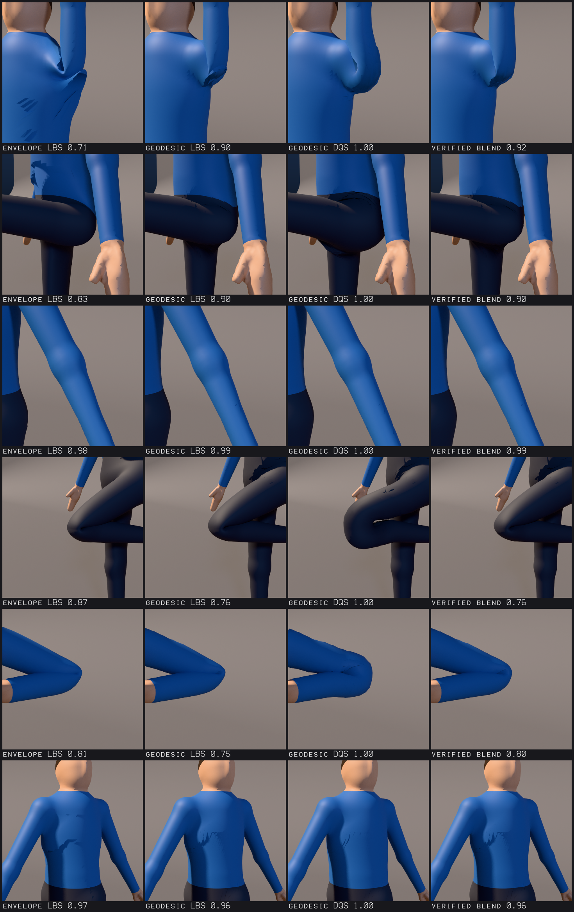
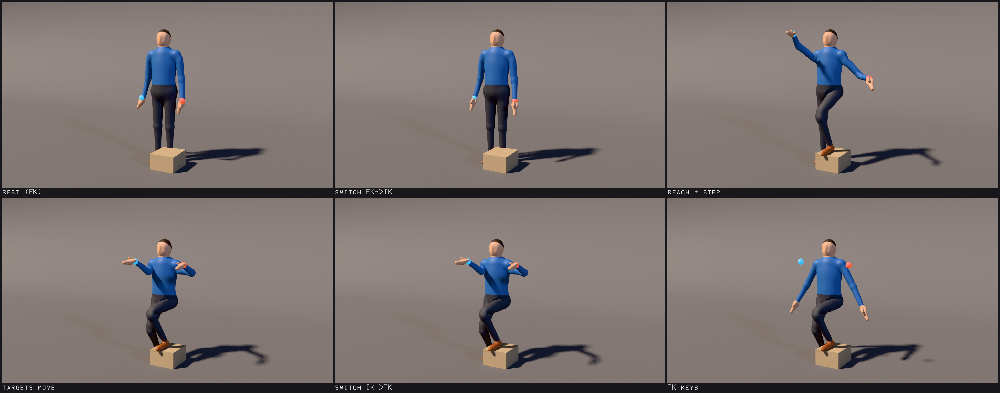
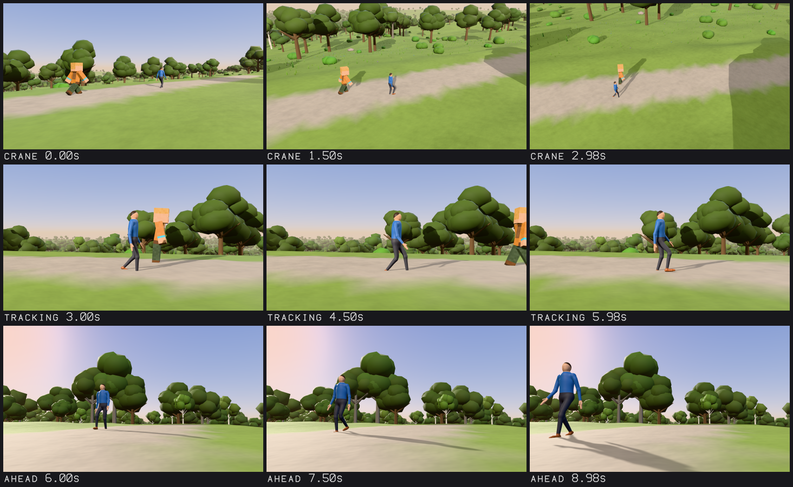

# Character rigging (0.19.0)

Automatic rigs for unrigged meshes, skin weights computed and edited as data, deformation
measured and fixed with verification, IK/FK controls that switch without a jump, high-level
pose commands, and -- when no skeleton is wanted -- Minecraft-style characters animated by
their own object transforms. Everything runs headless and is reachable from Python
(`scene.animation`), animation scripts (JSON), the command line (`aether3d rig ...`), scene
plans and MCP (`run_script`, `inspect_rig`, the guide `aether3d://rigging/guide`).

Stage 18 extends Stage 17's animation system ([ANIMATION.md](ANIMATION.md)): the same
`Rig`, joints, skins, solvers, timelines, clips and glTF -- nothing was rebuilt next to
them. The design record (what was inspected, the research behind each method, the
language of every subsystem and the outcome) is
[research/2026-10-stage18/DESIGN.md](../research/2026-10-stage18/DESIGN.md).

**What it is not.** Automatic rigging measures geometry: it finds limbs, joints and
symmetry in the mesh and places joints by measured sections and proportion priors; it
does not know anatomy beyond those priors and cannot be right for every mesh (every
landmark says how it was placed and how confident it is). Weights are geodesic distances
with falloffs and smoothing, not a muscle or tissue simulation. Deformation is linear,
dual quaternion or blended skinning plus corrective shapes driven by joint angles -- not
physically based. Corrections are verified by measurement, which is not the same as
being right. All rigging, weighting and skinning runs on the CPU (with native kernels
when `aether3d-native` is installed); nothing here runs on the GPU.

## Quick start

```python
from aether3d import Scene
from aether3d.sculpt.implicit import humanoid_shapes, implicit_surface

scene = Scene("Rigging")
body = scene.add_object("Body", mesh=implicit_surface(humanoid_shapes(), 0.02))
anim = scene.animation

# Look first: landmarks measured on the bare mesh, each with a confidence.
found = anim.detect_landmarks(body)
print(found["pose"], found["frame"]["forward"])  # A-pose [-0.0, -1.0, -0.0]

# Rig and bind in one undo step: skeleton, limits, IK controls, geodesic weights.
rig = anim.autorig(body, name="Hero")
print(len(rig["joints"]), rig["weights"]["Body"]["mode"])  # 23 geodesic

# Animate: a generated walk (in place), then a pose command keyed on the controls.
anim.generate("Hero", "walk", forward="-y", travel=False)
reach = anim.pose_character(
    "Hero", [{"do": "reach", "hand": "R", "target": [-0.3, -0.45, 1.35]}], time=1.0
)
print(reach["commands"][0]["reachable"], reach["residuals"]["arm_ik.R"])  # True 0.0

# Back to FK with a matched pose: no joint moves.
switch = anim.ik_fk("Hero", "arm_ik.R", "fk", 1.5)
print(switch["mismatch"] < 1e-9)  # True

# Measure the deformation (no errors), and see what Stage 18 proposes to fix.
report = anim.diagnose_rig("Hero", animation=False)
print(report["summary"]["error"])  # 0
proposals = anim.propose_rig_fix("Hero", animation=False)["proposals"]
print(all(p["safety"] in ("safe", "verify", "approval") for p in proposals))  # True
```

## Three workflows, chosen by the user

| Workflow | What moves the character | Use it for |
| --- | --- | --- |
| **Rigid transforms** (`generate_rigid`) | The part objects' own transforms; no armature, skin or weights | Minecraft-style segmented characters, props |
| **Bone-attached rigid parts** (Stage 17's `attach`, `autorig(template="blocky")`) | Joints; each part follows its joint rigidly | Blocky characters that want IK, retargeting, constraints |
| **Skinned rigs** (`autorig`, `skin`) | Joints; meshes deform by weights | Organic characters, clothing |

Nothing converts a character from one to another unless asked (`convert_character`).
Stage 17's blocky characters are unchanged: a fixture computed by the v0.18.0 sources
(`tests/data/v0.18.0/nova_motion.json`) pins their generated motions' part matrices.

## The rig document

A rig is Stage 17's immutable `Rig` with Stage 18 fields (file format 11; older files
load unchanged):

* joints -- as before (`name`, `parent`, rest `position`/`rotation`/`scale`, `tail`,
  `limits`) plus `role` (a semantic role: `hips`, `spine`, `chest`, `neck`, `head`,
  `shoulder.L`, `upper_arm.L`, `lower_arm.L`, `hand.L`, `thigh.L`, `shin.L`, `foot.L`,
  `toe.L`, ...; unique per rig; generators and pose commands use it first) and `deform`
  (`false`: a helper joint -- IK, twist sources -- that never receives weights);
* `controls` -- `{name, kind, object | joint, constraint, group, side, shape, size,
  mirror}`, kinds `ik_target`, `pole`, `gaze`, `fk`, `root`, `custom` (control objects
  are ordinary empties under the armature, keyed like any object);
* `correctives` -- corrective shapes: a morph target's weight driven by a joint's angle
  (`driver`: `angle`, `swing` (with an optional signed `direction`), `twist` or
  `rotation` about `axis`; `range` degrees mapped through `curve` `linear`/`smooth` to
  `weight`); evaluated after the joints, before the skin;
* `landmarks`, `template`, `info` (`forward`, `up`, `source`, `style`, `pose`) -- what
  the auto-rig measured, for diagnostics and for re-rigging;
* `enforce_limits` -- `"ik"` (limits apply to joints IK moves, Stage 17's rule; the
  default) or `"always"`.

**Limits.** Stage 17's Euler bounds (`{"rotation": {"min", "max"}}`, absolute local
angles) still work. Stage 18 adds forms relative to the rest pose, decomposed into swing
and twist about the bone axis (`axis`, default `+y`; quaternions canonicalized `w >= 0`, so
no wraparound or sign flips):

```json
{"swing": {"cone": 60}, "twist": [-40, 40]}
{"axis": "+y", "swing": {"x": [-5, 150], "z": [-5, 5]}, "twist": [-80, 80]}
{"hinge": {"axis": "+x", "min": -5, "max": 145, "play": 4}}
```

A cone or an ellipse (`x`, `z` ranges) bounds the swing, `twist` the rotation about the
bone; a hinge allows rotation about one axis (with `play` degrees of other swing).
Clamping keeps the closest allowed rotation; `limits.angles` reports a joint's swing,
twist and swing vector.

**Twist constraints** (`{"type": "twist", "joint", "target": {"joint"}, "axis",
"factor"}`) turn a helper joint by a fraction of another joint's twist (the auto-rig's
forearm helpers take half of the wrist's). Joint constraints are evaluated in dependency
order (a constraint after those that write what it reads).

## Automatic rigging

```python
rep = anim.autorig(
    [body, jacket, helmet],
    name="Hero",
    template="humanoid",
    parts={"Jacket": "transfer", "Helmet": "attach"},
    landmarks={"knee.L": [0.09, -0.02, 0.48]},
)
```

**Landmarks** (`detect_landmarks`, read-only). The meshes are voxelized together (128
cells over the height; open meshes closed morphologically); the canonical frame comes
from the up axis, the best mirror plane (a sweep of plane angles and offsets scored by
the solid voxels it maps onto solid voxels) and the feet's facing. Extremities are local
maxima of the geodesic distance (inside the solid) from the body's core; limbs are the
branches of the Reeb graph of that distance (slices of equal distance cut into connected
pieces); an eroded copy of the solid separates touching limbs. Joints are placed at
measured features -- the narrowest section of a limb, its bend, the axis of its segments
-- and, where a mesh shows nothing, by anthropometric fractions of the height (Drillis &
Contini). Every landmark reports `confidence`, the `method` that placed it and a `note`;
`diagnostics` name problems (`DETACHED_PARTS`, `FORWARD_AMBIGUOUS`, `ASYMMETRIC_BODY`,
`EXTRA_EXTREMITY`, `HAND_NOT_FOUND`, `FOOT_NOT_FOUND`, `HEAD_NOT_FOUND`, `LEGS_FUSED`,
...). Pass corrected points as `landmarks` (world space) to override any of them. On the
recipe's test bodies (A-pose, T-pose, arms down, child, stylized, wide stance) the
landmarks fall within 4 % of the height of the modeled joints (`tests/test_autorig.py`).

**Templates.** `humanoid` and `stylized` (Hips, Spine, Chest, Neck, Head; Shoulder,
UpperArm, ForeArm with a ForeArmTwist helper, Hand; Thigh, Shin, Foot, Toe; sides `.L`/`.R`;
roles), `blocky` (Hips, Body, Head, Arm.L/R, Leg.L/R; separate block objects are attached,
a single mesh is skinned rigidly block by block), `quadruped` (Pelvis, Spine, Chest,
Neck, Head, Tail, four three-joint legs). Bone frames (`orientation="bone"`): +Y along
the bone, +X its bend axis -- a positive rotation about +X bends elbows forward and knees
back; a negative one raises an arm or a thigh forward. Limits are swing-twist cones,
ellipses and hinges in those frames, the elbow's and knee's flexion range measured from
their rest bend. Controls: IK targets for hands and feet, elbow and knee poles, a gaze
target, two-bone IK constraints at influence 0 (the rig starts in FK) with `bend_axis`,
twist constraints for the forearm helpers.

**Parts** (`parts={mesh: mode}`): `geodesic` (the default: weights from distances inside
all geodesic parts voxelized together, so clothing over a body takes the body's),
`transfer` (each vertex takes the weights of the nearest point of the first geodesic
part's surface), `rigid` (the whole part follows its dominant joint), `attach` (a rigid
attachment to the joint nearest its centre, parented to the armature where it is so the
character can then be placed or turned as a whole: no skin, no deformation cost), `skip`.

## Skin weights

**Generated** (`generate_weights(mesh, armature, method=, policy=, ...)`): `geodesic`
(Dionne and de Lasa's geodesic voxel binding: the mesh and the bones voxelized, distances
inside the solid by an integer 3-4-5 chamfer metric in Dial buckets -- a native twin with
the same results -- and weights `d^-p` over the bones within `ratio` times the nearest),
`envelope` (Stage 17's) or `nearest`. Policies: `organic` (p 3, ratio 3, smoothing 6),
`stylized` (p 4, ratio 2, smoothing 3), `rigid`. Safeguards, each reported: bones farther
than `hops` joints from the nearest bone take no weight (no leg on the other leg), no
weight crosses the body's mid-plane to the other side's bones (`sides`), parts made of
one block follow one joint (`rigid_parts`), and the auto-rig's body-part regions fade
each limb's bones out over a band from the limb's junction (1.5 limb radii at the
shoulders and the neck, 3 at the hips, where the thighs move the groin and buttocks; the
legs' bones fade out toward the mid-plane where the legs meet). Smoothing never
crosses mesh components. `max_seconds` bounds the work; the report gives the technique,
voxel size, timings and coverage.

**Edited** (`edit_weights(mesh, [operations])`, one undo step): `assign`, `add`,
`subtract`, `scale`, `replace` (from one joint to another), `normalize`, `prune`, `cap`
(at most N influences), `smooth`, `mirror`, `rigid`, `lock`, `unlock` -- on selections
(`all`, `vertices`, `sphere`, `box`, `plane`, `joint`, `dominant`, `role`, `component`,
`component_of`, `near_joint`, `locked`, and `and`/`or`/`not` of them) with brush falloffs
(`center` or `joint`, `radius`, `curve` `constant`/`linear`/`smooth`/`sharp`/`root`/
`sphere`, `distance` `euclidean` or `geodesic`). Locked joints and vertices keep their
weights; rows an operation does not touch stay bit for bit.

**Transferred** (`transfer_weights(target, source, max_distance=, influences=4,
unmatched="rigid", smooth=2)`): nearest surface points of the source (barycentric
weights of its triangle), per-part distance statistics, and the parts too far to trust
reported (and bound rigidly, or left).

**Inspected** (`inspect_weights(mesh, joint=)`): validity, coverage, influence counts and
`WEIGHTS_NOT_NORMALIZED`, `WEIGHTS_INVALID`, `WEIGHT_LEAK`, `CROSS_SIDE_WEIGHTS`,
`HELPER_JOINT_WEIGHTED`, `UNUSED_JOINTS`.

## Deformation

`skin(mesh, armature, method=...)`: `linear` (Stage 17), `dual_quaternion` (Kavan et
al.: per-joint palettes split into a rotation and a translation by a polar decomposition,
scale and shear kept in a separate matrix so non-rigid joints still work) or `blended`
(per vertex, `dq` gives the dual quaternion share 0..1; 0 is linear blend skinning bit
for bit, 1 dual quaternion skinning bit for bit). Normals are transformed by the cofactor
matrix (correct under non-uniform scale). A native kernel computes all three, bitwise
equal to the NumPy reference (`tests/test_native.py`). Twist helpers spread a wrist's
twist along the forearm; corrective shapes add volume or shape where a joint bends.

## Structural editing

`edit_rig(armature, [operations], skins="rebind", animation="keep", channels="keep")` --
`add_joint`, `remove_joint`, `move_joint`, `orient_joint`, `rename_joint`,
`reparent_joint`, `insert_joint`, `split_bone`, `mirror_joints`, `align_bone`,
`set_joint` -- one undo step, all or nothing, `dry_run` to see first. Skins are rebound
so the mesh stays where it is (`J_new^-1 J_old B`); renamed joints are renamed in clips,
masks, constraints and controls; changed joint frames can rewrite their animation
(`animation="convert"`: quaternion tracks exactly, curves refitted within `tolerance`).
Single-operation shortcuts: `add_joint`, `remove_joint`, `move_joint`, `orient_joints`,
`rename_joint`, `reparent_joint`, `mirror_joint_chain`.

## Controls, IK/FK and posing

`add_control(armature, name, kind, ...)` gives any rig -- auto-rigged or hand-built,
Stage 17's included -- an IK limb (target, pole, constraint at influence 0), a gaze, an FK
control or the root.

`ik_fk(armature, limb, "ik" | "fk", time)` switches with **matched poses**: to IK, the
target and pole are keyed where the FK pose puts the hand or foot and its bend, then the
influence keyed to 1; to FK, the joints are keyed with the IK solution's rotations, then
the influence keyed to 0. The report measures the switch (`mismatch`: the largest joint
displacement; `rotation_mismatch`: the largest joint turn). IK bends a limb about its bend
axis only as far as the middle joint's limits require: a relaxed limb keeps its roll, so
switching it changes nothing visible (`tests/test_rig_controls.py` checks every joint,
twist helpers included, at both switches).

`pose_character(armature, [commands], time=)` turns intentions into keys: `reach` (a
hand to a point or object; leans the chest when out of reach and says so), `plant_feet`
(where the feet are now), `look_at`, `raise_arm`, `lean`, `crouch` (feet planted, hips
lowered), `aim_hips`, `rotate` (a joint, relative to its rest). Each reports
reachability, IK residuals (measured after limits) and limits hit. Joint rotation
channels are absolute local rotations, rest included (as glTF and Stage 17): commands
compose `rest * delta`.

## Diagnostics and verified correction

`diagnose_rig(armature, poses="suite", animation=True)` measures the rig and its skins:
the skeleton (`ZERO_LENGTH_BONE`, `BONE_AXIS_MISALIGNED`, `ASYMMETRIC_JOINTS`,
`POLE_ON_LINE`), the weights (`inspect_weights`' codes, `BIND_MISMATCH`), the deformation
in a pose suite -- elbows and knees bent 120 degrees, hips flexed 90, shoulders raised 90,
wrists twisted 90, the torso twisted 45, the spine bent 45, the head turned 60 -- and the
timeline (`IK_FLIP`, `IK_UNREACHABLE`, `FOOT_SLIDING`). Per pose and mesh:
`joint_ring` (the mean distance of the skin around the joint to its pivot, posed over
rest: below 0.75 is `JOINT_COLLAPSE`), `flipped_triangles` (turned over by the pose;
creases of the modeled surface are not counted), stretched and compressed edges and the
worst stretch, the volume change and `INTERPENETRATION`. Poses can be data:

```json
{"name": "deep_knee", "joint": "Shin.L",
 "turns": [{"joint": "Thigh.L", "axis": "+x", "angle": -60},
           {"joint": "Shin.L", "axis": "+x", "angle": 145}]}
```

(a string axis is in the joint's own frame, a vector in armature space). Every finding is
measured (`basis: numeric`); how a pose should look is not judged.

`propose_rig_fix` turns findings into proposals with a safety class -- `safe`
(normalizing, moving a helper's weights to its deforming parent, moving a pole off the
chain's line), `verify` (giving leaking vertices back to their dominant joint, smoothing,
rebinding, blending dual quaternion skinning around a collapsing joint -- the smallest
share that resolves it, measured), `approval` (mirroring joints: which side is right is
a choice). `apply_rig_fix(armature, fixes | "safe" | "verify", poses=, animation=)`
applies them one at a time, measures again what each can change, and undoes any that did
not improve its target or made anything worse; all that is kept is one undo step, and the
report lists `applied`, `reverted` and why.

`rig_preview(armature, mode=..., view=...)` draws `pose` (a time or a diagnostic pose),
`weights` (a joint's weights as a heat ramp), `stretch` (each vertex's mean edge-length
change: grey kept, red stretched, blue compressed, full colour at 1.41x and 0.71x) or
`skeleton` (bones, joints, IK targets and poles over the mesh, with an SVG), lit by key,
fill and rim lights in a separate preview scene, from the `front`, `back`, `side` (the
character's right), `left` or `three_quarter`.

**The feedback loop** ([FEEDBACK.md](FEEDBACK.md)): a `rig` expectation check
(`objects`, `poses`, `timeline`, `ignore`) reports the measured findings, planned into
`rig_fix` corrections (the rig's own proposals, checked as data and verified by the
feedback session as well; they need the policy's `allow_animation`).

## Rigid-part characters

```python
from aether3d import Scene

scene = Scene("Blocks")
hero = scene.add_object("Hero")


def block(name, size, center, parent, position):
    part = scene.add_object(name, parent=parent, position=position)
    with part.edit_mesh() as m:
        m.add_box(size, center=center)
    return part


torso = block("Torso", (0.5, 0.25, 0.75), (0, 0, 0), hero, (0, 0, 1.125))
block("Head", 0.5, (0, 0, 0), torso, (0, 0, 0.625))
block("Left Arm", (0.25, 0.25, 0.75), (0, 0, -0.3), torso, (0.375, 0, 0.3))
block("Right Arm", (0.25, 0.25, 0.75), (0, 0, -0.3), torso, (-0.375, 0, 0.3))
block("Left Leg", (0.25, 0.25, 0.75), (0, 0, -0.375), hero, (0.125, 0, 0.75))
block("Right Leg", (0.25, 0.25, 0.75), (0, 0, -0.375), hero, (-0.125, 0, 0.75))

walk = scene.animation.generate_rigid(hero, "walk")
print(walk["armature"], walk["verification"]["position"] < 0.002)  # None True
print(any(scene.animation.rig(o) is not None for o in scene.objects))  # False
```

`rigid_parts(root)` finds the parts (by name: head; torso, body or chest; arm; leg -- or
`parts={role: object}`), measures each side (left is `up x forward`; a contradicting name
is reported `SIDE_NAME_MISMATCH`) and each pivot (the shoulder half an arm's width below
the arm's top, the hip at the leg's top, the neck under the head, the waist under the
torso -- or the part's origin when it is already there). `generate_rigid(root, kind)`
runs the Stage 17 generators unchanged on a skeleton through those pivots in a private
scratch scene and writes each part's exact motion as ordinary `transform` clips (keys
chosen until every 240 Hz sample is within `tolerance`), with travel on the root; it
verifies the parts in the scene against the motion. An in-place motion stops a previous
generated travel; the user's own clips stay.

`convert_character(source, "skeleton" | "rigid")` converts on request: a rigid hierarchy
to an armature with attached copies of its parts (joints with roles, the motion baked onto
them), or an armature's attached parts to a hierarchy of pivots (the motion baked onto
them) -- verified sample by sample, the source untouched (hidden by default), one undo
step.

## Scripts, command line, MCP

Animation scripts (`aether3d.animation-script`) take every rigging operation as data:
`autorig`, `edit_rig` and its single-joint operations, `generate_weights`,
`edit_weights`, `normalize_weights`, `transfer_weights`, `add_control`, `ik_fk`,
`pose_character`, `apply_rig_fix`, `generate_rigid`, `convert_character`; read-only
`detect_landmarks`, `inspect_weights`, `diagnose_rig`, `propose_rig_fix`, `rigid_parts`.
Arguments are allowlisted and checked; a failing script changes nothing.

```json
{"format": "aether3d.animation-script", "version": 1, "label": "Rig the hero",
 "operations": [
  {"op": "autorig", "meshes": ["Body"], "name": "Hero"},
  {"op": "generate", "armature": "Hero", "motion": "walk", "forward": "-y"},
  {"op": "pose_character", "armature": "Hero", "time": 1.0,
   "commands": [{"do": "look_at", "target": [0.5, -3.0, 1.6]}]},
  {"op": "diagnose_rig", "armature": "Hero", "poses": ["knee_bend_120.L"], "animation": false}
 ]}
```

Command line: `aether3d rig autorig PROJECT --mesh Body`, `rig info`, `rig landmarks`,
`rig weights`, `rig diagnose`, `rig fix --safety verify`, `rig preview OUT.png --mode
weights --joint UpperArm.L` (`.svg`: the skeleton), `rig parts --root Hero`, `rig convert
--source Hero --to skeleton`, `rig guide`; rigging scripts run with `aether3d animation
run`.

MCP: rigging changes go through `run_script`; `inspect_rig` answers read-only questions
(`what`: `summary`, `landmarks`, `weights`, `diagnose`, `fixes`, `preview` -- a PNG --
and `parts`); the guide is the resource `aether3d://rigging/guide`.

## glTF

Exported: joints (with their roles, helper flags, tails and limits as Aether3D extras on
the joint nodes, read back on import), skins with their weights and inverse binds (every
mesh of a character, each its own skin), attachments as children of joint nodes,
animations (clips, or baked: what the scene shows -- constraints, IK and corrective
shapes' weights included). Reported: skins other than linear blend
(`SKINNING_METHOD_LOSSY`: glTF skins are linear blend; the same weights bend with less
volume -- a lossy export needs `allow_lossy`), and `RIG_AUTHORING_DATA` (what is kept
only as extras; control definitions, corrective drivers, landmarks and constraints are
not exported: their effect is baked). The round trip is tested numerically on a body, a
jacket and a helmet through a validated GLB (`tests/test_rig_gltf.py`).

## Showcases

Seven scripts, `examples/rigging_*.py`, model, rig, animate and render everything with
Aether3D (FFmpeg only encodes the rendered frames); each writes a `report.json` of what it
measured. Previews, sheets, heatmaps, preview videos and reports are committed in
`examples/output/rigging/`; the 1080p videos, lossless masters, frame sequences,
full-resolution stills and the skinned characters' scenes and GLBs are regenerated by
running the scripts (`--quick --backend cpu` runs each in seconds; the tests do).

| | Script | Shows | Measured (full quality) |
| --- | --- | --- | --- |
| A | `rigging_autorig.py` | an unrigged mesh: landmarks, the auto-rig (23 joints), weights, checks, clothes cut along its edges; walk, run, crouch, reach | auto-rig 0.69 s; no error-severity finding; feet slide at most 2.1 mm; the crouch's planted feet within 1.1 mm; the reach's residual 0; IK/FK switches move no joint (1e-16 m) |
| B | `rigging_deformation.py` | shoulder raised 150 degrees, hip flexed 100, wrist twisted 90, knee and elbow bent 140, torso twisted 60 -- envelope LBS (Stage 17), geodesic LBS, geodesic DQS and a verified blend side by side, stretch maps | the joints' kept size per method (the grid's labels); the verified blend adds DQS at the elbow only (0.75 -> 0.80) |
| C | `rigging_ikfk.py` | both hands and both feet on targets (one foot steps onto a block), FK to IK and back, then FK keys | every hand and foot on its target at both keyframes and all along the IK interval (at most 5e-16 m); the switches move no joint (7e-16 m) and no skin beyond the idle's own motion (0.03 mm); the legs hold after the switch (0.0 m) |
| D | `rigging_outfit.py` | a body, a jacket, trousers, boots and gloves (weight transfer), a helmet, shoulder plates and a backpack (attached) walking and running | clothing keeps 0.7-2.3 mm from the skin at its closest; the GLB passes the Khronos validator (0 errors, 0 warnings) |
| E | `rigging_minecraft_rigid.py` | Kit, an original pixel-skin character of six solid parts, animated by object transforms only: idle, walk, run, jump, wave | no rig and no skin in the scene; parts within 0.34 mm and 0.05 degrees of the generated motion; 0.68 ms per frame (0.91 ms as bone-attached blocks) |
| F | `rigging_world.py` | the auto-rigged walker and Kit on a road through a procedural world, a crane, a tracking and a ground-level shot | walker's feet slide at most 2.1 mm; the crane stays at least 1.41 m above the ground |
| G | `rigging_roundtrip.py` | the clothed, helmeted character through `.aether` and GLB | `.aether` exact (0.0); GLB: same joints, parents, roles and limits, weights within 4e-8, rest exact, posed skins within 0.07 mm, validator clean |









The twisted torso in B shows jagged dark patches in all four methods: the path tracer's
facet test with Stage 17's transformed normals (see the limitations), not the weights;
the GLB copy in G is lit differently because glTF carries no studio world.

**Renders and encodes.** Video frames: the GPU rasterizer at 1920x1080 with cascaded
shadow maps and 4x MSAA, key, fill and rim lights; every frame rendered at a true 60 fps
(no frame repeated). Encodes: libx264 `-preset slow -crf 10`, yuv420p, BT.709,
faststart; FFV1 lossless masters; 960x540 previews (CRF 23); PSNR/SSIM measured against
the frames, frame by frame. Stills and B's tiles: the GPU path tracer (A 256, D and E 192,
B 96 samples per pixel). On the development machine (RTX 4060 Laptop GPU):

| | Frames (60 fps) | Duration | Frame rendering | Stills | 1080p MP4 | PSNR / SSIM |
| --- | --- | --- | --- | --- | --- | --- |
| A | 696 | 11.6 s | 238.7 s (0.34 s a frame) | 4 path traced, 319 s | 3.9 MB | 43.0 dB / 0.996 |
| B | -- | -- | -- | 24 tiles 720x720, 181 s | -- | -- |
| C | 300 | 5.0 s | 105.0 s (0.35 s) | 2 switch views | 1.1 MB | 42.8 dB / 0.996 |
| D | 324 | 5.4 s | 112.6 s (0.34 s) | 2 path traced | 2.5 MB | 43.5 dB / 0.996 |
| E | 720 | 12.0 s | 239.8 s (0.33 s) | 5 path traced, 152 s | 22.5 MB | 38.8 dB / 0.984 |
| F | 540 | 9.0 s | 306.0 s (0.54 s) | 3 rasterized | 18.6 MB | 41.9 dB / 0.987 |
| G | -- | -- | -- | 9 views + a difference map | -- | -- |

## Performance

Measured with `benchmarks/bench_rigging.py` (results in
`benchmarks/results/stage18-rigging.json`, a 12th Gen Intel Core i9-12900H laptop):
auto-rigging a 6,488-vertex body 0.47 s (detection 0.29, binding 0.18) and an
18,008-vertex body 0.67 s; geodesic weights for 18,008 vertices 0.21 s; dual quaternion
skinning of a million vertices 393 ms in NumPy, 66 ms with the native kernel on one
thread and 14.7 ms on 20; 50 auto-rigged walking characters (6,488 vertices each, IK
constraints, twist helpers, gaze) evaluated in 16.9 ms per frame (0.34 ms each); 50
Minecraft-style characters per frame: 1.4 ms as rigid parts, 6.8 ms as bone-attached
blocks, 3.6 ms as one rigidly skinned mesh. Every Stage 17 animation benchmark is
unchanged within noise against v0.18.0 run interleaved
(`benchmarks/results/stage18-animation-interleaved.json`).
See [PERFORMANCE.md](PERFORMANCE.md).

## Limitations

* **Automatic rigging** knows its four templates. Humanoids are found in A-poses, T-poses
  and arms-down poses, standing, roughly symmetric, one character per call; fingers,
  facial joints, tails on humanoids, wings and props are not detected (add joints with
  `edit_rig`). Landmarks come from measured sections and proportion priors, each with its
  confidence -- not from anatomy -- and a mesh that hides a joint (a long coat over the
  knees) gets the prior there. Thin parts below the voxel size merge with what they touch.
* **Weights** are geodesic distances inside a voxelized solid with falloffs, region rules
  and smoothing; they are a good start, not a final artist's paint: deep bends of LBS
  skins lose volume (a knee bent 140 degrees keeps about 0.76 of its size on the test
  body), hips flexed past 90 degrees fold their groin, and a 60-degree torso twist
  shears the waist. Corrective shapes need targets someone makes; nothing simulates
  muscles, fat, skin sliding or collisions.
* **Skinned normals** are the rest normals transformed by the blended joint matrices (as
  in Stage 17 and glTF viewers). Where weights change quickly under a strong twist, the
  deformed facets turn further than those normals; the path tracers give no direct light
  to a facet facing away from a light, so a strongly twisted, coarse mesh shows jagged
  dark patches along the light's terminator (Showcase B's twisted torso, in all four
  skinning methods alike); the rasterizers draw the same surface smooth.
* **IK** is Stage 17's: two-bone, FABRIK and CCD per chain; there is no full-body solver,
  and `reach` leans the chest at most 30 degrees toward a goal out of reach, then reports
  what is left (`reachable: false`, the residual).
* **Diagnostics** are measurements of the mesh in chosen poses, not a judgment of how a
  pose should look; a verified fix improved what was measured, which is not the same as
  being right.
* **Everything runs on the CPU** (native kernels when installed); there is no GPU
  skinning. glTF keeps linear blend skinning only (dual quaternion and blended skins are
  a reported loss), and controls, corrective drivers, landmarks and constraints are
  baked or kept as extras, not exported as rig logic.
* **Rigid-part characters** are found by part names (or given by role); pivots come from
  the parts' boxes or their origins; generated motions are the Stage 17 generators'.

## Stage 17 and Stage 18

| | Stage 17 (0.17.0) | Stage 18 (0.19.0) |
| --- | --- | --- |
| Getting a rig | Hand-written joints (`add_rig`) | `autorig` from a bare mesh, with measured landmarks |
| Weights | Envelope or nearest | Geodesic voxel binding, region-aware; programmatic edits; transfer |
| Joint limits | Euler bounds | Swing-twist cones, ellipses, hinges relative to rest |
| Skinning | Linear (native), dual quaternion (NumPy) | Linear, dual quaternion and blended (native), cofactor normals |
| Deformation helpers | -- | Twist constraints and helper joints, corrective shapes |
| IK | Two-bone, FABRIK, CCD constraints | The same solvers, bend-axis alignment within limits, controls, matched IK/FK switches |
| Posing | Keys | Pose commands (reach, plant feet, look at, crouch, ...) |
| Rig changes | Replace the rig | `edit_rig`: structural edits with dependent data kept consistent |
| Checking | Foot contacts, curve reports | `diagnose_rig`, custom poses, previews, verified fixes, feedback `rig` check |
| Rigid characters | Bone-attached blocks | Also rigid-part generation with no bones, and conversions |
| glTF | Skeletons, skins, animation | Also joint semantics as extras, honest rig loss reports |
