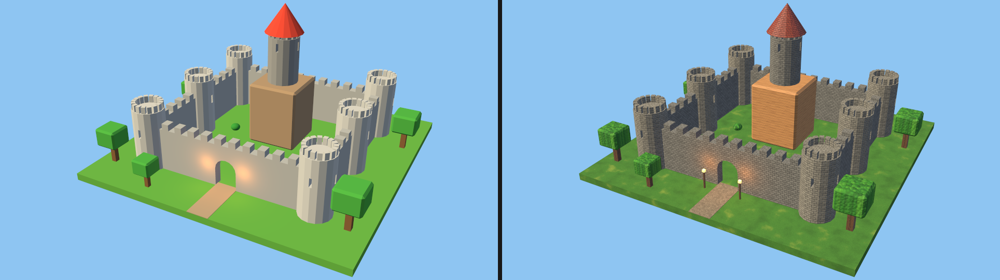
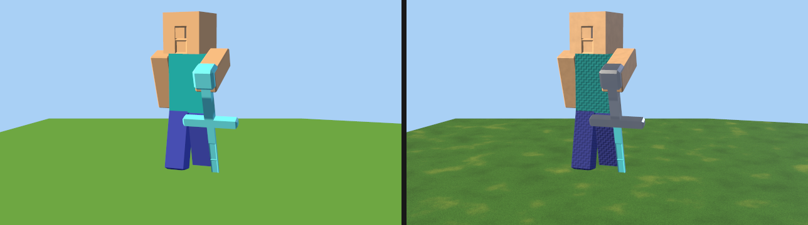
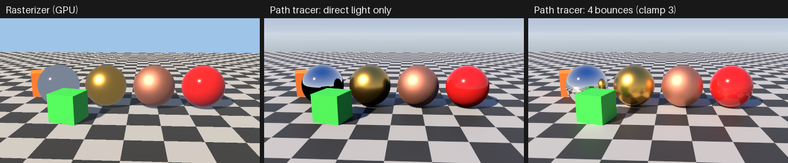

# Materials, textures and procedural shaders

Aether3D 0.7 gives surfaces materials. A material is a set of typed
parameters, the shading model they feed, and texture slots. Its textures come
from PNG/JPEG images or from procedural node graphs. Both renderers use the
same materials: the CPU reference renderer and the GPU backend agree to within
rounding. Materials are saved in projects, imported from and exported to glTF,
and scriptable from Python, JSON scene scripts and the CLI. Since 0.8 the
path tracer renders the same materials too, with physically based light
transport ([In the path tracer](#in-the-path-tracer)).



*The procedural castle of [`examples/minecraft_castle_render.py`](../examples/minecraft_castle_render.py),
in flat colors and with materials:*
- *stone bricks and planks from image textures, with a normal map;*
- *procedural shingles, cobblestones, grass, bark and leaves;*
- *emissive torch flames.*



*The hero of [`examples/hero_render.py`](../examples/hero_render.py): woven fabric, a
diamond blade on a steel hilt, and a grass block whose top is a face group with its own
material.*

- [Quick start](#quick-start)
- [Materials](#materials)
- [The shading models](#the-shading-models)
- [Texture slots](#texture-slots)
- [Image textures](#image-textures)
- [Texture coordinates and projections](#texture-coordinates-and-projections)
- [Procedural textures](#procedural-textures)
- [Presets](#presets)
- [Face groups: several materials on one mesh](#face-groups-several-materials-on-one-mesh)
- [Projects, paths and embedding](#projects-paths-and-embedding)
- [glTF](#gltf)
- [Scene scripts and the command line](#scene-scripts-and-the-command-line)
- [On the GPU](#on-the-gpu)
- [In the path tracer](#in-the-path-tracer)
- [Errors and diagnostics](#errors-and-diagnostics)
- [Untrusted textures and graphs](#untrusted-textures-and-graphs)
- [Performance](#performance)
- [Limitations](#limitations)

## Quick start

Run from the repository root (the textures are the examples' own):

```python
from aether3d import Scene

scene = Scene("Courtyard")
ground = scene.add_plane("Ground", size=20)
wall = scene.add_cube("Wall", size=2, position=(0, 0, 1), scale=(4, 0.5, 1))
crate = scene.add_cube("Crate", size=1, position=(2, -2, 0.5))

# A preset: procedural textures, no image files and no UVs needed.
scene.create_material("Lawn", preset="grass", scale=2)
scene.assign_material(ground, "Lawn")

# An image texture (PNG or JPEG) with a normal map, projected in object space.
bricks = scene.create_material("Bricks", roughness=0.85)
bricks.set_texture(
    "base_color", "examples/textures/stone_bricks_color.png", coordinates="object", scale=0.5
)
bricks.set_texture(
    "normal", "examples/textures/stone_bricks_normal.png", coordinates="object", scale=0.5
)
wall.material = bricks

# Factors and a procedural roughness map.
wood = scene.create_material("Wood", base_color="#b07a45", roughness=0.6)
wood.set_procedural_texture("roughness", {"type": "fbm", "scale": 8, "octaves": 4})
crate.material = wood

scene.add_directional_light("Sun", direction=(-0.4, 0.6, -1), intensity=2.2)
scene.add_camera("Camera", fov=40).frame(direction=(-0.5, 1, -0.5))
scene.render(width=640, height=360).save("courtyard.png")  # the CPU renderer
gpu = scene.render(backend="auto", width=640, height=360, shadows=True)  # the GPU if it works
gpu.save("courtyard_gpu.png")
print(wood.inspect())  # parameters, bindings, users and problems
scene.save("courtyard.aether")  # textures are stored as paths relative to the project
```

The same steps from the terminal, on a project with the same objects and no
materials yet (every command takes `--json`, `--dry-run` and `--output`):

```bash
aether3d material create courtyard.aether Lawn --preset grass --set scale=2
aether3d material assign courtyard.aether Lawn Ground
aether3d material create courtyard.aether Bricks --set roughness=0.85
aether3d material texture courtyard.aether Bricks base_color \
    --image examples/textures/stone_bricks_color.png --coordinates object --scale 0.5
aether3d material assign courtyard.aether Bricks Wall
aether3d material inspect courtyard.aether Bricks --json
aether3d material validate courtyard.aether      # exit code 3 if a texture cannot be used
aether3d material preview courtyard.aether Bricks -o bricks.png --shape sphere
aether3d render courtyard.aether -o courtyard.png
```

## Materials

Materials live in the scene's material library, `scene.materials` (a
`MaterialLibrary`). Each has:
- a stable `id`;
- a `name`, unique among the scene's materials;
- a `model` (`"standard"` or `"simple"`);
- parameters;
- texture bindings by slot.

Objects refer to materials; materials refer to textures. Any number of
objects can share a material, and any number of materials can share a texture.

```python
from aether3d import MaterialError

stone = scene.create_material("Stone", roughness=0.9)  # validated before it is added
stone.configure(base_color="#8c8a83", metallic=0.0)  # all-or-nothing changes
obj.material = stone  # or scene.assign_material(obj, "Stone")
scene.assign_material(["Wall 1", "Wall 2"], stone)  # names, ids or objects
obj.material = None  # back to the object's own color
print(scene.materials.users(stone))  # [(object, group or None), ...]
try:
    scene.materials.remove_material(stone)  # refused while objects use it
except MaterialError as exc:
    print(exc.code, exc.location)  # MATERIAL_IN_USE materials[Stone]
scene.materials.remove_material(stone, force=True)  # unassigns it, then removes it
```

- **Objects without a material** render with their own color
  (`obj.color`, `obj.appearance`). That is exactly a `"simple"` material, so
  existing scenes render bit-identically to Aether3D 0.6.
  `scene.materials.convert_appearances()` turns object colors into equivalent
  simple materials and assigns them.
- **One source of truth.** While an object uses a material, setting its color
  raises `MaterialError("OBJECT_HAS_MATERIAL")`: change the material instead,
  or unassign it.
- **History.** Every material and texture change is a step of `scene.history`
  and can be undone (see [HISTORY.md](HISTORY.md)).
- **Transactions.** `with scene.materials.transaction():` makes a block of
  changes all-or-nothing. If the block raises, materials, textures and
  assignments return to their previous state (the same Python objects, with
  their previous values).
- **Inspection.** `material.inspect()` and `scene.materials.inspect()` return
  JSON-compatible reports: parameters, bindings, each texture's status, users
  and problems. `scene.materials.validate()` lists problems as diagnostics.
- **Machine-readable schema.** `aether3d.materials.material_schema()` (CLI:
  `aether3d material schema --json`) describes every parameter, slot and
  binding option, with types, ranges and defaults.

### Parameters

| Parameter | Models | Default | Meaning |
| --- | --- | --- | --- |
| `base_color` | both | `(0.8, 0.8, 0.8)` | display (sRGB) color: `"#rrggbb"`, `"#rgb"` or `(r, g, b)` in 0..1 |
| `opacity` | both | 1 | 0..1, used with `alpha_mode="mask"` |
| `alpha_mode` | both | `"opaque"` | `"opaque"` (opacity ignored) or `"mask"` (cut out below `alpha_cutoff`) |
| `alpha_cutoff` | both | 0.5 | mask threshold |
| `metallic` | standard | 0 | 0 dielectric .. 1 metal |
| `roughness` | standard | 0.5 | perceptual roughness, 0 mirror-like .. 1 matte (floor 0.045) |
| `specular` | both | standard 0.5, simple 0 | standard: dielectric reflectance, F0 = 0.08 × specular (0.5 → 4%); simple: highlight strength |
| `shininess` | simple | 32 | Blinn-Phong exponent, 1..10000 |
| `emissive` | both | black | display color of the light the surface emits |
| `emissive_strength` | both | 1 | multiplies `emissive` (0..10⁶) |
| `normal_strength` | both | 1 | scales the tilt of the normal map (−10..10) |
| `occlusion_strength` | both | 1 | how much the occlusion map darkens ambient light |
| `double_sided` | both | `True` | `False`: back faces are not drawn (glTF's `doubleSided: false`) |
| `transmission` | standard | 0 | 0..1 (0.20.0): the share of a dielectric's diffuse part that is transmitted -- glass in the path tracers (refracted, total internal reflection, tinted by the base colour); the rasterizers draw only the reflection (`c_diff (1 − transmission)`) |
| `ior` | standard | 1.5 | 1..3 (0.20.0): the index of refraction of a transmissive material |

Changing `model` keeps the parameters both models share (`base_color`,
`opacity`, the alpha settings, `emissive`, the strengths, `double_sided`).
The other model's own parameters start from their defaults. That includes
`specular`, whose meaning differs between the models.

## The shading models

All lighting happens in linear light. User colors are display sRGB and are
converted to linear light once. `E` is a light's color × intensity ×
attenuation. `A` is the world's ambient light (color × intensity).

**`"standard"`** (the default) is glTF 2.0's metallic-roughness BRDF,
multiplied by π so that a white diffuse surface matches the simple model:

```
c_diff = base · (1 − metallic)
F0     = mix(0.08 · specular, base, metallic)
F      = F0 + (1 − F0) (1 − v·h)^5                      (Schlick)
D      = α² / (π ((n·h)² (α² − 1) + 1)²)                (GGX, α = roughness²)
V      = 0.5 / (n·l √((n·v)²(1 − α²) + α²) + n·v √((n·l)²(1 − α²) + α²))   (height-correlated Smith)
color  = Σ_lights E (n·l) ((1 − F) c_diff + π F D V)
       + A · ao · (c_diff + F0 · s + b)                 (ambient: Karis' analytic split-sum fit (s, b))
       + emissive · emissive_strength                   (added after lighting, unlit)
```

`roughness` is clamped to at least 0.045, because a perfect mirror would make
point-light highlights vanish. Ambient light is treated as a uniform
environment, so a metal reflects the ambient color.

**`"simple"`** is Aether3D 0.5/0.6's model, with unchanged arithmetic:

```
color = base · (A · ao + Σ E max(n·l, 0)) + Σ E · specular · max(n·h, 0)^shininess + emission
```

**Common to both models:**
- **Emission** is added after lighting. On the rasterizers it makes a surface
  glow but does not illuminate other objects; add a point light for that, as
  the castle's torches do. In the path tracer emissive surfaces are area
  lights that do light the scene.
- **Alpha masks.** With `alpha_mode="mask"`, a sample is kept where
  `opacity × opacity texture × base color image alpha ≥ alpha_cutoff`.
  Otherwise nothing is drawn there: other objects show through, and shadow maps
  get the same holes. There is no blended transparency.
- **Back faces.** On double-sided materials, back faces flip their normal.
  Single-sided materials (`double_sided=False`) are culled per triangle on
  both backends, mirrored instances included.
- **Shadows.** On the GPU, shadows apply to direct light only (see
  [GPU.md](GPU.md#shadows)).

## Texture slots

A texture bound to a slot multiplies the slot's factor. The exceptions are
`normal`, which tilts the shading normal, and `occlusion`, which darkens
ambient light.

| Slot | Reads | Color space | Effect |
| --- | --- | --- | --- |
| `base_color` | RGB (+ alpha from images) | sRGB | `base_color × texture`; an image's alpha multiplies opacity |
| `opacity` | channel `a` | linear | `opacity × texture` |
| `metallic` | channel `b` | linear | `metallic × texture` (glTF packing: metal in blue) |
| `roughness` | channel `g` | linear | `roughness × texture` (glTF packing: roughness in green) |
| `normal` | RGB | linear | tangent-space normal map (+X right, +Y up, as glTF), tilt scaled by `normal_strength` |
| `emissive` | RGB | sRGB | `emissive × emissive_strength × texture` |
| `occlusion` | channel `r` | linear | ambient × `1 + occlusion_strength × (texture − 1)` |

- **Vertex colours** (`Mesh.colors`, since 0.18.0) multiply too: the base colour by the
  interpolated vertex RGB and the opacity by its alpha, after the texture, as glTF's
  `COLOR_0` -- on every backend. Worlds use them for biome tints, ambient occlusion of
  blocks and water depth, under tiling detail textures.
- **Channels.** Number slots read their default channel. A binding's
  `channel` (`"r"`, `"g"`, `"b"`, `"a"`, `"luminance"`) overrides it.
  Procedural textures used in number slots read `r` by default: the node's
  value.
- **Color spaces.** Color slots decode sRGB images to linear light texel by
  texel, before filtering, as GPU sRGB textures do. Data slots use the stored
  values. A texture's `color_space` (`"auto"`, `"srgb"`, `"linear"`) can force
  either.
- **Normal maps.** UV-mapped normal maps are read in the **MikkTSpace**
  tangent frame (0.14.0; [TEXTURING.md](TEXTURING.md#tangent-space)), the
  standard that bakers, other engines and glTF use: every renderer
  interpolates the per-corner tangent and sign, and maps baked by Aether3D or
  by other MikkTSpace bakers render as intended. A binding that rotates,
  mirrors or non-uniformly scales the UVs, and object- or world-mapped normal
  textures, use each triangle's UV-gradient frame (made orthonormal against
  the interpolated normal). Mip levels of normal maps average unit vectors
  and renormalize them.
- **Painted textures** (`scene.add_painted_texture`, 0.14.0) are image
  textures you paint: 16-bit layers with blend modes, opacity and masks, kept
  in the project file and in the history ([TEXTURING.md](TEXTURING.md#painted-textures)).
  Bind them like any image.

```python
m.set_texture("roughness", "rough.png", channel="r")  # a grayscale roughness map
m.set_texture("normal", "normal.png")  # tangent-space normal map
m.configure(normal_strength=0.6)
decal = scene.add_image_texture("Decal", "decal.png", wrap="clamp")  # sampler settings
m.set_texture("base_color", decal)  # belong to the texture
m.clear_texture("roughness")  # the texture stays in the scene
```

## Image textures

```python
tex = scene.add_image_texture("Bricks", "textures/bricks.png", wrap="repeat", filter="linear")
tex.configure(wrap=["repeat", "clamp"], mipmaps=True, color_space="auto")
material.set_texture("base_color", tex, scale=4)  # bind an existing texture
material.set_texture("normal", "textures/bricks_normal.png")  # or a path: adds a texture
tex.embed()  # store the image in the project
print(tex.info(), tex.status())  # settings; format, size, digest
```

- **Formats.**
  - PNG is decoded by Aether3D itself, without dependencies: every color type
    and bit depth (1–16), Adam7 interlacing, palettes and `tRNS`
    transparency. 16-bit samples are rounded to 8 bits. Color-management
    chunks (`gAMA`, `iCCP`, `sRGB`...) are ignored: as in glTF, texture data
    is interpreted by its slot (sRGB colors, linear data).
  - JPEG (baseline and progressive) is decoded by Pillow, an optional
    dependency: `pip install 'aether3d[images]'`. EXIF orientation is not
    applied, because textures map by UV, not by camera orientation. Without
    Pillow, JPEG textures fail with `MaterialError("IMAGE_DECODER_MISSING")`;
    PNG textures keep working.
  - Other formats are refused (`IMAGE_FORMAT_UNSUPPORTED`). Files are
    recognized by their content, not their extension.
- **The UV convention.** `(0, 0)` is the bottom-left of the image and `v`
  grows upward. glTF's top-left origin is flipped on import and export.
  [`examples/textures/uv_grid.png`](../examples/textures/uv_grid.png) is a
  test grid whose top-left cell is white.
- **Sampling.** Sampler settings belong to the texture, as in glTF:
  - **`filter`.**
    - `"linear"` (default) is bilinear within a mip level and linear between
      the two nearest levels (trilinear).
    - `"nearest"` uses the texel containing the point (pixel art) and, with
      mipmaps, the nearest level.
  - **`wrap`.** `"repeat"` (default), `"clamp"` (to the edge texel) or
    `"mirror"`, per axis: `wrap=["repeat", "clamp"]`.
  - **`mipmaps`.** Default `True`. Mip levels are box-filtered: in linear
    light for sRGB data, and as renormalized unit vectors for normal maps.
  - **Level selection.** The level is chosen from the screen-space footprint:
    `λ = log2(max(|∂(u W, v H)/∂x|, |∂(u W, v H)/∂y|))`, the standard
    isotropic rule.
  - **Exact derivatives.** The CPU renderer knows the exact derivatives of
    each sample's barycentrics. The GPU uses `dpdxFine`/`dpdyFine`.
- **Caching.** An image file is re-read when its size, modification time or
  inode changes, so an edited texture appears in the next render. Identical
  content is decoded once (keyed by its SHA-256 digest). Decoded images and
  mip chains are kept within `AETHER3D_TEXTURE_CACHE_MB` (default 1024 MiB).
- **Missing or broken images never abort a render.** The binding is ignored,
  so the slot uses its factor alone, and the result carries a warning
  (`TEXTURE_MISSING`, `TEXTURE_INVALID`...).
  `aether3d material validate` reports the same problems before a render, with
  exit code 3.

## Texture coordinates and projections

Each binding chooses where its texture is read. The choice belongs to the
binding, not the texture, so one texture can be mapped differently by
different materials:

| `coordinates` | What | Needs |
| --- | --- | --- |
| `"uv"` (the default) | the mesh's UVs | a mesh with UVs (primitives, imported meshes, editing ops keep them) |
| `"object"` (the presets' default) | the position in the object's own space: the texture moves with the object | nothing |
| `"world"` | the position in world space: objects slide through the texture | nothing |

Object and world coordinates are 3D. A `projection` turns them into the
coordinates a texture reads:
- **`"triplanar"`** (default): three planar projections, onto x = `(s_x y, z)`,
  y = `(−s_y x, z)` and z = `(s_z x, y)`.
  - `s` is the sign of the triangle's geometric normal on that axis, so no
    face sees a mirrored image.
  - The projections are blended with weights `|n_axis|^blend` of the surface
    normal (`blend` 1..64, default 4).
  - A projection with weight below 10⁻⁴ is skipped on both backends, so
    axis-aligned faces cost one projection.
- **`"xy"`, `"xz"`, `"yz"`**: one plane.
- **`"volume"`**: the 3D point itself. This suits procedural 3D patterns
  (noise, wood rings), which then need only one evaluation per sample.

Every binding has a transform, `p' = R(rotation°) (scale ⊙ p) + offset`. `scale`
and `offset` are a number or a 2-3 vector, and `rotation` turns the uv plane,
or the coordinates around z. A `scale` of 4 repeats a UV texture 4 times;
`scale=0.5` in object space gives a texture tile 2 units wide.

```python
m.set_texture("base_color", "tiles.png", scale=8, rotation=45)  # uv
m.set_texture(
    "base_color", "rock.png", coordinates="world", projection="triplanar", scale=0.25, blend=8
)
m.set_texture_options("base_color", offset=[0.5, 0])  # change a binding
```

A UV binding on a mesh without UVs is skipped for that object, with a
`MISSING_UVS` warning. Object or world coordinates never need UVs. That is why
the procedural castle, whose booleans produce meshes without UVs, uses them.

## Procedural textures

A procedural texture is a small graph of nodes, stored as data and evaluated
for every sample: in NumPy on the CPU, and per fragment by an interpreter in
the GPU shader. It is never turned into a bitmap, nor into Python or shader
code. A graph is a JSON-compatible dict:

```python
graph = {
    "output": "color",
    "nodes": {
        "cells": {"type": "voronoi", "scale": 3.2, "seed": 7},
        "grain": {"type": "fbm", "scale": 9, "octaves": 4, "seed": 8},
        "tint": {
            "type": "ramp",
            "factor": {"node": "cells", "output": "cell"},
            "stops": [[0, "#6d6a63"], [1, "#a5a39b"]],
        },
        "color": {
            "type": "mix",
            "a": {"node": "tint"},
            "b": {"node": "grain"},
            "factor": 0.35,
            "mode": "multiply",
        },
    },
}
m.set_procedural_texture("base_color", graph, coordinates="object", projection="volume")
m.set_procedural_texture("roughness", {"type": "noise", "scale": 12})  # a single node
# A node type name: keywords are its parameters (the others are binding options).
m.set_procedural_texture("emissive", "checker", scale=8, color2="#ffcc00")
tex = scene.add_procedural_texture("Clouds", {"type": "fbm", "octaves": 6})
tex.set_params(scale=4)  # change the output node's parameters
image = tex.preview(256)  # an 8-bit sRGB array of the unit uv square
tex.bake("clouds.png", 1024)  # an explicit, optional PNG output
```

- **Values.** Every node produces four numbers (`r, g, b, a`). Its outputs
  name what they mean: `color` (rgb), `value` (r), `mask` (a), and so on.
  Every node also has the generic outputs `r`, `g`, `b` and `a`.
  - **References.** `{"node": id}` uses the node's first output, and
    `{"node": id, "output": name}` picks one.
  - **Colors and numbers.** A color used where a number is expected gives its
    luminance; a number used as a color gives gray.
- **Colors** written as `"#rrggbb"` or `[r, g, b]` are display (sRGB) colors.
  A plain number given for a color input is a *linear* gray: `0.5` means half
  reflectance, not `#808080`.
- **Coordinates.** Nodes are evaluated at the binding's coordinate `p`.
  Pattern nodes first apply their own `scale` (a number or `[x, y, z]`) and
  `offset`: `p' = p · scale + offset`.
- **Reproducibility.** All randomness comes from integer hashes (PCG3D) of
  lattice cells and the `seed` parameters. A graph gives the same result on
  every run, machine and backend. Parameters are rounded to float32 on both
  backends.
- **Limits.**
  - At most 64 nodes and 512 GPU instructions per graph.
  - Ramps have 2 to 8 stops.
  - Bump nodes nest at most 2 deep.
  - No cycles (`GRAPH_CYCLE`). Too-large graphs fail with
    `GRAPH_TOO_COMPLEX`.
  - Noise lattice coordinates are clamped to ±10⁶.
- **The full machine-readable schema:** `aether3d.materials.node_types()` or
  `aether3d material schema --json`.

### Node reference

| Node | Outputs | Parameters (defaults) |
| --- | --- | --- |
| `constant` | `color`, `value` | `value` (0.8): a color or a number |
| `coordinates` | `vector`, `x`, `y`, `z` | `scale`, `offset`: the coordinate itself |
| `checker` | `color`, `mask` | `color1` `#202020`, `color2` `#e0e0e0`, `dimensions` 2 (squares) or 3 (cubes); one square per unit |
| `gradient` | `value` | `kind`: `linear`, `quadratic`, `easing` (along x), `diagonal`, `radial` (angle around z), `spherical` |
| `stripes` | `color`, `mask` | `color1`, `color2`, `width` 0.5 (fraction of color1), `axis` `x`/`y`/`z`/`diagonal`; one period per unit |
| `noise` | `value` | `kind` `perlin` (gradient) or `value`, `seed`; smooth 3D noise in 0..1, features about one unit apart |
| `fbm` | `value` | `kind`, `seed`, `octaves` 5 (1..12), `lacunarity` 2, `gain` 0.5; fractal noise normalized to 0..1 |
| `voronoi` | `distance`, `edge`, `cell` | `randomness` 1, `dimensions` 2/3, `seed`; distance to the nearest point (F1), F2 − F1 (0 on borders), a random value per cell |
| `bricks` | `color`, `mortar` | `color1`, `color2`, `mortar_color`, `brick_width` 0.5, `brick_height` 0.25, `mortar` 0.02, `smoothness` 0.2, `row_offset` 0.5, `variation` 0.5, `seed`; running bond in the xy plane |
| `tiles` | `color`, `mortar` | `color1`, `color2`, `mortar_color`, `tile_width`, `tile_height` 0.25, `mortar` 0.01, `smoothness`, `variation`, `seed` |
| `wood` | `color`, `rings` | `color1`, `color2`, `rings` 10 per unit radius, `distortion` 0.4, `grain` 0.25, `axis` `z`, `seed` |
| `mix` | `color`, `value` | `a`, `b`, `factor` 0.5, `mode`: `mix`, `multiply`, `add`, `subtract`, `screen`, `difference`, `minimum`, `maximum`, `overlay` (linear light) |
| `ramp` | `color`, `value` | `factor`, `stops` (2–8 `[position, color or number]`), `interpolation` `linear`/`constant`/`smooth` |
| `math` | `value` | `op`: `add`, `subtract`, `multiply`, `divide`, `power`, `minimum`, `maximum`, `absolute`, `invert` (1 − a), `clamp` (a to [b, c]), `smoothstep` (b, c, a), `remap` (a from [b, c] to [0, 1]); inputs `a`, `b`, `c` |
| `bump` | `normal` | `height` (connect a height field), `depth` 0.02, `step` 0.001: a tangent-space normal by finite differences; use it in the `normal` slot |
| `image` | `color`, `alpha` | `texture` (an image texture's name or id), `color_space` `srgb`/`linear`, `scale`, `offset`: sample a scene image inside a graph |

All pattern nodes (`checker` through `wood`, and `image`) also take `scale`
and `offset`. Inputs marked connectable in the schema (colors, `factor`, `a`,
`b`, `c`, `height`) accept a literal or a reference.

## Presets

Presets build a material and its procedural textures from a few options. They
need no image files, and no UVs (object coordinates, triplanar). The three
transmissive presets (0.20.0) have no textures:

| Preset | Look | Options (besides `scale`, `seed`, `coordinates`, `projection`, `color`) |
| --- | --- | --- |
| `stone` | irregular stones with dark joints (voronoi, fbm detail, bump) | `mortar_color` |
| `brick` | running-bond bricks with mortar grooves and grime | `color2`, `mortar_color`, `brick_width`, `brick_height`, `mortar` |
| `wood` | solid wood with growth rings and grain (3D) | `color2`, `axis` |
| `metal` | brushed metal (metallic, varying roughness) | `roughness_low`, `roughness_high` |
| `grass` | patchy greens and blade clumps | `color2` |
| `fabric` | woven warp and weft threads | — |
| `glass` | clear glass: `transmission` 1, `ior` 1.5, roughness 0 (0.20.0) | — (`color` tints it) |
| `frosted_glass` | rough glass: roughness 0.35 (0.20.0) | — |
| `water` | `transmission` 1, `ior` 1.33, roughness 0.02 (0.20.0) | — |

```python
scene.create_material("Roof", preset="brick", color="#9c3a27", brick_width=0.42, roughness=0.8)
```

Any other keyword is a material parameter (`roughness=0.8` above). The result
is an ordinary material whose textures can be inspected and edited.
`aether3d material presets --json` lists the presets.

## Face groups: several materials on one mesh

Every triangle of a mesh belongs to a face group: 0 by default, any integer
0..65535 otherwise. An object can map groups to materials:

```python
scene.assign_material(block, earth)  # the whole object
scene.assign_material(block, grass, group=1)  # faces of group 1 only
block.group_materials  # {1: Material 'Grass'}
block.material_for_group(0)  # Material 'Earth'
```

Groups without an entry use the object's material, or its color if it has
none. Groups come from:
- **Mesh editing.**
  - `m.set_group(faces, 1)` puts faces in a group.
  - `m.select_faces(group=1)` and the `"group"` query key select by group.
  - New faces inherit the group of the face they come from (extrusion walls,
    inset borders, subdivided, split and triangulated pieces). A bevel
    chamfer takes the group of the beveled edge's lower-id face (see
    [EDITING.md](EDITING.md#face-groups)).
  - `join_triangles` merges only faces of the same group.
  - Dissolving an edge between two groups reports `FACE_GROUP_CHANGED`.
- **Procedural modifiers**, which keep groups through every modifier. In a
  boolean, each triangle keeps the group of the face it came from, in either
  operand. A boolean backend that could not track faces would report
  `FACE_GROUPS_DROPPED`.
- **Meshes built in code:**
  `Mesh(..., groups=array)` or `mesh.with_groups(array)`.
- **glTF import:** primitives with different materials become face groups of
  one mesh (`PRIMITIVES_AS_GROUPS`).

## Projects, paths and embedding

Materials are saved in projects since format version 4 (see [FILE_FORMAT.md](FILE_FORMAT.md)): the
scene's `materials` and `textures`, each object's `material` and
`group_materials`, and each mesh's `groups`. Version 1–3 projects load
unchanged, with no materials.

- **Image files are stored as relative POSIX paths** inside the project's
  directory (or below it), so a project folder can be moved or shared as a
  whole. Saving a project whose texture lies outside its directory fails with
  `MaterialError("TEXTURE_OUTSIDE_PROJECT")`. Nothing is written in that case.
  Copy the image into the project's folder, or `texture.embed()` it.
- **Embedded images** (`embed=True`, `texture.embed()`) are stored in the
  project, base64-encoded, up to 64 MiB each. `texture.extract(path)` writes
  one out and references the file instead.
- **A missing file on load is not an error.** The project loads, the texture
  reports its status, and renders fall back to the factor with a warning, so
  a project with a missing texture can still be opened and fixed.
- **Paths that would escape the project are refused** (`UNSAFE_PATH`):
  absolute paths, `..` segments, drive letters and backslashes when a project
  is loaded, and symbolic links that resolve outside the project when an
  image is read.

## glTF

Import and export map materials to glTF 2.0's `pbrMetallicRoughness`, with
`KHR_texture_transform`, `KHR_materials_emissive_strength`,
`KHR_materials_specular` and, since 0.20.0, `KHR_materials_transmission` and
`KHR_materials_ior` (a transmission texture is not imported:
`TRANSMISSION_TEXTURE_IGNORED`; an `ior` outside 1..3 is clamped with the lossy
`IOR_CLAMPED`). Each face group becomes one primitive. Procedural
textures are not glTF content. They are left out with a warning
(`PROCEDURAL_TEXTURE_NOT_EXPORTED`) or, when explicitly requested, *baked*
into PNG images over the unit UV square: `scene.export("a.glb",
bake_textures=1024)` or `aether3d export PROJECT a.glb --bake-textures 1024`.
Textures mapped by object or world coordinates have no glTF equivalent, baked
or not (`TEXTURE_MAPPING_NOT_EXPORTED`). Exported
materials carry their exact Aether3D parameters in `extras.aether3d`, which
restores simple materials and object colors exactly. Details are in
[GLTF.md](GLTF.md#materials-and-textures).

## Scene scripts and the command line

JSON scene scripts (`aether3d scene run PROJECT script.json`,
`run_scene_script`) have material operations, as data:
- **`create_material`, `set_material`, `remove_material`.**
- **`assign_material`:** `objects`, `material` (`null` unassigns), optional
  `group`.
- **`set_texture`:** `material`, `slot` and one of `texture`, `image`,
  `procedural` or `"clear": true`, plus binding options.
- **`add_texture`, `set_texture_settings`, `remove_texture`.**
- **`convert_colors`**, and the read-only **`materials`**.

```json
{
  "format": "aether3d.scene-script",
  "version": 1,
  "operations": [
    {"op": "create_material", "name": "Wall", "preset": "brick", "scale": 2, "roughness": 0.9},
    {"op": "assign_material", "objects": ["Wall 1", "Wall 2"], "material": "Wall"},
    {"op": "create_material", "name": "Floor", "roughness": 0.6},
    {"op": "set_texture", "material": "Floor", "slot": "base_color",
     "image": "textures/planks.jpg", "coordinates": "object", "scale": 0.5},
    {"op": "assign_material", "objects": "Floor", "material": "Floor"}
  ]
}
```

Scripts are atomic: if any operation fails, every change is undone, the
material library included. Image paths in a script must stay inside the
project's directory (`UNSAFE_PATH`), because scripts may come from anywhere.

The CLI:
- **`aether3d material`:** `list`, `presets`, `schema`, `create`, `set`,
  `assign`, `texture`, `inspect`, `validate`, `remove`, `convert-colors` and
  `preview`.
- **`aether3d texture`:** `list`, `add`, `procedural`, `set`, `inspect`,
  `preview` and `remove`.

Every command that changes a project writes it atomically. It accepts
`--dry-run` (report, write nothing), `--output OTHER.aether` and `--json`.
`aether3d inspect PROJECT --json` shows each object's `material` and
`group_materials`.

## On the GPU

The GPU backend renders the same materials ([GPU.md](GPU.md)):
- **Material data.** Material factors, bindings and texture programs are
  packed into one storage buffer per render.
- **Procedural graphs** are compiled to fixed-format instructions with
  numeric operands, run by an interpreter in the fixed WGSL shader. No shader
  code is ever generated from a scene.
- **Images.**
  - All mip levels of all images are stored in one texel pool, sampled with
    the same arithmetic as the CPU.
  - The pool is keyed by image content, decoding mode and mipmaps, so it is
    uploaded again only when the set of images changes. An edited file has a
    new digest and can never leave a stale image on the GPU.
  - A render whose images are a subset of the pool reuses it, so the pool keeps
    the last uploaded set until a scene needs other images, or until
    `aether3d.release_gpu()`.
  - `result.backend["resources"]` reports images, texel uploads and their
    bytes, the pool size and texture program sizes.
- **The texel pool must fit one storage binding.** Aether3D requests the
  adapter's maximum `max-storage-buffer-binding-size`: 2 GiB on the RTX 4060,
  128 MiB (the WebGPU default) on lavapipe. A 4096² image with its mip chain
  needs 85 MiB. Larger texture sets fail with `RenderError("GPU_LIMIT_EXCEEDED")`
  (location `textures`); `backend="auto"` then renders on the CPU, with a
  diagnostic.
- **Parity.** In parity mode (`supersample=s, msaa=1`) the GPU samples the
  CPU's positions. On the textured castle, every pixel shows the same object,
  except along edges, and 99.98% of the other pixels are within 2 of 255
  codes (99.99% on lavapipe). With MSAA, the GPU shades once per pixel where
  the CPU shades every sample, so fine texture detail differs; the average
  colors agree.

## In the path tracer

`render(backend="path")` ([RENDER_QUALITY.md](RENDER_QUALITY.md)) evaluates
materials with the CPU renderer's own code, so every parameter, texture,
projection, normal and bump map, alpha mask and face group means the same
thing. What changes is the light that reaches the surface:

- **The BRDF.** `"standard"` materials use exactly the formulas above, divided
  by pi (the light intensities carry that pi). Lights see the same surface
  response; the path tracer also gets reflections of the scene, its
  environment and bounce light. `"simple"` materials with `specular` 0 are
  Lambertian. With a highlight they get a GGX lobe whose roughness matches
  `shininess` (as glTF export converts them).
- **Emission lights the scene.** Emissive triangles are area lights,
  importance-sampled by power and combined with BSDF sampling by multiple
  importance sampling. Textured and masked emission is evaluated at the
  sampled point.
- **Occlusion maps are ignored.** The path tracer computes occlusion from the
  geometry, and applying a baked map too would darken twice.
- **Glass** (0.20.0). `transmission` and `ior` make a rough dielectric interface:
  reflection and refraction with the exact Fresnel term and total internal reflection,
  the refracted light tinted by the base colour ([RENDER_QUALITY.md](RENDER_QUALITY.md#glass-0200)).
- **Alpha masks and single-sided materials** let rays through, shadow and
  AO rays included, so cut-outs cast cut-out shadows.
- **Texture filtering.** Mip levels and procedural filtering come from ray
  differentials on camera rays (one pixel / `sqrt(samples)`) and ray cones on
  bounces (coarser after rough bounces). At the same footprint as the CPU
  rasterizer (16 samples vs 4×4 supersampling) the images agree to within 1%
  on average.



*[`examples/metal_spheres.py`](../examples/metal_spheres.py): chrome, satin
gold, rough copper and glossy plastic. The rasterizer shows highlights and
a constant ambient reflection. With direct light only, the path tracer
reflects the sun and the sky. With bounces the metals reflect the floor, the
blocks and each other (that render clamps indirect light at 3 per sample
against the speckles of the chrome sphere's sun caustic).*

## Errors and diagnostics

Invalid requests raise `MaterialError` (a subclass of `AetherError`) with a
stable `code`, a `location` such as `materials[Stone].roughness`, a `hint` and
`details`. Nothing is changed when one is raised. Match on codes, not
messages:

| Code | When |
| --- | --- |
| `INVALID_MATERIAL`, `INVALID_TEXTURE`, `INVALID_ARGUMENT` | a parameter, binding or setting is out of range or of the wrong type |
| `INVALID_TEXTURE_GRAPH`, `UNKNOWN_NODE_TYPE`, `GRAPH_CYCLE`, `GRAPH_TOO_COMPLEX` | a procedural graph is invalid or too large |
| `UNKNOWN_PRESET` | no such preset |
| `MATERIAL_NOT_FOUND`, `TEXTURE_NOT_FOUND`, `NAME_CONFLICT` | references and names |
| `MATERIAL_IN_USE`, `TEXTURE_IN_USE` | removal refused without `force=True` |
| `NOT_A_MESH_OBJECT`, `OBJECT_HAS_MATERIAL` | assignment to a light or camera; setting the color of an object that uses a material |
| `IMAGE_FORMAT_UNSUPPORTED`, `INVALID_IMAGE`, `IMAGE_TOO_LARGE`, `IMAGE_DECODER_MISSING` | an image cannot be decoded safely |
| `TEXTURE_MISSING`, `TEXTURE_UNREADABLE`, `TEXTURE_INVALID` | an image file is missing, unreadable or broken |
| `UNSAFE_PATH`, `TEXTURE_OUTSIDE_PROJECT` | a path would leave the project's directory |
| `RESOURCE_LIMIT` | more than 10,000 materials or textures |

Problems found while rendering are warnings in `result.diagnostics`. The
render goes on with a documented fallback:
- **An image that cannot be used** (`TEXTURE_MISSING`, `TEXTURE_INVALID`,
  `UNSAFE_PATH`, `IMAGE_TOO_LARGE`...): the binding is ignored, and the slot
  renders with its factor alone.
- **`MISSING_UVS`:** a UV binding on a mesh without UVs is ignored for that
  object.

`scene.materials.validate()` (and `aether3d material validate`) reports the
same problems before rendering. It also reports:
- `NO_FACE_GROUPS` (warning): group materials on a mesh without groups;
- `GEOMETRY_EVALUATION_FAILED` (warning): procedural geometry that cannot be
  evaluated, so its UVs and face groups could not be checked. An example is a
  boolean without manifold3d. Geometry is evaluated only for those checks.
- `UNUSED_MATERIAL` and `UNUSED_TEXTURE` (information).

## Untrusted textures and graphs

Textures and projects may come from anywhere. Aether3D treats them as data:
- **Images are validated before pixels are allocated.**
  - Size limits: 256 MiB per file, 16384 pixels per side, 8192² pixels in
    total (`ImageLimits`).
  - PNG chunk CRCs, lengths and counts, and the zlib stream are checked.
  - Truncated, malformed or oversized images raise `MaterialError` with a
    code. Memory stays within the limits above: compressed data is inflated
    only up to the size its header declares, so a decompression bomb stops
    there.
  - JPEGs are decoded by Pillow, with the same limits applied before decoding.
- **Paths** stored in projects and given by scripts must stay inside the
  project's directory. This is checked on the text (no absolute paths, `..`,
  drive letters or backslashes) and again after resolving symbolic links,
  so a link to a file outside the project is refused (`UNSAFE_PATH`). glTF
  images must lie next to the asset.
- **Graphs are data**, validated against the node schema: types, ranges,
  references, cycles and size limits. They are evaluated by a fixed NumPy
  evaluator and a fixed shader interpreter, never compiled to code.
- **No partial files.** Saving a project, writing a texture or extracting an
  embedded image writes a temporary file and renames it, so a failed write
  never leaves a partial or corrupted file. Failed library changes and scripts
  roll back.

## Performance

[`benchmarks/bench_materials.py`](../benchmarks/bench_materials.py) measures
decoding, mip chains, procedural nodes, shading cost per kind of material,
uploads and the castle. One run on an i9-12900H with an RTX 4060 Laptop GPU
(Vulkan), Python 3.14, NumPy 2.5; the CPU renderer is single-threaded:

| Measurement | Result |
| --- | --- |
| PNG decoding (Aether3D's own, NumPy), photograph-like images | 4–6 megapixels/s: 2048² in 0.72 s, 4096² in 3.7 s |
| JPEG decoding (Pillow) | 160–230 megapixels/s: 4096² in 0.1 s |
| Mip chain | 2048²: 0.25–0.32 s (21 MiB); 4096²: 1.1–1.5 s (85 MiB) |
| Procedural nodes on the CPU, per point | checker 53 ns, bricks 115 ns, noise 390 ns, voronoi 394 ns, wood 841 ns, fbm (5 octaves) 1.9 µs |
| 24 spheres + ground (53k triangles), 1920×1080, 4 samples per pixel, **CPU** | flat colors 0.79 s; standard 2.3 s; UV image 3.8 s; triplanar image 6.0 s; image + normal map 7.5 s; fbm 5.8 s; stone preset 27 s |
| The same, **GPU** | flat colors 0.022 s; images and single nodes 0.022–0.025 s; stone preset 0.060 s |
| A new 4096² PNG texture, first GPU render | 5.1 s (decoding and mips on the host 4.7 s; uploading 85 MiB of texels 0.3 s); next renders 0.020 s |
| The castle, 1920×1080, 4 samples per pixel | flat colors: CPU 1.0 s, GPU 0.026 s; materials: CPU 11.7 s, GPU 0.037 s. Peak host memory on the CPU: 227 → 604 MiB |

In practice:
- **The GPU is the fast path for textured scenes.** The CPU renderer is the
  reference.
- **Decoding is paid once per image and process.** Decoded images and mip
  chains are cached. Prefer JPEG for large photographic textures (much faster
  to decode) and PNG for exact data (normal maps, masks).
- **Procedural textures cost per sample.** Triplanar projections evaluate up
  to three times on curved surfaces, and bump nodes three times. Use
  `projection="volume"` for 3D patterns.

## Limitations

- **No blended transparency.** Opacity is a cutout (`alpha_mode="mask"`).
  glTF `BLEND` materials import as opaque, with a warning.
- **Emission does not light the scene on the rasterizers.** Emissive surfaces
  glow but do not illuminate other objects there (the path tracer does), and
  there is no bloom.
- **Image-based lighting.** On the rasterizers an image environment lights
  through nine spherical harmonics and one extracted sun (0.20.0): no reflections of
  the image or of other objects. The path tracers reflect the scene and the
  environment, images included.
- **Transmission** (0.20.0) is refracted by the path tracers only; the rasterizers
  draw glass's reflection. No absorption in volumes, dispersion or subsurface
  scattering.
- **Normal-map tangents** are MikkTSpace for UV bindings that keep the UV
  basis (0.14.0); rotated, mirrored or non-uniformly scaled bindings use the
  per-triangle UV-gradient frame. glTF `TANGENT` attributes are not imported
  (MikkTSpace is recomputed, which matches files written by MikkTSpace tools);
  they are exported.
- **Procedural patterns are point-sampled**, not prefiltered. Very fine
  patterns alias unless the image is supersampled (`samples` ≥ 2 on the CPU,
  `supersample` on the GPU). MSAA alone shades once per pixel.
- **Texture coordinates.** One UV set per mesh (glTF `TEXCOORD_1` is not
  imported). Images decoded from files are 8 bits per channel; painted
  textures keep 16 bits per channel (their level 0 is filtered at 8 bits by
  the renderers, as other images).
- **File formats.** PNG and JPEG textures only (no KTX2/Basis, HDR or EXR textures;
  HDR images light scenes as environments, [RENDERING.md](RENDERING.md#image-environments-0200)).
- **No displacement.** Bump and normal maps tilt normals; they do not move
  geometry.
