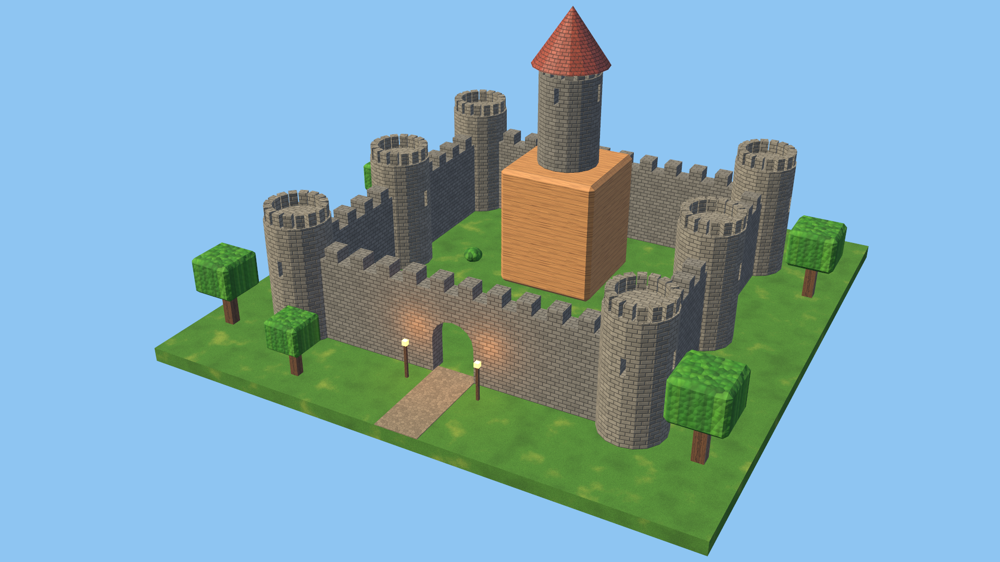
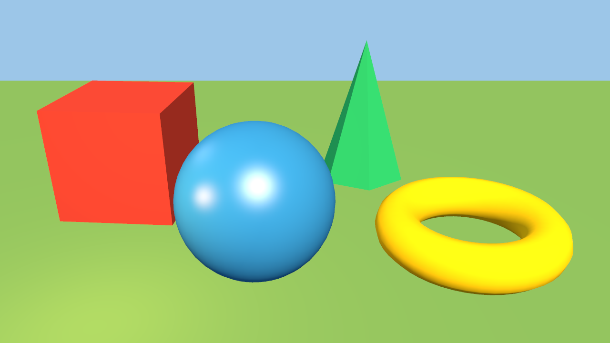
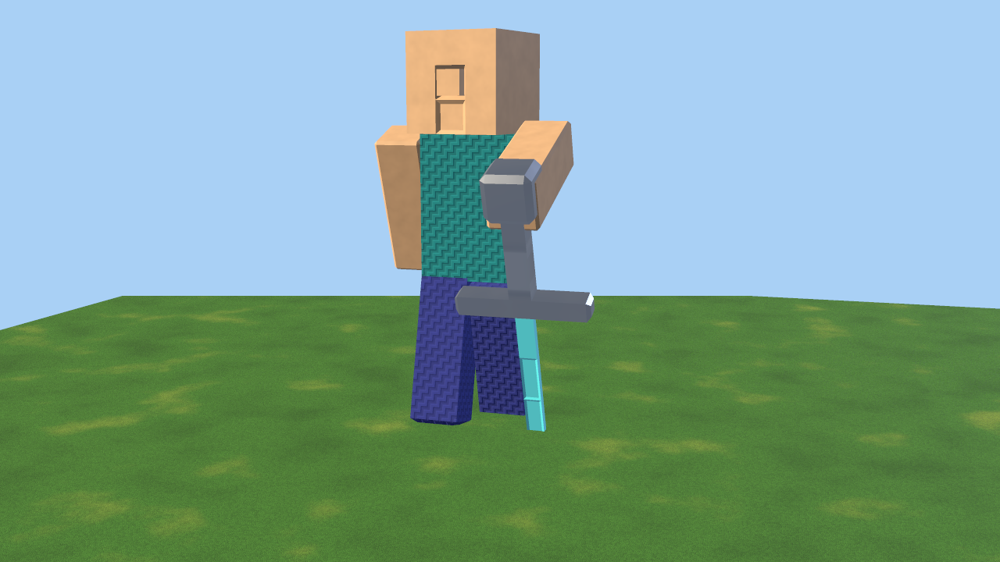

# Rendering

Aether3D renders images **with its own implementation**. This guide covers
cameras, lights, the shading model and the default renderer: a deterministic,
headless CPU rasterizer written in Python and NumPy. It turns any Aether3D
scene into a correctly projected, depth-tested, lit PNG. Scenes can contain
static meshes, imported glTF meshes, meshes made with the editing engine, and
procedural geometry. No external renderer, GPU, OpenGL context or GUI is
involved, and the PNG encoder is Aether3D's own.

Since 0.6, the same scenes also render on graphics hardware with
`backend="gpu"`: real GPU rasterization through wgpu (Vulkan, Metal,
Direct3D 12), with MSAA and directional shadow maps. See [GPU.md](GPU.md).
The CPU renderer stays the default and the reference.

Since 0.7, surfaces can have **materials**: the physically based
metallic-roughness model of glTF, image and procedural textures, normal maps,
alpha masks and emission, on both backends. See [MATERIALS.md](MATERIALS.md).
Objects without a material render with their own color, exactly as before.

Since 0.8, `backend="path"` renders with a **path tracer** instead of a
rasterizer (since 0.8.1 `backend="gpu_path"` runs the same path tracer on the
GPU). It computes physically based light transport:
- shadows from every light, soft with the light's size;
- light bouncing between surfaces;
- reflections of the scene;
- emissive surfaces that light their surroundings;
- an environment (uniform or procedural sky);
- ambient occlusion.

See [RENDER_QUALITY.md](RENDER_QUALITY.md). The rasterizers described here are
unchanged; the new scene data the path tracer reads (light `radius`/`angle`,
`scene.world.environment`) does not affect them.

Since 0.20.0 (Stage 19), lights and images go further on **every backend**: spot and area
lights (squares, rectangles, disks and ellipses, with Blender's `spread`), Blender's
power units, colour temperature, light linking and shadowless lights
([Lights](#light-fields-units-and-linking-0200)), studio light rigs solved for a subject
([Studio light rigs](#studio-light-rigs-0200)), image environments -- HDR files and four
built-ins -- that light the rasterizers too
([Image environments](#image-environments-0200)), a camera lens with real depth of
field, the `film` view transform, 16-bit and OpenEXR masters, and motion vectors. The
path tracers add glass, importance-sampled environments, Owen-scrambled Sobol' samples,
pixel filters, adaptive sampling and a denoiser ([RENDER_QUALITY.md](RENDER_QUALITY.md)).
The lights were measured against Blender 5.2's Cycles (experiment E3); defaults keep every
earlier scene rendering exactly as before.



*The Stage 4 procedural castle with its Stage 7 materials (image and procedural
textures), rendered by Aether3D's CPU renderer at 1920×1080 with 3×3 samples
per pixel
([`examples/minecraft_castle_render.py`](../examples/minecraft_castle_render.py)).*

- [Quick start](#quick-start)
- [The pipeline](#the-pipeline)
- [Coordinate conventions](#coordinate-conventions)
- [Cameras](#cameras)
- [Lights and the shading model](#lights-and-the-shading-model)
- [Color](#color)
- [Rasterization](#rasterization)
- [What renders](#what-renders)
- [Python API](#python-api)
- [Command line](#command-line)
- [Persistence](#persistence)
- [How correctness is verified](#how-correctness-is-verified)
- [Performance](#performance)
- [The first renders](#the-first-renders)
- [Error and diagnostic codes](#error-and-diagnostic-codes)
- [Limitations](#limitations)
- [Toward later stages](#toward-later-stages)

## Quick start

```python
from aether3d import Scene

scene = Scene("Studio")
scene.add_plane("Ground", size=20).color = "#6f9b4f"
crate = scene.add_cube("Crate", size=2, position=(0, 0, 1))
crate.color = "#c0392b"
ball = scene.add_sphere("Ball", radius=0.8, position=(2.2, 0.5, 0.8))
ball.appearance.configure(color="#2e86c1", specular=0.5, shininess=60)

camera = scene.add_camera("Camera", fov=40)  # the first camera becomes active
camera.frame(direction=(-0.5, 1.0, -0.45))  # fit all visible geometry
scene.add_directional_light("Sun", direction=(-0.4, 0.6, -1.0), intensity=2.0)
scene.world.configure(background="#9cc6e8", ambient_intensity=0.25)

result = scene.render(width=640, height=360)  # samples=2 (2x2 antialiasing) by default
result.save("studio.png")
print(result.stats["timings"]["total"], [o["name"] for o in result.objects])
```

From the terminal, the same steps work without any Python; see
[Command line](#command-line).

## The pipeline

```text
Scene ──extract──▶ RenderScene ──CPU backend──────────────────────────────────▶ RenderResult
        (read-only)  meshes (shared arrays, procedural = current evaluation)
                     instances (world + normal matrices, linear colors)
                     lights (world space), camera (frame + projection)
                     background, ambient

CPU backend (aether3d/rendering/cpu.py, raster.py):
  geometry   vertices → world (M) → clip space (P·V·M); normals with M⁻ᵀ;
             world-space facing; back/front-face culling; frustum rejection
  clipping   Sutherland–Hodgman against 6 planes in homogeneous clip space
  raster     perspective divide → viewport → 8-bit fixed point → exact
             integer edge functions per sample row (top-left rule)
             → visibility buffer (packed depth + triangle id, np.minimum.at)
  shade      once per covered sample: perspective-correct barycentrics,
             world position, interpolated normal, lights
  resolve    average the s×s samples of each pixel in linear light
output:      exposure → clamp → sRGB transfer function → 8 bits → PNG (own encoder)
```

| Module | Responsibility |
| --- | --- |
| `rendering/camera.py` | `Camera` parameters, projection matrices, camera frame from a world matrix |
| `rendering/light.py` | `Light` parameters |
| `rendering/settings.py` | `Appearance`, `World`, `RenderSettings`, `RenderLimits` |
| `rendering/color.py` | sRGB ↔ linear transfer functions, color parsing |
| `rendering/scene_data.py` | `RenderScene` extraction (backend-independent) |
| `rendering/retained.py` | the retained render world: extraction kept up to date between renders |
| `rendering/raster.py` | clipping, fixed-point rasterization, visibility buffer |
| `rendering/cpu.py` | the CPU backend: geometry, raster, shading, resolve |
| `rendering/renderer.py` | `render()` and `RenderResult` |
| `rendering/framing.py` | exact camera framing |
| `rendering/png.py` | PNG encoder |
| `rendering/script.py` | declarative scene-setup scripts |

Rendering never modifies the scene. Extraction reads objects, transforms and
the *current evaluated* procedural meshes (through the procedural cache), and
everything after extraction works on immutable `RenderScene` data.

Since 0.11.1 extraction is retained between renders (`rendering/retained.py`):
what it computed for a scene is kept with the scene and updated from the
history's change journal, so a frame where nothing changed, or one object moved,
does not visit every object again. The render scene is exactly the one a full
walk of the scene gives; the full walk runs inside open operations and
transactions, when the scene fails to render (it reports the error), and with
`AETHER3D_RETAINED_RENDER_WORLD=0`. A procedural object's mesh is evaluated again
after any procedural or geometry change; between them it is reused (evaluations
are deterministic, so a new evaluation of unchanged definitions is the same mesh).

## Coordinate conventions

- **World:** right-handed, **+Z up**, 1 unit = 1 meter. An asset's front
  faces **−Y**.
- **Cameras (and lights) look along their local −Y axis, with local +Z up.**
  This is the same "front faces −Y" convention as every asset, so
  `obj.look_at(target)` aims cameras, directional lights and models alike.
  Seen through the camera, image right is the camera's local **−X**. An
  unrotated camera at `(0, 10, 0)` looks along −Y, toward the origin.
- **Camera frame.** The renderer derives the frame from the camera's world
  matrix:
  - forward is the normalized world direction of local −Y;
  - up is the world direction of local +Z, made orthogonal to forward
    (Gram–Schmidt);
  - right = forward × up.

  Scale, shear or mirroring inherited from parents therefore never distort or
  mirror the image; they are reported as `CAMERA_SCALE_IGNORED`.
- **View space:** x right, y up, the camera looking down −z (the usual
  right-handed convention).
- **Clip space and NDC:** x and y in [−1, 1] (y up); depth z in **[0, 1]**,
  with the near plane at 0 and the far plane at 1.
- **Images:** row 0 is the top. Pixel `(x, y)` covers `[x, x+1] × [y, y+1]`,
  and its center is at `(x + 0.5, y + 0.5)`. NDC (−1, 1) is the top-left
  corner of the image.
- **Other tools:**
  - A Blender camera (looking along local −Z, +Y up) with the same view has
    the rotation matrix whose columns are (right, up, −forward).
  - glTF cameras look along −Z in glTF's Y-up space. Under Aether3D's exact
    axis conversion that is world +Y, so a glTF camera node corresponds to an
    Aether3D camera turned 180° about Z.

## Cameras

```python
cam = scene.add_camera(
    "Main",
    projection="perspective",
    fov=40,
    fov_axis="vertical",
    near=0.1,
    far=1000,
    position=(8, -12, 6),
    look_at=(0, 0, 1),
)
cam.camera.fov = 35  # validated immediately
cam.camera.configure(near=500, far=5000)  # several values at once, all or nothing
```

| Parameter | Meaning | Valid values (default) |
| --- | --- | --- |
| `projection` | `perspective` or `orthographic` | (`perspective`) |
| `fov` | Field of view in degrees, measured along `fov_axis` | 0.01–179 (40) |
| `fov_axis` | `vertical`, `horizontal`, or `auto` (the larger image dimension) | (`vertical`) |
| `ortho_scale` | Orthographic view size in world units along `fov_axis` | > 0 (10) |
| `near`, `far` | Clipping distances along the view direction | perspective: 0 < near < far, far/near ≤ 10⁹; orthographic: 0 ≤ near < far (0.1, 1000) |
| `aspect_ratio` | The frame shape (width / height) the camera is meant for, or `None` | 10⁻³–10³ (None) |
| `sensor` (0.20.0) | Sensor size in mm along `fov_axis`; with `fov` it gives `focal_length = sensor / (2 tan(fov/2))` (`configure(focal_length=50)` sets `fov`; 0.1–100,000 mm) | 1–1000 (36) |
| `shift_x`, `shift_y` (0.20.0) | Lens shift in units of the image's larger side (as Blender's): the view moves right/up without turning, so verticals stay vertical | −10–10 (0) |
| `fstop` (0.20.0) | f-number of the aperture (diameter `focal_length / fstop`); 0 is a pinhole | 0 or 0.1–10⁴ (0) |
| `focus_distance`, `focus_object` (0.20.0) | Metres along the view axis to the plane in focus, or an object whose origin sets it every frame | > 0 (10), an id (None) |
| `aperture_blades`, `aperture_rotation`, `aperture_ratio` (0.20.0) | 0: a round aperture, 3–16: a polygon (a corner up), its rotation in degrees, an anamorphic ratio (the width divided by it) | (0, 0, 1) |

**Depth of field** (0.20.0) follows Blender's model, measured (experiment E5): a thin lens
at the eye, the field of view unchanged, so a point at distance `d` blurs into a disk of
`(focal_length / fstop) |1/d − 1/focus|` in units of the image plane at distance 1. The
path tracers sample the aperture per path; the rasterizers average `dof_samples` (default
16, `render(dof_samples=N)`) pinhole views from points spread over it (`DEPTH_OF_FIELD`,
info; depth and object index are the pinhole view's). Shot presets, rack focus and focus
measurement are in [ANIMATION.md](ANIMATION.md#cameras-and-cinematics).

**Aspect ratio.**
- Pixels are always square, so the projection uses the image's aspect
  (width / height).
- The field of view stays fixed along `fov_axis`, and the other extent
  follows the image.
- A camera's `aspect_ratio` gives the missing dimension when a render only
  specifies a width or a height, and framing uses it.
- If the image's shape differs from `aspect_ratio`, the render reports
  `ASPECT_MISMATCH` (info).

**Projection matrices.** With `tx`, `ty` the tangents of the half angles
(perspective), `hx`, `hy` the half extents (orthographic), and `n`, `f` the
clipping distances:

```text
perspective                                  orthographic
[1/tx  0     0          0        ]           [1/hx  0     0          0         ]
[0     1/ty  0          0        ]           [0     1/hy  0          0         ]
[0     0     f/(n−f)    n·f/(n−f)]           [0     0     −1/(f−n)   −n/(f−n)  ]
[0     0     −1         0        ]           [0     0     0          1         ]
```

Both map view depth −n to NDC z 0 and −f to 1. For perspective, the depth at
distance d along the view direction is `z = f (d − n) / (d (f − n))`, and
`x_ndc` is inversely proportional to d (foreshortening). Orthographic
projection has no foreshortening.

**Aiming.**
- `obj.look_at(target, up=(0, 0, 1))` turns any object so its front (local
  −Y) faces a point or another object, keeping local +Z as close to `up` as
  possible. `obj.look_along(direction)` takes a direction instead.
- Both are exact under rotated and non-uniformly scaled parents and under
  the object's own negative scale. The local rotation is solved through the
  inverse parent transform, so the resulting *world* forward and up axes are
  exactly the requested ones.
- When the direction is parallel to `up`, the image's up becomes the world
  axis least aligned with the direction, preferring Y, then X, then Z. Its
  sign is chosen so that looking straight down puts +Y at the top, like a top
  view, and looking straight up puts −Y at the top.
- Aiming an object at its own position raises `ValidationError`.
- `obj.set_world_position(p)` places an object in world space through its
  parents.

**Active camera.**
- `scene.add_camera()` makes the new camera active when there is no active
  camera yet, or when `active=True`.
- `scene.active_camera = cam` (an object, id or name) or `None` changes it.
- Removing the active camera clears it.
- `scene.render()` uses `camera=` if given, else the active camera. Without
  either it raises `NO_CAMERA`, with a hint listing the scene's cameras.
- `render(frame=True)` renders without any camera: it uses a temporary one,
  as described under framing below.
- **Virtual cameras** (since 0.12.0): `render(camera=...)` also takes a camera that is not
  part of the scene -- a `RenderCamera` without an object id, built by
  `aether3d.feedback.virtual_camera(position, look_at=..., fov=...)` or, for a scene
  camera's exact twin, `aether3d.feedback.camera_view(scene, "Cam")` (it renders bit for
  bit like the camera). Inspection views of the visual feedback tools
  ([FEEDBACK.md](FEEDBACK.md)) use them, so looking from above or framing a close-up adds
  nothing to the scene. A malformed frame is `INVALID_CAMERA`.

**Framing.** `cam.frame(targets=None, direction=None, margin=0.05,
fit_clipping=True, aspect=None)` moves a camera so the targets (default:
every visible mesh object) exactly fill the frame. For the camera's view
direction and the targets' world-space **vertices** (not a bounding sphere),
it computes the closest position along that direction at which every vertex
projects inside the frame minus the margin. Each image axis is centered
independently. The closed-form solution is in
[`rendering/framing.py`](../src/aether3d/rendering/framing.py).

- Orthographic cameras get the `ortho_scale` that fits.
- With `fit_clipping`, near and far are set to enclose the geometry.
- `direction` turns the camera first.
- Framing is atomic: if it fails (for example `NOTHING_TO_FRAME`), the camera
  is unchanged.
- `render(frame=True)` frames for that render only. If the scene has no
  camera, a temporary perspective camera looks from the front (−Y), right
  (+X) and above, along `(−0.6, 1.0, −0.55)`.

## Lights and the shading model

Objects without a material, and objects with a `"simple"` material, are
shaded with the model below. Materials of the default `"standard"` model use
glTF's physically based metallic-roughness BRDF, with the same lights; its
equations are in [MATERIALS.md](MATERIALS.md#the-shading-models).

This is a deliberately simple, **non-physically-based** model. Intensities are
unitless multipliers, not photometric units. The equations are exactly what
the renderer computes, in linear light:

```text
radiance = base ⊙ ambient
         + Σ_lights base ⊙ Lᵢ · aᵢ · max(0, n·lᵢ)
         + Σ_lights Lᵢ · aᵢ · specular · max(0, n·hᵢ)^shininess   (only where n·lᵢ > 0)
```

| Term | Definition |
| --- | --- |
| `base` | The object's color in linear light |
| `ambient` | World `ambient_color` (linear) × `ambient_intensity` |
| `Lᵢ` | Light color (linear) × `intensity` |
| `lᵢ` | Unit vector toward the light |
| `hᵢ` | Unit half vector between `lᵢ` and the direction toward the camera (Blinn–Phong) |
| `n` | The shading normal |
| `aᵢ` | Attenuation |

| Light | Placement | Attenuation `aᵢ` |
| --- | --- | --- |
| `directional` | Travels along the light object's front (local −Y); its position does not matter | 1 |
| `point` | At the object's world position | `1/d²` (`falloff="inverse_square"`, default) or 1 (`falloff="none"`), with d clamped to ≥ 10⁻⁴; with a `range`, also multiplied by `clamp(1 − (d/range)⁴, 0, 1)²` (the smooth window recommended by glTF's KHR_lights_punctual) |
| `spot` (0.20.0) | At the object's position, aimed along its front (local −Y) | as `point`, times the cone mask: 1 inside `spot_size` (the full angle), `smoothstep((cos t − cos h) / ((1 − cos h) · spot_blend))` at its edge (`h` the half angle, `t` the angle from the axis), 0 outside -- Blender's, measured |
| `area` (0.20.0) | A one-sided Lambertian emitter facing the front: `square`, `rectangle`, `disk` or `ellipse`, `size` along local X and `size_y` along local Z | its radiance is `π I / A` (`A` its area): the **exact irradiance of its polygon** (Lambert's formula, clipped at the surface's horizon; disks and ellipses as 16-gons enlarged to the same area), so far away it lights as a point light of the same intensity; highlights toward its representative point with the lobe widened by its apparent size (Karis 2013, an approximation the path tracers do not need) |
| ambient | `scene.world`: uniform, no direction | — |

What the numbers mean:
- A white directional light of intensity 1 shining straight onto a surface
  makes it appear exactly its base color, before exposure.
- A point light of intensity *I* does the same at distance √*I*.
- Lights add up linearly.
- **There are no shadows** on the CPU rasterizer: lights are not occluded. The GPU
  rasterizer renders shadow maps for directional lights ([GPU.md](GPU.md#shadows)); point,
  spot and area lights cast none there (`POINT_LIGHT_SHADOWS_UNSUPPORTED`, info). There
  are no reflections and no indirect light. (The path tracer computes all three; it reads
  these intensities as physical units that reproduce this direct lighting exactly, see
  [RENDER_QUALITY.md](RENDER_QUALITY.md#lights-emission-and-the-environment).)
- Hidden light objects (`visible = False`) do not shine.
- If a scene has no light objects and `default_lights` is on (the default), a
  built-in white key light of intensity 1 shines from the camera's upper left
  and behind it (`DEFAULT_LIGHTING`, info). Turn it off to render with
  ambient light only (`NO_LIGHTS`, warning).

### Light fields, units and linking (0.20.0)

| Field | Meaning | Default |
| --- | --- | --- |
| `spot_size`, `spot_blend` | A spot's full cone angle (degrees, 0.1–180) and soft edge (0–1) | 45, 0.15 |
| `shape`, `size`, `size_y` | An area light's shape, its size along local X (a disk's diameter) and along local Z (rectangles and ellipses) | `square`, 1, 1 |
| `spread` | Degrees (1–180): an area light's emission narrowed as by a honeycomb grid in front of it: toward angle `a` from its normal the radiance is `L max(1 − tan a / tan h, 0) / (1 − h / tan h)` (`h = spread / 2`), which keeps its power -- what Blender's `spread` measures as | 180 (Lambertian) |
| `units` | `aether` (the intensities above) or `watts`: Blender's light units -- a sun's irradiance in W/m² (intensity `S / π`), the power of point and spot lights in W (`P / (4π²)`: radiant intensity `P / (4π)`), of area lights (`P / π²`: radiance `P / (π A)`) | `aether` |
| `temperature`, `use_temperature` | Kelvins (100–100,000; the black body is computed at 800–12,000, as Blender clamps): the colour times the black body's (luminance 1: only the hue changes) | 6500, off |
| `exposure` | Stops: the intensity times `2^exposure` | 0 |
| `shadow` | Whether the light is occluded (`False`: it shines through geometry, an artistic light; shadow maps skip it) | true |
| `include`, `exclude` | **Light linking**: object ids (scripts and plans take names); with `include` not empty the light lights only those objects and their descendants; `exclude` lists objects (with their descendants) it does not light. Every backend honours it -- the GPU for its first 64 lights (`LIGHT_LINK_LIMIT`, warning, names the others); an id that is not in the scene is `LIGHT_LINK_MISSING` (warning) | empty |

Measured against Blender 5.2's Cycles on an albedo-1 plane (`tests/test_lights.py`,
fixture `tests/data/blender_lights`): area lights on the rasterizers within 2·10⁻⁴ of
Blender per pixel (CPU = GPU), spot and point lights within 10⁻⁴; spread on the
rasterizers (a 12 × 12 midpoint rule over the part of the light that reaches each point):
median 0.13–0.44 %, at most 4.9 % at the rim; the path tracers integrate spread exactly
(sums within 0.4 % at 2,048 samples). A sized point light keeps the irradiance of a
sphere where Blender's soft falloff gives `d² / (d² + r²)` of it (a documented
difference); the black body agrees with Blender's within 1.1 % from 2,700 K, 2.6 % at
1,850 K and 6.2 % at 1,000–1,500 K.

**Appearance.** Every mesh object has `obj.appearance`:

| Field | Meaning | Valid values (default) |
| --- | --- | --- |
| `color` | Base color | display sRGB (light gray `(0.8, 0.8, 0.8)`) |
| `specular` | Highlight strength | 0–1 (0, matte) |
| `shininess` | Highlight exponent | 1–10000 (32) |

`obj.color` is a shortcut for `obj.appearance.color`. The highlight is a
simple, non-energy-conserving Blinn–Phong term, in the light's color. An
appearance is exactly a `"simple"` material without textures. An object with
a material (`obj.material`) renders with the material instead; while it has
one, setting its color raises `OBJECT_HAS_MATERIAL`. See
[MATERIALS.md](MATERIALS.md).

**Normals.**
- Meshes with normals are shaded with the vertex normals, interpolated
  perspective-correctly and renormalized per sample. Aether3D meshes split
  vertices at sharp edges, so flat-shaded and smooth-shaded meshes both look
  as authored.
- Normals are transformed by the **inverse transpose** of the world matrix's
  linear part. This handles non-uniform scale, and it keeps outward normals
  outward under mirroring; the plain cofactor matrix would flip them.
- Meshes without normals (allowed by glTF) are shaded flat with geometric
  face normals.
- Where interpolated normals cancel out, the geometric normal is used.
- A triangle's outward side is its counter-clockwise side, reversed for
  mirrored instances (negative world determinant).
- **Two-sided lighting:** triangles seen from behind are lit with their
  normals turned toward the camera, so open surfaces and interiors render
  sensibly. Materials with `double_sided=False` drop their back faces
  instead, per triangle.
- `cull="back"` or `"front"` removes back-facing or front-facing triangles
  instead.

## Studio light rigs (0.20.0)

`scene.light_rig(subject, preset="three_point", *, camera=None, time=None, distance=None,
level=1.0, ratio=None, rim=1.0, temperature=None, prefix="")` creates (or updates) ordinary
area lights around a subject -- the object and its descendants, measured posed at `time`
-- from where the camera sees it. Each light stands at an azimuth (degrees from the
camera's side, positive to the camera's left) and an elevation, `distance` from the
subject's centre (default 1.25 times its size), aimed at it:

| Preset | Lights (azimuth, elevation) | Lighting ratio (key + fill) : fill |
| --- | --- | --- |
| `three_point` | key (45, 35), fill (−50, 15), rim (160, 40) | 4:1 (two stops) |
| `loop` | key (35, 30), fill (−40, 10), rim (150, 35) | 3:1 |
| `rembrandt` | key (50, 45), fill (−45, 10) | 8:1 |
| `butterfly` | key (0, 45), fill (0, −15), rim (180, 45) | 3:1 (fill from below) |
| `split` | key (90, 10) | no fill |
| `high_key` | key (30, 30), fill (−30, 10), rim (180, 45) | 2:1 |
| `low_key` | key (60, 30), fill (−60, 5), rim (150, 30) | 16:1 |
| `silhouette` | rim (150, 25), rim (−150, 25) | rims only |

Keys and fills are square soft boxes (0.5 and 0.75 of the distance wide), rims strips
(0.15 × 0.6). Intensities are **solved, not guessed**: each light's irradiance at the
subject's centre (on a surface facing it, unoccluded, with the rasterizers' exact polygon
formula) is computed and the intensities scaled so that the key and the fill together give
`level` (1: a white surface facing them appears white at exposure 0) in the preset's ratio
(or `ratio`); rims give `rim` times the key. The report gives what was solved. The lights
are tagged `light_rig`; calling it again updates them and removes the rig's lights (tagged,
same `prefix`) that the new preset does not use (`removed`), all in one undo step. CLI:
`aether3d light rig PROJECT --subject S --preset P`; scene scripts: `{"op": "light_rig",
...}`. The feedback check `lighting` measures what a rig did and corrects it
([FEEDBACK.md](FEEDBACK.md#lighting)).

## Image environments (0.20.0)

`scene.world.environment.configure(type="image", image=..., intensity=1.0, rotation=0.0,
visible=True)` lights the scene with an equirectangular HDR image: a Radiance `.hdr`/`.pic`
or `.pfm` file inside the project's directory (checked textually and after resolving
links: `ENVIRONMENT_OUTSIDE`), or a built-in drawn by Aether3D -- `builtin:studio`,
`builtin:overcast`, `builtin:sunset`, `builtin:night`. Files are untrusted: sizes are
checked before allocating (`ENVIRONMENT_TOO_LARGE`, `ENVIRONMENT_INVALID`,
`ENVIRONMENT_UNSUPPORTED`; images above 2048 × 1024 are box-filtered down); a missing file
falls back to the ambient light with `ENVIRONMENT_MISSING`. The mapping is Blender's,
measured (experiment E6): a direction `d` turned by `rotation` degrees about +Z is read at
`u = 0.5 − atan2(y, x) / 2π`, `v = 0.5 + asin(z) / π` (+X the middle of the image, +Z its
top row), bilinearly. With `visible=False` the image lights the scene and the background
stays `world.background`.

The **rasterizers** light with an approximation of it: a compact bright source (a sun)
becomes a directional light along its energy-weighted direction with its irradiance, and
the rest is projected on nine spherical harmonics convolved with the clamped cosine
(Ramamoorthi and Hanrahan 2001): the ambient a white surface of each normal reflects, on
the CPU and the GPU alike (within 3.4·10⁻⁴). Measured against the exact integral: an
overcast sky within 0.5 %, a sunset within 2.0 % with its sun extracted. The background is
the image itself, composited exactly behind the geometry. The **path tracers** integrate
the image, importance-sampled ([RENDER_QUALITY.md](RENDER_QUALITY.md)): they converge to
the exact integrals (an upward plane at 512 samples: overcast −0.26 %, studio −0.26 %, sunset −0.02 %, night −0.41 % of the luminance).
CLI: `aether3d scene set PROJECT --environment image --environment-image builtin:studio
--environment-rotation 30 --environment-visible false`.

## Color

- **Inputs are display colors.** Object, light, background and ambient colors
  are sRGB-encoded, as in color pickers and hex codes. They are given as
  `"#rrggbb"`, `"#rgb"`, or three numbers in [0, 1].
- **Lighting happens in linear light.** Inputs are converted with the exact
  IEC 61966-2-1 sRGB transfer function. Light, antialiasing and exposure
  then add up linearly.
- **Output:**
  1. Linear values are multiplied by `2^exposure` (EV stops).
  2. They are clamped to [0, 1] (`tonemap="none"`, the default). Since 0.8,
     `tonemap="neutral"` (Khronos PBR Neutral, any backend) instead lowers
     colors by up to 0.04 and compresses values above about 0.76 smoothly
     toward 1; since 0.20.0 `tonemap="film"` is a film view transform -- a
     log-encoded tone curve with a path to white for bright saturated colours,
     fitted to Blender's AgX (RMS 0.008 of the display range over its test
     colours, at most 0.038); see
     [RENDER_QUALITY.md](RENDER_QUALITY.md#color-management-and-output).
  3. They are encoded with the sRGB transfer function.
  4. They are quantized to 8 bits, rounding to nearest with ties to even.

  The PNG declares sRGB with an `sRGB` chunk. `result.linear` keeps the
  linear values after exposure (above 1 where they will clip). Masters (0.20.0):
  `result.save("x.png", bits=16)` writes a 16-bit PNG of the same view transform
  (`aether3d.rendering.tonemap.display(linear, tonemap, bits=16)`), `.exr` writes
  scene-linear OpenEXR (half floats) with the path tracers' passes, and `.hdr`/`.pfm`
  hold the linear image as before. A background
  color comes out exactly as given (for example `#336699` → `(51, 102, 153)`).
- Half of a pixel covered by white and half by black averages to 0.5 in
  linear light. That displays as sRGB 188, not 128: antialiasing is
  physically consistent.

## Rasterization

- **Clipping.** Triangles are clipped against all six frustum planes, near
  plane first, in homogeneous clip space, where linear interpolation is exact
  for perspective. A clipped triangle becomes one or two triangles with the
  same winding. Triangles entirely outside one plane are rejected first.
  Geometry behind the camera therefore never wraps around, and extreme
  coordinates (10⁶–10¹² units) are safe.
- **Fixed point.**
  - After the perspective divide, vertices are snapped to 1/256 of a sample
    (8 sub-pixel bits).
  - Edge functions are evaluated **exactly in 64-bit integers** at sample
    centers.
  - The covered span of every sample row is computed directly; no candidate
    pixels are tested and rejected.
- **Fill rule.** A sample exactly on an edge belongs to the triangle for
  which that edge is a top or left edge. Triangles sharing an edge therefore
  cover each sample on it **exactly once**: no cracks, no double coverage.
  This is tested with random meshes and with fans around vertices placed
  exactly on sample centers and pixel corners. Zero-area triangles after
  snapping are skipped (counted as `degenerate`).
- **Visibility buffer.**
  - Depth (NDC z, affine in screen space) is quantized to `63 − b` bits and
    packed with the triangle's index in its `b` low bits.
  - `np.minimum.at` keeps the nearest fragment of every sample.
  - Occlusion therefore does not depend on draw order.
  - Exact depth ties go to the lowest triangle index (scene order), so
    results are deterministic.
- **Shading.**
  - Each covered sample is shaded once.
  - Perspective-correct barycentrics come from the **original** triangle in
    homogeneous 2D coordinates: `b ∝ adj(M)·(x, y, 1)` with
    `M = [c₀ c₁ c₂]` in clip (x, y, w). This works even for triangles that
    were clipped at the near plane.
  - The view depth is `w = det(M) / Σb′`, and the world position is
    reconstructed on the sample's view ray.
- **Antialiasing.** `samples = s` renders `s × s` ordered-grid supersamples
  per pixel (1–4; default 2) and averages them in linear light (box filter).
  `result.depth` and `result.object_index` describe one representative sample
  per pixel: the center sample for odd `s`.
- **Precision.**
  - Geometry and shading arithmetic is float64. Mesh positions are stored as
    float32, like all Aether3D meshes.
  - Per-vertex and per-sample arithmetic is written out explicitly rather
    than delegated to BLAS, so identical inputs give identical bits across
    platforms.
  - The remaining cross-platform differences are possible last-bit
    differences in C-library `tan`/`pow`. They are rare and can only flip
    samples lying within 1/512 pixel of an edge.

## What renders

| Content | Rendered as |
| --- | --- |
| Static meshes, imported glTF meshes, meshes committed by editing sessions | Their mesh |
| Procedural objects | **The current evaluation**, through the procedural cache. Nothing is baked, and the modifier stack, parameters and base meshes are untouched. A geometry that fails to evaluate raises `GEOMETRY_EVALUATION_FAILED` with the object's location; hide the object (`visible = False`) to render without it. |
| Objects sharing a mesh | Separate instances with their own transform, color and visibility. The mesh is extracted once. |
| Hierarchies | Each object uses its full world matrix, including non-uniform, sheared and mirrored transforms. |
| Objects with materials | Their material, or each face group's material. Alpha-masked samples are dropped (`stats["alpha_discarded"]`). Textures that cannot be used are reported, and the slot uses its factor. |
| Hidden objects (`visible = False`), cameras, lights, empties | Nothing. Visibility is not inherited by children. |
| Meshes with vertex colours (`Mesh.colors`, since 0.18.0) | The colours multiply the material's (or the object's) base colour and opacity, as glTF's `COLOR_0`, interpolated across each triangle; on every backend. |
| Procedural worlds (`scene.worlds`, since 0.18.0) | What each world contributes for the render's camera -- terrain tiles, water, cave volumes, plants (instances), structures, or block chunks -- appended to the render scene with ids `world:<world id>:<part>`; nothing is added to the scene. See [WORLDS.md](WORLDS.md#rendering). |
| An empty scene | The background, with `NOTHING_TO_RENDER` (warning). |

## Outdoor atmosphere (0.18.0)

`scene.world.atmosphere` adds what large outdoor views need: a sky with a sun glow and a
horizon glow, exponential **height fog** with sunlight scattered toward the camera, and
**hemisphere ambient** light. It is off by default (scenes render exactly as before) and
saved with the project. Its numeric fields -- like the world's background and ambient
light and the environment's intensity, rotation and sky colours -- can be keyed since
0.20.0, so a day-night cycle is the sun light's keys plus the world's
([ANIMATION.md](ANIMATION.md#animatable-properties)).

```python
sun = scene.add_directional_light("Sun", direction=(0.5, 0.6, -0.35), intensity=1.8)
scene.world.environment.configure(type="sky")
scene.world.atmosphere.configure(
    enabled=True,
    sun="Sun",
    sky=True,
    sun_glow=1.0,
    horizon_glow=0.4,
    fog_density=0.00015,
    fog_height=120.0,
    fog_falloff=0.0012,
    fog_sun=0.6,
    ambient="hemisphere",
    ground_ambient=(0.36, 0.33, 0.29),
)
```

The formulas (`rendering/atmosphere.py`; the GPU evaluates the same in
`gpu/wgsl/atmosphere.wgsl`, and tests compare them):

* **Sky** in direction `d` (`z = d.z`): the world's environment -- for `"sky"`,
  `mix(horizon, zenith, sqrt(z))` above the horizon and `mix(horizon, ground, min(1, 4|z|))`
  below -- plus the sun glow `glow (g^size + 0.15 g^(size/8))`, `g = max(d . sun, 0)`, plus
  the horizon glow `horizon_glow * glow_colour * (1 - min(2.5|z|, 1))^4 (0.25 + 0.75 a^2)`
  (`a`: the cosine between `d`'s and the sun's horizontal directions). With `sky=True` the
  rasterizers draw it behind the geometry instead of `background`.
* **Fog**: density `rho(z) = fog_density e^(-fog_falloff (z - fog_height))`; along a camera
  ray from `c` in direction `d` to distance `t` its optical depth is exact,
  `tau = rho(c.z) (1 - e^(-falloff d.z t)) / (falloff d.z)`, and a colour `L` becomes
  `L T + F (1 - T)` with `T = e^(-tau)` and `F = fog_colour + fog_sun * sun * g^power`.
  The sky is fogged too (infinite distance: opaque below the horizon's line of sight).
* **Hemisphere ambient** (rasterizers): `mix(ground_ambient, ambient, 0.5 + 0.5 n.z)`.

Fog applies along camera rays on every backend -- per sample on the rasterizers, to each
camera path's first segment in the path tracers. It is an aerial-perspective model, not a
participating medium: it does not scatter light between surfaces or cast light shafts.

## Python API

| Call | Description |
| --- | --- |
| `scene.add_camera(name=None, *, projection, fov, fov_axis, ortho_scale, near, far, aspect_ratio, parent, position, rotation, look_at, up, active)` | Add a camera object |
| `scene.add_light(type="directional", name=None, *, color, intensity, range, falloff, radius, angle, parent, position, rotation, direction, look_at, up, **fields)` | Add a light object; also `add_directional_light(name, direction=...)`, `add_point_light(name, position=...)`, and since 0.20.0 `add_spot_light(name, position=..., look_at=... \| direction=..., spot_size=, spot_blend=)` and `add_area_light(name, position=..., look_at=..., shape=, size=, size_y=, spread=)`; `fields` are the [light fields](#light-fields-units-and-linking-0200). `radius` (point, spot) and `angle` (directional, degrees) size the light for the path tracer's soft shadows |
| `scene.light_rig(subject, preset, *, camera, time, distance, level, ratio, rim, temperature, prefix)` | A studio light rig (0.20.0; [above](#studio-light-rigs-0200)) |
| `scene.cameras`, `scene.lights`, `scene.active_camera` | Lookup and active camera (settable) |
| `scene.world` | `World`: `background`, `ambient_color`, `ambient_intensity`, and `environment` (`"ambient"`, `"uniform"`, `"sky"` or, since 0.20.0, `"image"` with `image`, `rotation`, `visible`) |
| `scene.render_settings` | `RenderSettings`: `width`, `height`, `samples`, `exposure`, `cull`, `default_lights`; saved with the project |
| `scene.render(*, camera, width, height, samples, exposure, cull, default_lights, frame, margin, limits, backend, adapter, msaa, supersample, shadows, path, ao, tonemap, progress, outputs, denoise, motion, dof_samples, time)` | Render (0.20.0: `denoise` for the path tracers, `motion=dt` adds `passes["motion"]` on any backend, `dof_samples` for the rasterizers' depth of field); arguments override the saved settings for this render. Giving only `width` or `height` keeps the camera's `aspect_ratio` (or the saved shape). `backend="gpu"`/`"auto"` and the GPU options are described in [GPU.md](GPU.md); `backend="path"`, `"gpu_path"`, `path`, `ao` and `progress` in [RENDER_QUALITY.md](RENDER_QUALITY.md). `tonemap` applies to every backend. `outputs` (since 0.11.1) chooses the per-pixel outputs to return (default: all; the image always comes): the GPU backend reads back only those, which makes small renders and previews faster ([GPU.md](GPU.md)); the others are `None`, and the CPU renderer and path tracers return every output anyway. Returns a `RenderResult`. |
| `obj.camera`, `obj.light`, `obj.kind` | Components (`Camera`/`Light` or `None`); `"mesh"`, `"procedural"`, `"camera"`, `"light"` or `"empty"`. An object holds at most one of mesh, camera and light. |
| `obj.appearance`, `obj.color`, `obj.visible` | Appearance and render visibility |
| `obj.material`, `obj.group_materials`, `scene.create_material(...)`, `scene.assign_material(...)`, `scene.materials` | Materials and textures ([MATERIALS.md](MATERIALS.md)) |
| `obj.look_at(target, *, up)`, `obj.look_along(direction, *, up)`, `obj.world_forward`, `obj.set_world_position(p)` | Aiming and placement |
| `cam.frame(targets=None, *, direction, up, margin, fit_clipping, aspect)` | Exact framing; returns `Framing` |
| `aether3d.render(scene, ...)` | Same as `scene.render(...)` |
| `aether3d.rendering.extract_render_scene(scene, camera)` | The backend-independent `RenderScene` |
| `run_scene_script(scene, script)` | Declarative setup scripts (see below) |

**`RenderResult`:**

| Field or method | Contents |
| --- | --- |
| `image` | `(h, w, 3) uint8` sRGB |
| `linear` | `float32`, linear light after exposure |
| `depth` | View depth; `inf` for background |
| `coverage` | Fraction of each pixel's samples covered by geometry |
| `object_index` | Index into `objects`; −1 for background |
| `objects` | Id, name, triangles and `visible_samples` of every rendered object |
| `camera` | Parameters, frame, and the horizontal and vertical field of view used |
| `settings` | The settings used |
| `stats` | Counts and timings |
| `diagnostics` | `Diagnostic` list |
| `output` | Set by `save()` |
| `backend` | Which backend rendered it, and how |
| `color` | The output transform: working space, exposure, tone mapper, encoding |
| `passes` | Path tracer: `beauty`, `direct`, `indirect`, `albedo`, `normal`, `depth`, `ao`, `sample_count`, `variance`; any backend with `motion=dt`: `motion` (`(h, w, 4)`: pixels to where each pixel's surface was `dt` before, then will be `dt` after) |
| `save(path, *, bits=8)` | Atomic write: `.png` (`bits=16`: a 16-bit master), `.hdr`/`.pfm` (linear, unclipped), `.exr` (scene-linear OpenEXR with the passes) |
| `png_bytes(compression=6)`, `pixel(x, y)`, `to_dict()` | Encoded PNG (zlib level 0-9: 1 encodes several times faster, a few percent larger), one pixel, JSON-compatible report |

`stats` holds:
- counts: `instances`, `meshes`, `lights`, `triangles`, `culled_backface`,
  `culled_frustum`, `clipped`, `rasterized`, `degenerate`, `fragments`,
  `samples`, `samples_covered`, `pixels_covered`, `alpha_discarded`;
- `timings` in seconds: `evaluate`, `textures` (resolving materials:
  decoding images and building mip chains, which are cached), `extract`,
  `geometry`, `raster`, `shade`, `output`, `total`, plus `encode` and `write`
  after `save`.

**`RenderLimits`** are checked before any large allocation (`RESOURCE_LIMIT`):
- `max_dimension`: 16384 pixels per side;
- `max_samples`: 40,000,000 samples (width × height × samples²);
- `max_triangles`: 20,000,000 triangles, counting instances;
- `max_gpu_memory` (GPU) and `max_path_rays`, `max_path_memory` (path tracer).

Errors raise `RenderError` (code, message, location, hint, details), and
nothing is written or changed.

## Command line

A complete terminal-only workflow:

```console
$ aether3d camera add castle.aether --name Main --frame --frame-direction -0.55 1 -0.6 --fov 30
$ aether3d light add castle.aether --type directional --direction 0.55 0.6 -0.8 --intensity 2.4 --color "#fff1d6"
$ aether3d light add castle.aether --type point --name Torch --position -2.6 -14 3 --intensity 6 --range 10
$ aether3d object set castle.aether "Curtain Wall" --color "#8f8f88"
$ aether3d scene set castle.aether --background "#8ec5f2" --ambient-intensity 0.32 --width 1920 --height 1080 --samples 3
$ aether3d render castle.aether -o castle.png --json
$ aether3d render model.glb -o preview.png --frame          # any project or glTF file, no setup
$ aether3d camera list castle.aether ; aether3d light list castle.aether
```

| Command | Purpose |
| --- | --- |
| `render PATH [-o OUT.png\|.hdr\|.pfm\|.exr] [--bits 8\|16] [--width W] [--height H] [--camera REF] [--samples N] [--exposure EV] [--tonemap none\|neutral\|film] [--cull MODE] [--background C] [--no-default-lights] [--frame] [--margin M] [--force]` | Render a `.aether` project, or a `.glb`/`.gltf` file with `--frame`. The output defaults to `PATH.png`. Existing files need `--force`. The project is never modified. `--backend gpu` and its options: [GPU.md](GPU.md); `--backend path` (CPU) or `gpu_path` (GPU) and their options (`--spp`, `--bounces`, `--seed`, `--ao`, `--passes DIR`, ...): [RENDER_QUALITY.md](RENDER_QUALITY.md#python-and-cli-reference). |
| `camera add PATH [--name] [--projection] [--fov] [--fov-axis] [--ortho-scale] [--near] [--far] [--aspect-ratio] [--parent] [--position X Y Z] [--rotation-euler X Y Z] [--look-at X Y Z \| --look-at-object REF] [--up X Y Z] [--active \| --inactive] [--frame] [--frame-direction X Y Z] [--margin]` | Add a camera |
| `camera set PATH CAMERA [...] [--activate]`, `camera frame PATH [CAMERA] [--object REF]... [--direction X Y Z] [--margin] [--no-fit-clipping]`, `camera activate PATH CAMERA\|none`, `camera list PATH` | Change, frame, activate, list cameras |
| `light add PATH [--type directional\|point\|spot\|area] [--name] [--color] [--intensity] [--range R\|none] [--falloff] [--radius R] [--angle DEG] [--spot-size DEG] [--spot-blend B] [--shape S] [--size M] [--size-y M] [--spread DEG] [--units aether\|watts] [--temperature K] [--use-temperature B] [--light-exposure EV] [--shadow B] [--direction X Y Z] [--position X Y Z] [--look-at ...] [--parent]`, `light set PATH LIGHT [...]`, `light list PATH` | Lights (list also shows ambient light and the environment) |
| `light rig PATH --subject S [--preset P] [--camera] [--distance] [--level] [--ratio] [--rim] [--temperature] [--prefix]` | A studio light rig (0.20.0) |
| `object set PATH OBJECT [--position] [--rotation-euler] [--scale] [--look-at ...] [--color] [--specular] [--shininess] [--visible true\|false]`, `object remove PATH OBJECT` | Any object |
| `scene set PATH [--background] [--ambient-color] [--ambient-intensity] [--environment ambient\|uniform\|sky\|image] [--environment-image FILE\|builtin:NAME] [--environment-rotation DEG] [--environment-visible B] [--environment-color] [--environment-intensity] [--sky-zenith] [--sky-horizon] [--sky-ground] [--width] [--height] [--samples] [--exposure] [--cull] [--default-lights true\|false] [--active-camera REF\|none]` | World and saved render settings |
| `scene run PATH SCRIPT.json\|-` | Apply a declarative scene script |

How the commands behave:
- Every changing command accepts `--output PATH` and `--dry-run`, and writes
  the project only if everything succeeded.
- Every command accepts `--json`. The JSON `command` field names the
  subcommand (for example `"camera add"`).
- Exit codes: `0` success, `1` failure (a `RenderError` or `ScriptError` with
  `code` and `location`), `2` usage error.
- Images and projects are written atomically.
- `inspect --json` now reports each object's `kind`, `camera`, `light`,
  `appearance` and `visible`.

**Scene scripts** (`aether3d.scene-script` v1) are data, never code. They are
the declarative form of every setup operation, and the CLI commands above are
built on them:

```json
{
  "format": "aether3d.scene-script",
  "version": 1,
  "operations": [
    {"op": "add_camera", "name": "Main", "fov": 35, "frame": true, "frame_direction": [-0.5, 1, -0.45]},
    {"op": "add_light", "type": "directional", "name": "Sun", "direction": [-0.4, 0.6, -1], "intensity": 2},
    {"op": "add_light", "type": "point", "name": "Bulb", "position": [2, -2, 3], "intensity": 6, "range": 12},
    {"op": "set_object", "object": "Crate", "color": "#c0392b", "specular": 0.3},
    {"op": "set_world", "background": "#9cc6e8", "ambient_intensity": 0.25},
    {"op": "set_render_settings", "width": 1280, "height": 720, "samples": 2}
  ]
}
```

| Operation | Keys |
| --- | --- |
| `add_camera` | Camera parameters, `name`, `parent`, `position`, `rotation_euler`, `look_at` (point or object), `up`, `active`, and `frame` with `frame_targets`, `frame_direction`, `frame_margin` |
| `add_light` | `type`, light parameters (including `radius`, `angle` and the 0.20.0 fields; `include`/`exclude` take object names or ids), `name`, `parent`, `position`, `rotation_euler`, `direction`, `look_at`, `up` |
| `light_rig` | `subject`, `preset` and the rig's options (0.20.0) |
| `set_camera`, `set_light` | `camera`/`light` plus parameters |
| `set_object` | `object`, `position`, `rotation_euler`, `scale`, `look_at` or `look_along`, `up`, `color`, `specular`, `shininess`, `visible`, `tags` (replaces them), `add_tags`, `remove_tags`, `metadata` (entries to set; `null` removes one) |
| `frame_camera` | `camera` (default: active), `targets`, `direction`, `up`, `margin`, `fit_clipping` |
| `set_active_camera` | `camera` or `null` |
| `set_world` | `background`, `ambient_color`, `ambient_intensity`, `environment` (an object of environment fields) |
| `set_render_settings` | `width`, `height`, `samples`, `exposure`, `cull`, `default_lights` |
| `remove` | `object` (and its children) |
| `info` | Read-only summary |
| `query` | A read-only spatial query: `query` names it, the other keys are its arguments (see [SPATIAL.md](SPATIAL.md#json-requests-the-command-line-and-scripts)) |

A script is atomic. If any operation fails:
- created objects are removed;
- removed objects are restored in place;
- every changed value is restored *in place*, so held handles stay valid;
- the error names the operation and the element, for example
  `operations[1]: objects[Main].camera.fov`.

These operations are designed to be exposed unchanged to AI agents through
the planned MCP server (Stage 11).

## Persistence

Projects are saved as `.aether` **format version 5** (version 3 added
rendering, version 4 materials, version 5 the path tracer's environment and
light sizes); see [FILE_FORMAT.md](FILE_FORMAT.md). Version 13 (0.20.0) adds the
lights' 0.20.0 fields, the environment's image fields and the cameras' lens; older
projects load with the defaults, which render exactly as before.

- `scene.active_camera`, `scene.world` and `scene.render` (the render
  settings) are saved.
- Every object has `camera`, `light`, `appearance` (`null` = default) and
  `visible`.
- Every object has `material` and `group_materials`, and the scene its
  `materials` and `textures` (since version 4).
- Versions 1–4 load unchanged: versions 1 and 2 have no cameras, the default
  world and the default settings, no version before 4 has materials, and
  version 4 projects get the `"ambient"` environment and unsized lights.
  Saving writes version 5.
- Rendering a reloaded procedural project still evaluates its definitions.
  Nothing is baked, and parameters stay editable.

## How correctness is verified

1. **Analytic tests** compare against exact expected values at every pixel:
   - projection of frustum corners, depth formula, foreshortening ratios;
   - Lambert shading at several light angles;
   - point lights with inverse-square, range-window and no falloff;
   - the specular peak at the half-vector point;
   - exposure, exact background colors, and a half-covered pixel resolving
     to 0.5 linear;
   - watertight coverage and the exact top-left fill rule;
   - culling, two-sided lighting and mirror-image symmetry.
2. **An independent reference renderer**
   ([`tests/render_reference.py`](../tests/render_reference.py)) is a
   brute-force Möller–Trumbore ray caster. It shares no projection, clipping,
   rasterization or shading code with the renderer. It is compared with the
   renderer on scenes with:
   - non-uniform scale and mirrored shared meshes;
   - rotated, scaled parents of objects and of the camera;
   - geometry crossing the near plane, a camera inside a closed room;
   - perspective and orthographic cameras;
   - glTF-imported and edited meshes.

   Documented tolerances:
   - The visible object agrees at every pixel center. The only exceptions
     are samples within the 1/256-pixel snapping band of a silhouette, which
     must lie on an object boundary.
   - Depth agrees within 10⁻⁵ relative.
   - Linear radiance agrees within 10⁻⁴: within float32 precision in
     interiors, and up to about 10⁻⁵ where barycentrics are clamped at
     edges. Samples exactly on a crease between two faces may legitimately
     be shaded by either face.
3. **Regression images.**
   [`tests/data/renders`](../tests/data/renders) holds small renders,
   regenerated deliberately with `python tests/render_goldens.py --update`.
   They are compared with a cross-platform tolerance: at most 0.5% of pixels
   may differ by more than 2 codes, and the mean difference must be below
   0.25 codes.
4. **External verification (optional, not part of the image pipeline).**
   `python examples/minecraft_castle_render.py --blender` exports the scene,
   renders the same camera in Blender's Workbench engine, and compares
   silhouettes. On Blender 5.2, the 1920×1080 castle agreed on all but
   **2 of 2,073,600 pixels** (IoU 1.00000). The published PNGs are always
   Aether3D's own renders.

CI runs the renderer and checks real PNGs on Linux, macOS and Windows, and
uploads the renders as workflow artifacts.

## Performance

`python benchmarks/bench_render.py` gives the following timings. All are the
best of 3 runs at 2×2 antialiasing (4 samples per pixel), on an Intel Core
i9-12900H, single-threaded, Linux, Python 3.14, NumPy 2.5. Peak memory is
measured with `tracemalloc`.

| Scene | Triangles | 640×360 | 1280×720 | 1920×1080 |
| --- | --- | --- | --- | --- |
| Procedural castle (as in the published render) | 6,804 | 0.16 s / 92 MiB | 0.58 s / 141 MiB | 1.24 s / 221 MiB |
| UV sphere + ground | 65,026 | 0.11 s / 109 MiB | 0.36 s / 164 MiB | 0.81 s / 249 MiB |
| UV sphere + ground | 1,046,530 | 0.46 s / 248 MiB | 0.73 s / 305 MiB | 1.19 s / 395 MiB |
| 400 instanced cubes (one shared mesh) | 4,800 | 0.18 s / 84 MiB | 0.66 s / 135 MiB | 1.45 s / 214 MiB |

The castle at 1920×1080 takes 1.24 s in total:

| Stage | Time | Notes |
| --- | --- | --- |
| Evaluation and extraction | under 0.01 s | Procedural results are cached |
| Geometry | 0.002 s | |
| Rasterization | 0.31 s | 10.8 million fragments |
| Shading | 0.64 s | |
| Resolve and sRGB | 0.08 s | |
| PNG encoding | 0.18 s | Measured separately |

The published 3×3-sample castle render takes about 2.2 s.

- Rasterization costs about 30 ns per fragment, including overdraw.
- Shading costs about 0.15 µs per covered sample.
- Geometry costs about 0.17 µs per triangle. Frustum tests and screen setup
  are done once per vertex, using Cohen–Sutherland outcodes.
- Memory is roughly 8 bytes per sample (the visibility buffer) plus about
  90 bytes per pixel, with work done in bounded batches.
- The renderer is single-threaded NumPy, with no compiled extensions.

## The first renders

| Image | Script |
| --- | --- |
|  | [`examples/minecraft_castle_render.py`](../examples/minecraft_castle_render.py): Stage 4 procedural castle (walls, battlements, arched gate, towers, keep, watchtower, red roof, trees, path, torches), 1920×1080 with 3×3 samples per pixel |
|  | [`examples/first_render.py`](../examples/first_render.py): static and procedural primitives, sun, fill light and point light, 1280×720 |
|  | [`examples/hero_render.py`](../examples/hero_render.py): the Stage 3 hero and sword, modeled with the editing engine, 1280×720 |

To reproduce them:

```console
$ python examples/minecraft_castle_render.py      # writes examples/output/minecraft_castle_render.png (+ .aether)
$ aether3d render examples/output/minecraft_castle_render.aether -o castle.png   # same image from the CLI
$ python examples/first_render.py ; python examples/hero_render.py
```

Each script checks its own result:
- every part is visible;
- colors are distinct;
- the saved project re-renders identically;
- for the castle, `aether3d render` reproduces the API's pixels exactly.

## Error and diagnostic codes

Errors (`RenderError.code`):

| Code | Meaning |
| --- | --- |
| `NO_CAMERA`, `NOT_A_CAMERA`, `OBJECT_NOT_FOUND` | No usable camera, or an unknown reference |
| `INVALID_CAMERA`, `INVALID_CAMERA_TRANSFORM` | A bad camera parameter, or a degenerate camera world transform |
| `INVALID_LIGHT`, `INVALID_APPEARANCE`, `INVALID_WORLD`, `INVALID_COLOR`, `INVALID_SETTINGS`, `INVALID_FRAMING` | Bad values |
| `INVALID_PATH_SETTINGS`, `INVALID_AO_SETTINGS` | Bad path tracer or AO settings |
| `RESOURCE_LIMIT` | Image size, samples or triangles beyond `RenderLimits`; for the path tracer also its estimated rays (`max_path_rays`) or memory (`max_path_memory`) |
| `GEOMETRY_EVALUATION_FAILED` | Procedural geometry could not be evaluated |
| `NONFINITE_TRANSFORM` | A world matrix overflowed |
| `NOTHING_TO_FRAME` | Framing with no geometry |
| `INVALID_OUTPUT`, `OUTPUT_ERROR`, `INVALID_IMAGE` | Bad output path, write failure, bad PNG input |
| `RENDER_FAILED` | Non-finite pixel values; this should not happen |

Diagnostics (in `result.diagnostics`):

| Code | Severity | Meaning |
| --- | --- | --- |
| `DEFAULT_LIGHTING` | info | No light objects, so the built-in key light was used |
| `NO_LIGHTS` | warning | No light objects, and default lights are off |
| `NOTHING_TO_RENDER` | warning | No visible mesh objects |
| `CAMERA_FRAMED` | info | `frame=True` placed the camera for this render |
| `CAMERA_SCALE_IGNORED` | info | The camera's world transform has scale, shear or mirroring |
| `ASPECT_MISMATCH` | info | The image shape differs from the camera's `aspect_ratio` |
| `ZERO_WORLD_SCALE` | warning | An object collapses (singular world matrix) and was skipped |
| `LIGHT_DIRECTION_UNDEFINED` | warning | A directional light with zero forward scale was skipped |
| `NONFINITE_GEOMETRY` | warning | Triangles with non-finite coordinates were skipped |
| `TEXTURE_MISSING`, `TEXTURE_INVALID`, `UNSAFE_PATH`, ... | warning | A material's texture cannot be used; that slot renders with its factor ([MATERIALS.md](MATERIALS.md#errors-and-diagnostics)) |
| `MISSING_UVS` | warning | A UV-mapped texture on a mesh without UVs is ignored for that object |
| `RENDER_STOPPED` | info | Path tracer: the `progress` callback stopped the render; the image averages the samples done |
| `PASS_THROUGH_LIMIT` | warning | Path tracer: rays crossed more than 256 cut-out or single-sided surfaces and were treated as leaving the scene |
| `CULL_CAMERA_RAYS` | info | Path tracer: `cull` hid faces from camera rays only |
| `LIGHT_LINK_MISSING` | warning | A light's `include`/`exclude` names an object that is not in the scene (0.20.0) |
| `LIGHT_LINK_LIMIT` | warning | GPU: lights after the first 64 with links light every object there (0.20.0) |
| `LIGHT_SIZE_UNDEFINED` | warning | An area light of zero size (zero scale) is ignored (0.20.0) |
| `ENVIRONMENT_MISSING` | warning | The environment image cannot be read: the ambient light is used (0.20.0) |
| `FOCUS_OBJECT_UNUSABLE` | info | The camera's `focus_object` is missing or behind it: `focus_distance` is used (0.20.0) |
| `DEPTH_OF_FIELD` | info | Rasterizers: the aperture views averaged (0.20.0) |
| `DENOISED` | info | Path tracers: the image was denoised (biased; `passes["beauty"]` is the raw image) (0.20.0) |

## Limitations

- **Lighting:** the CPU renderer draws no shadows (the GPU backend renders
  directional-light shadow maps, with cascades for wide outdoor views, see
  [GPU.md](GPU.md#shadows); spot, area and point lights cast none). There are no
  reflections or indirect light, and image environments light through nine spherical
  harmonics and one extracted sun. Emissive surfaces do not light other objects, and
  glass is not refracted (its diffuse part is dropped). The path tracers
  (`backend="path"`, `"gpu_path"`, [RENDER_QUALITY.md](RENDER_QUALITY.md)) compute all of
  these, more slowly.
- **Transparency:** alpha masks only (cutouts); no blended transparency.
  Material limitations are listed in
  [MATERIALS.md](MATERIALS.md#limitations).
- **Antialiasing:** ordered-grid supersampling only. Specular highlights on
  coarse tessellations can still alias.
- **Speed:** single-threaded CPU rendering. Previews take seconds at 1080p,
  not real time. The GPU backend ([GPU.md](GPU.md)) renders the same scenes in
  milliseconds on graphics hardware.
- **Limits:** perspective cameras need `far / near ≤ 10⁹`, which keeps the
  packed depth precise. Tone mapping: `none`, Khronos PBR Neutral, or the `film`
  transform (fitted to AgX, not Blender's OpenColorIO configuration).
- **glTF export:** cameras and lights are written as plain nodes (their
  transforms are kept, and the files pass the Khronos validator). glTF
  cameras and `KHR_lights_punctual` are not written yet, and imported glTF
  cameras and lights are still skipped (reported as before).
- **Materials in glTF** are written as metallic-roughness materials
  (object colors included); procedural textures need explicit baking
  ([GLTF.md](GLTF.md#materials-and-textures)).

## Toward later stages

- **Stage 6 (GPU rendering) is implemented.** The GPU backend consumes the
  same `RenderScene` and returns the same `RenderResult`, so `scene.render`,
  the CLI and the CPU tests stayed unchanged. See [GPU.md](GPU.md).
- **Stage 7 (materials and textures) is implemented.** Materials are
  resolved once per render into backend-neutral records
  (`rendering/materials.py`). The CPU's per-triangle table gained material
  ids, and shading evaluates textures per sample (`rendering/surface.py`).
  Projection, clipping and visibility were untouched, apart from the
  per-triangle culling of single-sided materials and alpha-mask tests during
  rasterization. See [MATERIALS.md](MATERIALS.md).
- **Stage 8 (render quality) is implemented as a path tracer.** It consumes
  the same `RenderScene` and camera conventions and evaluates materials with
  `rendering/surface.py`, so the rasterizers stayed untouched. See
  [RENDER_QUALITY.md](RENDER_QUALITY.md).
- **Later.** The visibility buffer and deferred shading remain the natural
  base for CPU shadow maps (fitted by the backend-neutral
  `rendering/shadows.py` the GPU already uses), better antialiasing and
  post-processing for the rasterizer.
