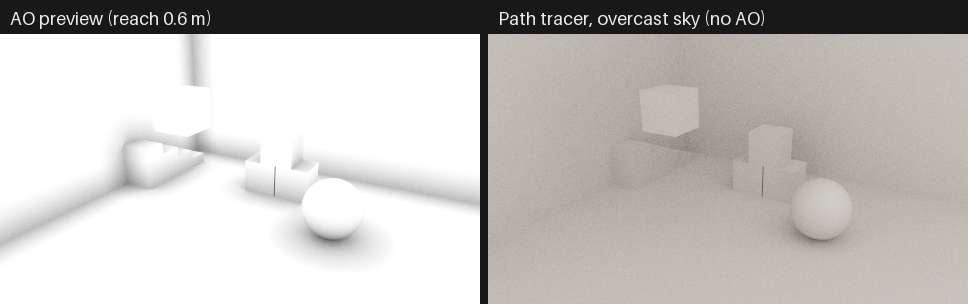
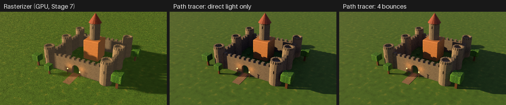
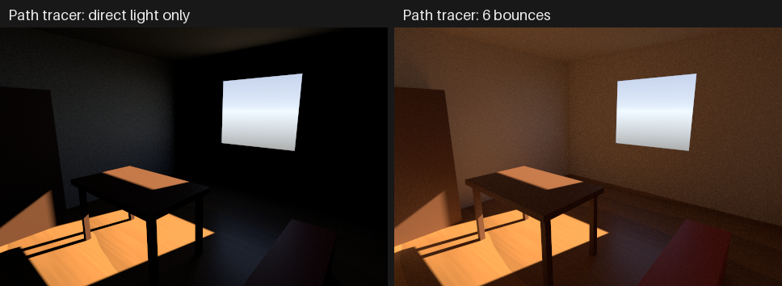
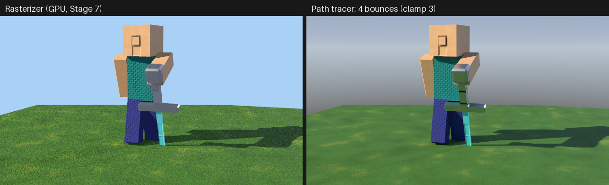
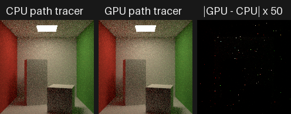
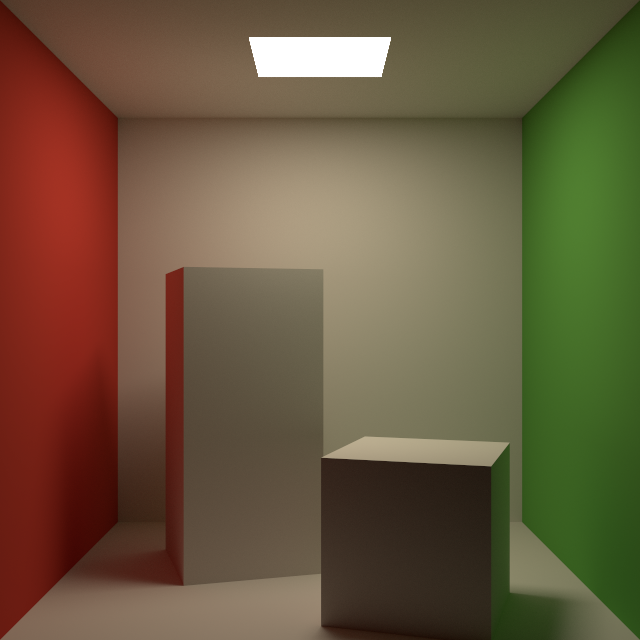
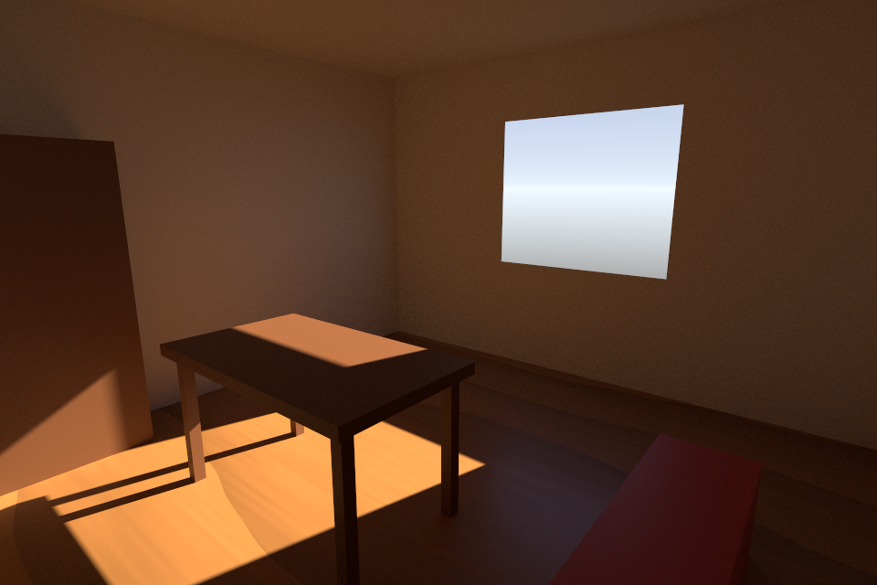
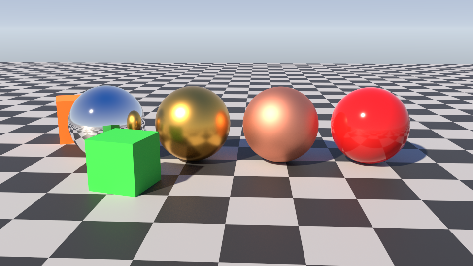
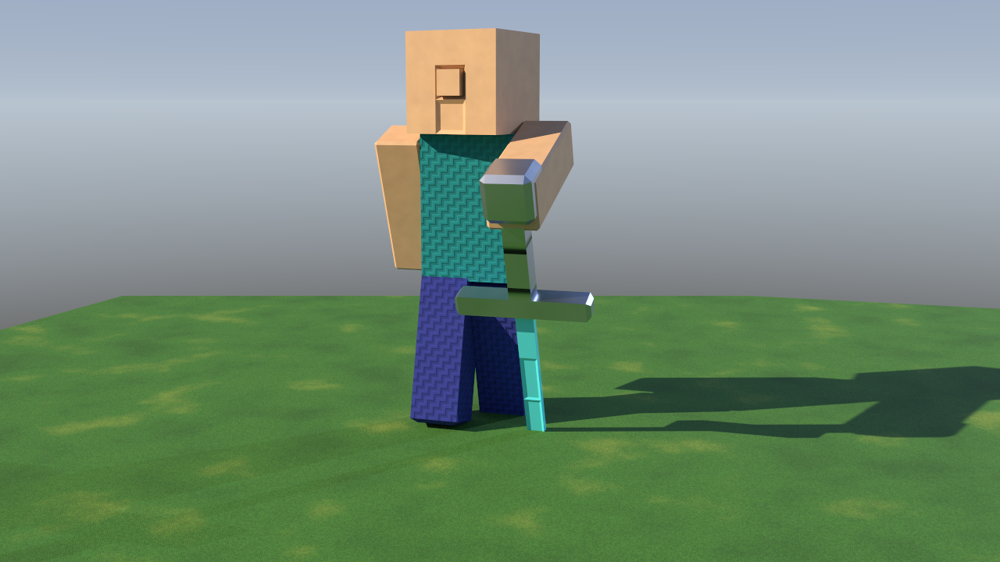

# Render quality: the path tracer

Aether3D 0.8 adds a physically based **path tracer**: `render(backend="path")`.
It traces rays through the scene's own geometry and materials. Light bounces
between surfaces (global illumination); metals reflect the scene around them;
emissive surfaces light their surroundings; shadows come from real visibility
and soften with the size of the light. Ambient occlusion is available as a
separate pass and a fast preview.

It runs **on the CPU** (`backend="path"`), in NumPy, in one process or in
several forked worker processes (Linux). Since 0.8.1 the same path tracer also
runs **on the GPU** (`backend="gpu_path"`): a wgpu compute kernel traces the
CPU path tracer's paths -- same estimator, same random numbers -- much faster
([On the GPU](#on-the-gpu-backendgpu_path)). Every render says where it ran,
in its report (`result.backend["device"]` is `"cpu"` or `"gpu"`) and in the
PNG's `Source` text chunk. The rasterizers (`"cpu"`, `"gpu"`, `"auto"`) are
unchanged and much faster still. At 640x360 with 16 samples per pixel and 4 bounces, the
textured castle takes 15.5 s on 8 processes, against 1.4 s on the CPU
rasterizer and 0.03 s on the GPU ([Performance](#performance)). The
rasterizers stay the tools for previews and interactive work; the path
tracer is for quality.


*A Cornell-box-inspired room lit only by an emissive panel
([`examples/cornell_box.py`](../examples/cornell_box.py)). The rasterizer
shows the panel glowing but cannot light anything with it. Direct light
alone leaves the ceiling black. With bounces the red and green walls tint the
white surfaces.*

- [Quick start](#quick-start)
- [What the path tracer computes](#what-the-path-tracer-computes)
- [Architecture](#architecture)
- [Rays and the BVH](#rays-and-the-bvh)
- [Materials and the BSDF](#materials-and-the-bsdf)
- [Lights, emission and the environment](#lights-emission-and-the-environment)
- [Indirect light and Russian roulette](#indirect-light-and-russian-roulette)
- [Ambient occlusion](#ambient-occlusion)
- [Sampling, noise and reproducibility](#sampling-noise-and-reproducibility)
- [Color management and output](#color-management-and-output)
- [Passes, statistics and diagnostics](#passes-statistics-and-diagnostics)
- [Python and CLI reference](#python-and-cli-reference)
- [On the GPU: `backend="gpu_path"`](#on-the-gpu-backendgpu_path)
- [Performance](#performance)
- [Showcase examples](#showcase-examples)
- [How path-traced images differ from raster images](#how-path-traced-images-differ-from-raster-images)
- [Testing and verification](#testing-and-verification)
- [Sources and licenses](#sources-and-licenses)
- [Limitations and future work](#limitations-and-future-work)

## Quick start

```python
from aether3d import Scene

scene = Scene("Studio")
floor = scene.add_plane("Floor", size=20)
floor.material = scene.create_material("Tiles", preset="stone")
ball = scene.add_sphere("Ball", radius=1.0, segments=64, rings=32, position=(0, 0, 1))
ball.material = scene.create_material("Chrome", base_color="#f0f0f0", metallic=1.0, roughness=0.05)
scene.add_directional_light("Sun", direction=(-0.4, 0.6, -1.0), intensity=2.5, angle=1.0)
scene.world.environment = {"type": "sky", "intensity": 0.8}
scene.add_camera("Camera", position=(4, -6, 3), look_at=(0, 0, 1))

result = scene.render(
    width=960,
    height=540,
    backend="path",
    path={"samples": 64, "bounces": 4, "seed": 1},
    ao={"distance": 0.5},
    tonemap="neutral",
)
result.save("studio.png")  # display image
result.save("studio.hdr")  # linear high dynamic range
print(result.backend["device"], result.backend["processes"], result.stats["rays"])
print(result.stats["noise"], sorted(result.passes))
```

The same render from the terminal:

```bash
aether3d render studio.aether --backend path --width 960 --height 540 \
    --spp 64 --bounces 4 --seed 1 --ao --ao-distance 0.5 --tonemap neutral \
    --passes studio_passes --output studio.png --json
```

## What the path tracer computes

Each pixel is the average of `samples` independent estimates of the radiance
arriving through a uniformly random point of the pixel (a box filter). An
estimate follows one path:

1. A camera ray (between the camera's `near` and `far` distances, like the
   rasterizers) finds the nearest surface.
2. At every surface the path reaches, the integrator:
   - adds the surface's emission (weighted against light sampling when the
     surface was found by a BSDF sample, see below);
   - samples the lights (next-event estimation, with shadow rays);
   - samples the BSDF for the next direction and multiplies the path's
     throughput by `f cos / pdf`.
3. A ray that leaves the scene adds the environment's radiance.
4. The path stops after `bounces + 1` surfaces, when its next direction
   would go below the surface, or by Russian roulette.

This is the standard unidirectional path tracer with next-event estimation
(Kajiya 1986; Veach 1997; Pharr, Jakob and Humphreys, *Physically Based
Rendering*). It solves the rendering equation for the supported materials and
lights, without bias apart from the documented approximations below
(clamping, if switched on, is the only intentionally biased option).

**Bounces.** `bounces=0` is direct lighting only: the first surface lit by
every light and emitter and by the sky (the latter through the BSDF sample
of that surface). Each further bounce adds light that reflected once more.
The `direct` pass holds exactly the `bounces=0` image; `indirect` holds the
rest.

## Architecture

```
scene.render(backend="path")  -> rendering/renderer.py
  extract_render_scene()       -> RenderScene (shared with the rasterizers)
  rendering/pathtrace/
    integrator.py   camera rays, the bounce loop, passes, accumulation
    scene.py        PathScene: world-space shading data, hit points, materials,
                    pass-through surfaces, shadow/AO visibility
    bsdf.py         the metallic-roughness BRDF: evaluation and sampling
    lights.py       point/directional lights (sized or not), emissive triangles
    environment.py  ambient / uniform / sky environments
    sampling.py     counter-based random numbers, sample warps, MIS
    parallel.py     tiles, rounds and forked worker processes
  rendering/raytrace/
    bvh.py          binned-SAH BVH construction
    accel.py        two-level acceleration structure, BLAS cache, traversal
```

- **Shared scene and material semantics.** The path tracer consumes the same
  `RenderScene` as the rasterizers and evaluates materials with the
  rasterizer's own `surface.evaluate_material`, so image textures, mip
  levels, procedural graphs, normal and bump maps, triplanar mapping,
  face-group materials and alpha masks mean the same thing on every backend.
- **Separate from the rasterizers.** Nothing in the CPU or GPU rasterizers
  changed for the path tracer. The new scene data (light sizes and the
  environment) is ignored by them.
- **Vectorized over rays ("wavefront").** Batches of 65,536 paths advance
  together: every step (traversal, shading, light sampling, BSDF sampling)
  is a NumPy operation over all paths still alive. This is what makes a
  Python path tracer practical: a Python loop over individual rays would be
  far slower.
- **Ready for other executors.** The BVH layout (flat arrays, children's
  boxes in the parent, leaf-ordered triangles), the counter-based random
  numbers and the tile/round work split are the same structures a compiled
  or GPU tracer needs.

### Decisions and alternatives

- **CPU first, then the GPU.** Stage 8 delivered one verified CPU
  implementation. The GPU path tracer (0.8.1) is a port of it, not a second
  design: the same estimator, constants, random numbers and scene data, with
  the GPU rasterizer's material code. Every GPU image can therefore be
  checked against the CPU's, path for path.
- **Native acceleration was considered, not added.** Profiles show
  traversal taking 58–67% of render time (the three benchmark scenes, one
  process). Compiled kernels (for example with numba, BSD-licensed) could
  make it much faster. But even infinitely fast traversal would make renders
  at most 2.4–3 times faster, and compiled kernels would add a second code
  path to verify and a large optional dependency. Left for a later stage.
- **BVH, not grids or k-d trees.** Binned-SAH BVHs build fast, adapt to
  uneven geometry (a castle's thin walls and detailed towers), work naturally
  with instancing (one BVH per mesh, one over instances) and are the structure
  hardware ray tracing uses. Brute force over all triangles is used only as a
  test reference.
- **Processes, not threads.** NumPy releases the interpreter lock only in
  parts of the work; measured thread scaling stopped below 1.5x. Forked
  processes inherit the scene and BVH for free. With 8 processes the
  benchmark renders are 2.6–4.2 times faster than with one. More processes
  did not help (most likely the memory bandwidth limits them).

## Rays and the BVH

**Camera rays** follow the rasterizers' camera conventions exactly
(`docs/RENDERING.md`): a pixel's ray passes through
`xn = (col + u) * 2/W - 1`, `yn = 1 - (row + v) * 2/H` with `(u, v)` uniform
in the pixel; perspective rays start at the eye, orthographic rays on its
image plane. They only hit geometry between `near` and `far`, like the
rasterizers' clipping.

**Bounding volume hierarchy** (`raytrace/bvh.py`). Binary BVHs are built
with the binned surface area heuristic (Wald 2007): for every node, the
primitives' centroids are binned into 16 slots along the longest axis, and the
split minimizing `area(left) x count(left) + area(right) x count(right)` is
taken. Leaves hold up to 4 triangles. Construction is vectorized level by
level, in chunks of at most 8,192 nodes (bounded memory), and deterministic.
Where all centroids coincide, the node is split at its middle. Inner nodes
store both children's boxes, so traversal never visits a child whose box the
ray misses. Object-space triangle corners and boxes are float32 — exactly the
mesh's own positions — and all arithmetic is float64.

**Instancing** (`raytrace/accel.py`). Every distinct mesh has a bottom-level
BVH in its object space; a top-level BVH spans the instances' world boxes. A
ray entering an instance is transformed by the inverse of its world matrix
(rotations, non-uniform and negative scales alike); the ray parameter `t`
is kept, so hits in different instances compare directly. Shared meshes share
one bottom-level BVH.

**Caching and invalidation.** Bottom-level BVHs are cached by the identity of
the mesh's read-only arrays, with weak references and a least-recently-used
budget (`AETHER3D_RAYTRACE_CACHE_MB`, default 1024). Re-rendering an
unchanged scene reuses them. An edited mesh, a re-evaluated procedural object
or a new import is a new array and gets a new BVH. When a mesh is freed its
BVH goes too. Arrays that could still change (writeable) are never cached.

**Traversal** is a vectorized per-ray state machine. Each iteration visits
one node per ray: at an inner node both children's boxes are tested (slab
test), the nearer hit child is visited next and the other pushed on the ray's
stack; at a leaf the triangles are tested and the stack popped. Entries
farther than the closest hit found so far are skipped. Shadow and AO rays
use the same loop and stop at the first hit.

**Triangles** use the watertight test of Woop, Benthin and Wald (JCGT 2013):
the ray is mapped onto the +z axis by an axis permutation and shear, and the
signs of three edge functions decide the hit. A ray crossing a shared edge or
vertex therefore hits at least one of the triangles that share it: no light
leaks through cracks in closed meshes. Tests are two-sided; degenerate
triangles are never hit.

**Self-intersection.** A ray leaving a surface excludes the triangle it
leaves (exact: a planar triangle cannot be hit again) and starts
`1e-9 x (1 + max |p|)` off the surface along the geometric normal, on the
side it leaves to.

## Materials and the BSDF

The path tracer uses Stage 7's metallic-roughness model
([MATERIALS.md](MATERIALS.md)) as a BRDF:

```
f(l, v) = (1 - F) c_diff / pi + F D V
c_diff  = base (1 - metallic)
F0      = 0.08 specular (1 - metallic) + base metallic
F       = F0 + (1 - F0) (1 - v.h)^5                       (Schlick)
D       = a^2 / (pi ((n.h)^2 (a^2 - 1) + 1)^2)            (GGX, a = roughness^2)
V       = 0.5 / (n.l sqrt((n.v)^2 (1 - a^2) + a^2) + n.v sqrt((n.l)^2 (1 - a^2) + a^2))
```

This is exactly the rasterizers' shading divided by pi (their light
intensities carry that factor, see below), with the same roughness floor of
0.045. A test checks that `pi f (n.l)` equals the rasterizer's light term to
1e-9.

**"simple" materials** (and object colors) with `specular = 0` are
Lambertian: `f = base / pi`. With `specular > 0` they get a dielectric GGX
lobe with `F0 = 0.08 specular` and the roughness that matches their
Blinn-Phong exponent, `a^2 = 2 / (shininess + 2)` — the same conversion the
glTF exporter writes. Blinn-Phong highlights on the rasterizers are not
energy-normalized, so their brightness differs from the path tracer's.

**Sampling.** The specular lobe is chosen with probability `p_s` (the
luminance of `F(n.v)` against the diffuse albedo, kept within `[0.1, 0.9]`
when both lobes exist; 1 for pure metals, 0 for Lambertian surfaces):

- diffuse lobe: cosine-weighted hemisphere, `pdf_d = n.l / pi`;
- specular lobe: GGX visible normals (Heitz 2018) reflected about `h`,
  `pdf_s = G1(v) D(h) / (4 n.v)`, Smith `G1`.

Every sample is weighted with the mixture density
`pdf = p_s pdf_s + (1 - p_s) pdf_d` (one-sample MIS over the lobes), so the
estimator is unbiased whichever lobe produced the direction. Tests compare
the sampled estimate of the directional albedo with a deterministic
quadrature, check that the density integrates to the probability of valid
samples, and that no material reflects more energy than it receives.

**Shading normals.** Interpolated vertex normals and normal maps tilt the
shading frame. Directions below the geometric surface carry no light (no
leaks through faceted geometry). Where the view falls below the shading
hemisphere, the geometric normal is used instead.

**Texture filtering with ray differentials.** Material evaluation needs the
change of the barycentric coordinates across one sample's footprint (it
selects mip levels and filters procedural textures):
- camera rays carry ray differentials (Igehy 1999) for one pixel step,
  scaled by `1 / sqrt(samples)` (many samples resolve detail finer than a
  pixel, as in pbrt), and transferred to the hit's plane;
- later rays carry a ray cone (Akenine-Möller et al. 2019) whose width grows
  with distance by a spread angle, widened at each bounce by `2 a` for the
  specular lobe and by 1 radian for the diffuse lobe.

Indirect light therefore samples coarse mip levels, which is faster and
avoids noise from texture detail that bounced light cannot resolve.

**Not modelled** (documented, not faked):
- transmission and refraction: every material reflects, there is no glass;
- occlusion maps (`occlusion` texture slot) are ignored, because the path
  tracer computes occlusion from geometry.

**Pass-through surfaces.** Rays continue through texels an alpha mask cuts
out and through the backs of single-sided materials (both invisible on the
rasterizers too). Shadow and AO rays do the same, so a cut-out leaf casts a
leaf-shaped shadow. Camera rays also skip the faces removed by `cull`; later
rays see both sides of double-sided surfaces. A ray gives up after 256 such
surfaces (reported as `PASS_THROUGH_LIMIT`).

## Lights, emission and the environment

**Units.** On the rasterizers, a white light of intensity `I` facing a white
Lambertian surface makes it appear with radiance `I` (their `E (n.l)` term).
With the BRDF `base / pi` that corresponds to an irradiance of `pi c I` for
directional lights and a radiant intensity of `pi c I` for point lights. The
path tracer uses exactly that, so directly lit diffuse surfaces have the same
radiance on every backend. Point lights keep their `falloff` (`1/d^2` or
none) and `range` window (`clamp(1 - (d/range)^4, 0, 1)^2`).

**Next-event estimation.** At every path vertex, every light gets
`light_samples` shadow rays:

| Light | Sampled direction | Contribution of one sample |
|---|---|---|
| directional, `angle = 0` | toward the light | `f cos x pi c I` |
| directional, `angle > 0` | uniform in the cone of half-angle `a = angle/2` | `f cos x pi c I x 2 / (1 + cos a)` |
| point, `radius = 0` | toward the light (shadow ray up to it) | `f cos x E` |
| point, `radius > 0` | uniform in the cone the sphere subtends, `sin a = radius / d` (shadow ray up to the sphere) | `f cos x E x 2 (1 - cos a) / sin^2 a` |

Here `E = pi c I x falloff(d) x window(d)` at the center distance `d`; a
sized light's samples are also multiplied by their MIS weight (below). A
sized light is a disk (sun) or sphere of uniform radiance chosen so that a
surface facing it receives exactly the irradiance of the unsized light:
`pi L sin^2 a` with `L = c I / sin^2 a` (sun) or `L = E / (pi sin^2 a)`
(sphere). Sizing a light therefore softens its shadows and keeps the light it
gives surfaces facing it; on other surfaces the cosine is averaged over the
light's extent.

**Sized lights are also found by BSDF sampling.** A ray the BSDF samples
that leaves the scene inside a sun's cone, or enters a light's sphere before
any surface, sees the light's radiance (`c I / sin^2 a`, or the sphere's).
Light sampling and BSDF sampling are then weighted with the power heuristic
(densities `1 / Omega`, `Omega = 2 pi (1 - cos a)` the cone's solid angle,
and the BSDF's), so each light is counted once.
- **Mirror-like surfaces** reflect a sun or a lamp cleanly: their BSDF
  samples find it and get the weight.
- **Diffuse surfaces** are lit smoothly: there, light sampling gets the
  weight.

Tests check both: a mirror shows a sun disk and a sphere light at their
radiance, with no fireflies, and a sun disk still gives a plane its exact
irradiance (within the noise).
Lights without size can only be sampled (no ray can hit a point or a
parallel beam) and need no weights. Camera rays do not see lights, only
their reflections do.

**Emissive surfaces are area lights.** A material's `emissive x
emissive_strength` is radiance leaving the front face (and the back face of
double-sided materials). The camera sees it exactly as on the rasterizers;
unlike them, it lights the scene:
- next-event estimation picks one emissive triangle per sample with
  probability proportional to its power (area x luminance of the emissive
  factor, doubled when double-sided), then a uniform point on it, with
  solid-angle density `p = P(triangle) / area x d^2 / |cos theta_light|`;
- textured and alpha-masked emission is evaluated at the sampled point;
- rays the BSDF sends toward an emitter find it too, so both strategies are
  weighted with Veach's power heuristic. Every emitter is counted exactly
  once: the analytic room test checks the bounce series to within 5 standard
  errors.

**The environment** (`scene.world.environment`, saved in projects since
format 5) is the radiance of rays that leave the scene:

| `type` | Radiance | Camera rays that miss |
|---|---|---|
| `"ambient"` (default) | uniform: the world's ambient light, `ambient_color x ambient_intensity` (linear) | show `world.background`, as on the rasterizers |
| `"uniform"` | `color x intensity`, everywhere | see the environment |
| `"sky"` | above the horizon `mix(horizon, zenith, sqrt(z))`, below it `mix(horizon, ground, min(1, 4 abs(z)))`, times `intensity` (`z`: the direction's up component) | see the environment |

The default `"ambient"` environment is the physical reading of the
rasterizers' ambient term: a white Lambertian surface open to the whole sky
reflects exactly that ambient light. Existing scenes keep their look on the
rasterizers and get matching sky light in the path tracer. The environment
is reached by BSDF sampling (it is not sampled as a light), which suits these
smooth, low-contrast environments; a sun is a directional light with an
`angle`. High-dynamic-range environment images are not supported (see
[Limitations](#limitations-and-future-work)).

```python
scene.world.environment = {
    "type": "sky",
    "zenith_color": "#2f63b8",
    "horizon_color": "#d6e2ee",
    "intensity": 0.9,
}
scene.add_directional_light("Sun", direction=(0.5, 0.6, -0.7), intensity=2.6, angle=0.53)
scene.add_point_light("Lamp", position=(0, 0, 3), intensity=5, radius=0.2)
```

## Indirect light and Russian roulette

After the light sampling, the BSDF sample sets the next ray. From vertex
`russian_roulette` on (default 3), a path continues with probability
`q = clamp(max(throughput), 0.05, 1)` and divides its throughput by `q`:
dim paths stop early, survivors carry their weight, and the expected value
is unchanged. `bounces` is a hard limit on top.

`clamp > 0` caps the indirect radiance one sample may carry (scaling it
down, hue preserved). It removes rare very bright samples ("fireflies") at
the cost of losing some energy (bias). It is off by default.

## Ambient occlusion

AO answers a geometric question: which fraction of the hemisphere above a
surface point is blocked by geometry within a reach? With `ao=` the path
tracer computes, at the surface every camera sample sees:

```
ao = 1 - strength x occlusion,   occlusion = (blocked AO rays) / samples
```

AO rays are cosine-weighted about the geometric normal and reach `distance`
scene units. Geometry farther away does not occlude. A point on an open floor
gets exactly 1. A point at the foot of a tall wall gets 0.5, the half of the
cosine lobe the wall covers. The analytic test checks the whole curve
`1 - (acos c - c sqrt(1 - c^2)) / pi` with `c = x / distance` at distance `x`
from the wall.

- **A pass, never applied to the image.** AO is an artistic approximation.
  The path tracer already darkens corners physically, because less light
  reaches them, so multiplying AO into its image would darken them twice. AO
  is returned as the `ao` pass (`result.passes["ao"]`, `--passes`) and the
  image is unaffected.
- **A fast preview.** `path={"integrator": "ao"}` (CLI `--ao-only`) traces
  only camera and AO rays, no bounces or shadow rays, and makes the AO the
  image. It gives a quick look at form and contact without running the path
  tracer.



*[`examples/ao_contact.py`](../examples/ao_contact.py): the AO preview
(reach 0.6 m) beside the path tracer under a uniform sky. Both show the
darkening in corners and contacts; the path tracer derives it from light
transport.*

## Sampling, noise and reproducibility

- **Random numbers** are counter-based: each one is a SplitMix64 hash
  (Steele, Lea and Flood 2014) of `(seed, pixel, sample, dimension)`.
  Dimensions are fixed per path vertex and purpose (pixel position, lobe
  choice, BSDF direction, Russian roulette, AO rays, each light sample).
  Nothing depends on how paths are batched, ordered or spread over
  processes.
- **Reproducible renders.** Per pixel, samples are summed in sample order.
  The same scene, settings and seed give the same image bit for bit on a
  given platform — whatever `workers` is. Tests check this across batch
  sizes and worker counts.
- **Across platforms**, math libraries round some functions differently in
  the last bit, and the path tracer keeps those differences from changing
  which directions the random numbers sample. For example, a wall rotated by
  90 degrees has a normal whose vertical component is a rounding residue:
  +2e-16 on Linux and macOS, -2e-16 on Windows. The sampling frame does not
  depend on its sign (a test checks this), so images agree to rounding.
  - CI renders the same small image on Linux, macOS and Windows and
    compares it with a stored reference.
  - One case remains: a ray that meets exactly the seam between two
    separate meshes may hit one of them on one platform and slip between
    them on another. Sampled rays practically never do, but a symmetric
    camera can aim pixel centers there. This affects only the pixel-center
    `depth` and `object_index` maps.
- **Noise** falls as `1 / sqrt(samples)` (a test checks the convergence
  rate). The `variance` pass is the unbiased variance of each pixel's mean,
  per channel. `stats["noise"]` summarizes it: `mean_standard_error` and
  `mean_relative_error` of the luminance over lit pixels.
- **Guidance.**
  - Small bright emitters and very smooth surfaces next to them converge
    slowest: raise `samples`, or `light_samples` for many lights.
  - Interiors lit through small openings converge slowly: most of their
    light arrives by bouncing off a small sunlit patch, which paths find only
    rarely. Expect to need several hundred samples (the window room showcase
    uses 512).
  - Rough metals converge quickly.
  - Fireflies from caustic-like paths (light reflected by a mirror onto a
    diffuse surface) are a property of the estimator; `clamp` trades them for
    a small bias.
  - Nothing filters or denoises the image: what you see is the estimator.
- **Progress and stopping.** `progress=callable` is called after every
  completed sample pass as `progress(done, total, seconds)`. Returning
  `False` stops the render there: the image averages the passes done
  (`sample_count` tells) and a `RENDER_STOPPED` diagnostic says so. A time
  budget is a callback that checks `seconds`.

## Color management and output

Transport is computed in linear floating-point radiance (linear sRGB
primaries). Colors you give (materials, lights, environment) are display
(sRGB) colors converted to linear first, as everywhere in Aether3D. The
output stage, shared by all backends:

1. multiplies by `2 ** exposure`;
2. applies `tonemap`:
   - `"none"` (default) clips to `[0, 1]` — every legacy render is unchanged;
   - `"neutral"` is the Khronos PBR Neutral tone mapper. It lowers every
     color by up to 0.04 (exactly 0.04 once its smallest channel reaches
     0.08: the 4% Fresnel reflection a PBR surface adds under white light, so
     base colors display as authored; black stays black). Colors whose
     largest channel then stays below 0.76 are otherwise kept, and brighter
     ones are compressed smoothly toward white, so lights and bright skies
     keep their shape instead of clipping;
3. encodes with the sRGB transfer function and quantizes to 8 bits.

When to tone map: `"neutral"` suits scenes with very bright parts in view
(lit products, light sources, sunlit highlights next to dark surfaces). Its
offset darkens dim tones noticeably, so dim interiors and scenes lit by
bounce light usually look better with `"none"` and a suitable `exposure`;
the showcase images use `"none"`.

`result.color` reports the working space, exposure, tone mapper and encoding.
`result.linear` holds the image after exposure and before tone mapping, and
`result.save("image.hdr")` (Radiance RGBE) or `"image.pfm"` (float32) writes
it without clipping. RGBE stores each channel to within 1/128 of the pixel's
largest channel. PFM is exact. Passes are scene-referred: before exposure.

## Passes, statistics and diagnostics

`result.passes` (path tracer only; `aether3d render --passes DIR` writes them
as `.pfm` files):

| Pass | Contents |
|---|---|
| `beauty` | the image (before exposure): `direct + indirect` |
| `direct` | light reaching the camera after at most one surface (emission seen directly, every light and emitter at the first surface, the sky through its BSDF ray) |
| `indirect` | everything else: light that bounced at least once more |
| `albedo` | directional albedo at the first surface: `c_diff (1 - F(n.v)) + F(n.v)` |
| `normal` | shading normal at the first surface (world space, facing the camera), averaged over samples |
| `depth` | view depth through the pixel center (`inf`: nothing) |
| `ao` | ambient occlusion (with `ao=`) |
| `sample_count` | samples averaged per pixel |
| `variance` | variance of each pixel's mean, per channel |

`result.depth`, `result.object_index` come from a ray through each pixel
center (as the raster's center sample). `result.coverage` is the fraction of
camera samples that hit geometry.

`result.stats` holds the following:
- `camera_rays`, `bounce_rays`, `shadow_rays`, `ao_rays`, `center_rays`,
  `pass_through_rays`, `rays` and `rays_per_second`;
- `paths` and `samples_per_pixel`;
- the triangle, instance, light and emissive-triangle counts;
- `noise`;
- `timings`: extraction, BVH, the tracing wall time and the CPU seconds of
  its stages (camera rays, shading, light sampling, bounces, AO), summed over
  worker processes, the center pass and output encoding.

`result.backend` holds the following:
- the settings, `samples_rendered`, `processes` and why that many;
- `bvh` (nodes, depth, bytes, bottom-level BVHs built and reused, build
  times);
- the lights (count, sized lights, emissive triangles) and the environment;
- the work estimate checked against the limits.

## Python and CLI reference

`scene.render(backend="path", ...)` takes the usual `camera`, `width`,
`height`, `exposure`, `cull`, `default_lights`, `frame` and `limits`, plus:

- `path` — `PathSettings` or a dict:

  | Field | Default | Meaning |
  |---|---|---|
  | `samples` | 16 | paths per pixel (1 – 1,000,000) |
  | `bounces` | 4 | indirect bounces (0 = direct light only, at most 64) |
  | `seed` | 0 | random seed |
  | `light_samples` | 1 | shadow rays per light (and per emitter sample) per vertex |
  | `russian_roulette` | 3 | first path vertex (0: the surface the camera sees) where dim paths may stop |
  | `clamp` | 0 | indirect radiance cap per sample (0 = off) |
  | `integrator` | `"path"` | `"ao"`: the AO preview |
  | `workers` | 0 | processes: 0 = one per CPU (up to 8) for big renders, 1 = this process |

- `ao` — `True`, `AOSettings` or a dict: `samples` (4, per camera sample),
  `distance` (1), `strength` (1).
- `tonemap` — `"none"` or `"neutral"` (any backend).
- `progress` — `progress(done, total, seconds)`; return `False` to stop.

`samples=` (raster antialiasing), `msaa`, `supersample`, `adapter` and
`shadows` do not apply to the path tracer and are rejected with a hint.
`path`, `ao` and `progress` are rejected for the other backends.

CLI (`aether3d render ... --backend path`):
- path settings: `--spp`, `--bounces`, `--seed`, `--light-samples`,
  `--russian-roulette`, `--clamp`, `--workers`;
- AO: `--ao`, `--ao-only`, `--ao-samples`, `--ao-distance`, `--ao-strength`;
- output: `--tonemap`, `--passes DIR` and `-o image.png|.hdr|.pfm`.

Scene data: `aether3d light add|set --radius R --angle DEG`, and `aether3d
scene set --environment ambient|uniform|sky --environment-color
--environment-intensity --sky-zenith --sky-horizon --sky-ground`. Scene
scripts accept `radius`, `angle` and `environment` in `add_light`,
`set_light` and `set_world`.

**Limits** (`RenderLimits`): `max_path_rays` (default 10^11) bounds an upper
estimate of the rays a render may trace (paths x (bounces + 2) plus shadow
and AO rays), and `max_path_memory` (default 8 GiB) bounds an estimate of its
host memory:
- pixel buffers: about 200 bytes per pixel;
- shading data and the BVH: about 250 bytes per triangle;
- one batch of paths per process: about 1.5 kB per path.

Oversized requests fail with `RESOURCE_LIMIT` before any work is done.
`max_dimension` and `max_triangles` apply as on the rasterizers.

## On the GPU: `backend="gpu_path"`

Since 0.8.1 the path tracer also runs on a GPU adapter:

```python
result = scene.render(backend="gpu_path", path={"samples": 1024, "bounces": 6})
result.backend["device"], result.backend["adapter"]["name"]  # "gpu", "NVIDIA GeForce ..."
```

```console
$ aether3d render castle.aether -o castle.png --backend gpu_path --spp 512 --bounces 4
```

It takes the same `path`, `ao`, `progress`, `tonemap` and `limits` options as
`backend="path"` (except `workers`), and `adapter` selects the GPU as for
`backend="gpu"` ([GPU.md](GPU.md)). Without a usable adapter it fails with
a `GPU_*` error; it never falls back to the CPU silently. `backend="path"`
is the fallback you choose.

**What runs where.**
- **On the CPU, as for `backend="path"`:** the scene preparation
  (`PathScene`: the two-level BVH with its BLAS cache, the emitter table,
  the environment model) and the GPU rasterizer's material packing and texel
  pool.
- **In one compute kernel:** everything per path
  (`rendering/gpu/wgsl/pathtrace.wgsl`):
  - camera rays with differentials;
  - BVH traversal and watertight ray/triangle tests;
  - materials (`material.wgsl`'s `evaluate_surface`, the GPU rasterizer's
    own code: textures, procedural graphs, normal maps, triplanar mapping,
    face groups, cut-outs);
  - the BSDF and its sampling;
  - next-event estimation of lights and emitters with MIS;
  - sized lights, the environment, Russian roulette, the clamp;
  - AO and the pixel-center pass.

  Each invocation traces whole paths for one pixel and adds them to that
  pixel's float32 sums. The sums are read back once, and the passes and
  statistics are computed as on the CPU.
- **On the RTX 4060 of the development machine,** the kernel runs on the
  shader cores through Vulkan. Traversal is software; the RT cores are not
  used.

**The same paths as the CPU.** The kernel draws exactly the CPU path
tracer's random numbers: SplitMix64 computed in pairs of 32-bit integers,
with the same slots per decision. A test checks every bit a float32 keeps.
With the same scene, settings and seed, both backends therefore trace the
same paths, and their images differ by float32 rounding:
- **Most pixels** agree to about 1e-5 (the Cornell box: median relative
  difference 7e-6).
- **A few paths change** when rounding flips a discrete decision: a ray
  grazing an edge, a Russian-roulette draw within 2^-24 of its threshold, a
  texel at the alpha cutoff. That pixel then differs like a different
  sample.
- **Procedural textures** evaluate in float32 on the GPU and in float64 on
  the CPU, so textured scenes differ a little more (the castle: median 6e-4,
  image means equal to 0.02%).

`gpu_path_vs_cpu.png` below shows one such comparison.

Feature parity with `backend="path"`:

| | GPU path tracer |
|---|---|
| Estimator, BSDF, lights, MIS, sized lights, emitters, environment, RR, clamp | the CPU's, step for step |
| Materials and textures | the same data, evaluated by the GPU rasterizer's code (float32) |
| Passes, statistics, noise estimate, `progress` and stopping | the same |
| AO pass and AO preview | the same |
| Reproducibility | bit for bit on one device and driver, however the image is tiled |
| `workers` | not applicable (rejected) |
| Float32 margins | rays leave surfaces 256 float steps off them (CPU: 1e-9 relative); shadow rays stop 1e-4 short of a point on an emitter (CPU: 1e-7); a normal counts as horizontal for the sampling frame when its z is within 1e-5 (CPU: 1e-12) |

**Limits.**
- **GPU memory:** the kernel keeps 22 float32 sums per pixel (1920x1080:
  183 MB), plus a copy to read them back. `RenderLimits.max_gpu_memory`
  bounds the total, and each buffer must fit the device's binding limit:
  2 GiB on the RTX 4060, 128 MiB on lavapipe (about 1.5 megapixels).
- **BVH depth:** traversal keeps 64 entries per ray; scenes whose BVH
  needs more fail with `GPU_LIMIT_EXCEEDED` (use `backend="path"`).
- **Work per dispatch:** samples are dispatched in tiles of at most 512x512
  pixels and about a million pixel-samples, which keeps every dispatch short.
- **Graphics APIs:** tested on Vulkan (the RTX 4060 and lavapipe, locally and
  in CI) and Metal (the paravirtual device of GitHub's macOS runners).
- **Direct3D 12 needs DXC, and WARP is refused.** This is what was measured on
  GitHub's Windows runners, with Microsoft WARP (Direct3D 12 in software):
  - FXC, Direct3D 12's default shader compiler, took about 13 minutes
    (725-772 s) to compile the kernel. FXC took 51 s without BVH traversal and
    102 s without material evaluation, so the time comes from the two together.
  - FXC's code crashed WARP (heap corruption) at the first dispatch.
  - With DXC the kernel compiled in 12 s and ran: the random-number test
    passed. But WARP did not finish the next test, a 24x24 Cornell box, in 36
    minutes.

  So the path tracer needs DXC on Direct3D 12 (`AETHER3D_GPU_DXC`: the path of
  `dxcompiler.dll`, from the Windows SDK or a DirectX Shader Compiler release),
  and refuses WARP. A refused adapter fails at once with
  `GPU_FEATURE_UNSUPPORTED` and the reason. With `adapter="auto"`, only
  adapters that can run the path tracer are considered: a Windows GPU is then
  used through Vulkan, while the rasterizers keep Direct3D 12. Direct3D 12 on
  hardware, with DXC, has not been tested.
- **Compiling the kernel:** once per process and device. Vulkan and Metal take
  about a second, DXC 12 s. A compile over a minute is reported as
  `SLOW_SHADER_COMPILE`.

**Performance.** These measurements are one run each, on the RTX 4060
Laptop GPU, with the device already created:

| Scene (showcase settings) | Size | spp | Bounces | GPU | CPU, 8 processes | Speed-up | Rays | GPU M rays/s |
|---|---|---|---|---|---|---|---|---|
| Cornell | 640x640 | 256 | 8 | 9.7 s | 9.5 min | 58x | 616 M | 64 |
| Metals | 960x540 | 128 | 4 | 3.0 s | 3.3 min | 65x | 191 M | 66 |
| Window room | 960x640 | 512 | 6 | 43.3 s | 40.0 min | 56x | 1,905 M | 44 |
| Castle | 1920x1080 | 64 | 4 | 18.2 s | 15.6 min | 51x | 580 M | 33 |
| Hero | 1280x720 | 64 | 4 | 2.6 s | 2.4 min | 55x | 159 M | 67 |

Both columns trace the same paths: the GPU's ray counts equal the CPU's to
within 0.001% (the few paths float32 rounding changes). The CPU times are
those of the showcase renders below
(their JSON records); `benchmarks/bench_gpu_pathtrace.py` re-renders only on
the GPU.

- **51 to 65 times the CPU's eight processes** on these scenes.
- **Traversal is fast and shading dominates:**
  - camera and AO rays alone (the castle, AO preview) run at
    228 M rays/s;
  - full paths run at 33-67 M rays/s;
  - the textured castle is the slowest, because its procedural materials
    (noise, fbm and voronoi for several texture slots and projections) are
    evaluated at every hit, as on the rasterizer.
- **Where it could go faster:** a wavefront design (one kernel per stage,
  sorting by material) would trade the single state-machine kernel's
  divergence and register pressure for more passes. It is not implemented.

## Performance

Measured with [`benchmarks/bench_pathtrace.py`](../benchmarks/bench_pathtrace.py)
and [`benchmarks/bench_raytrace.py`](../benchmarks/bench_raytrace.py), one
run each, on the development machine:
- an Intel Core i9-12900H laptop CPU (20 threads), Linux;
- Python 3.14, NumPy 2.5;
- its RTX 4060 Laptop GPU for the GPU column.

Nothing is extrapolated. Times are wall-clock for one render with the
scene's BVH already cached.

**Renders.** All use 16 samples per pixel; `b` is the number of bounces. The
CPU rasterizer renders with its default 2x2 supersampling; the GPU time is
for a warm device. `workers=0` (the default) chose 8 processes, except for
the smallest sphere render, which it kept in one process (too little work to
gain from more).

| Scene | Size | b | 1 process | `workers=0` | Speed-up | M rays/s (`workers=0`) | CPU raster | GPU raster |
|---|---|---|---|---|---|---|---|---|
| Room (Cornell-like, 14 triangles) | 320x180 | 0 | 5.09 s | 1.62 s | 3.1x | 1.67 | | |
| | 320x180 | 4 | 10.96 s | 3.30 s | 3.3x | 1.62 | 0.040 s | 0.0025 s |
| | 640x360 | 0 | 19.66 s | 7.58 s | 2.6x | 1.41 | | |
| | 640x360 | 4 | 42.23 s | 15.01 s | 2.8x | 1.41 | 0.148 s | 0.0088 s |
| Sphere (100k triangles, chrome) | 320x180 | 0 | 1.76 s | (1 process) | | 0.83 | | |
| | 320x180 | 4 | 2.29 s | 0.54 s | 4.2x | 3.02 | 0.052 s | 0.0050 s |
| | 640x360 | 0 | 6.08 s | 1.98 s | 3.1x | 3.22 | | |
| | 640x360 | 4 | 7.25 s | 2.05 s | 3.5x | 3.14 | 0.120 s | 0.0099 s |
| Castle (textured, procedural) | 320x180 | 0 | 9.98 s | 2.79 s | 3.6x | 0.78 | | |
| | 320x180 | 4 | 15.92 s | 4.06 s | 3.9x | 0.69 | 0.380 s | 0.017 s |
| | 640x360 | 0 | 37.00 s | 11.10 s | 3.3x | 0.77 | | |
| | 640x360 | 4 | 58.68 s | 15.50 s | 3.8x | 0.72 | 1.43 s | 0.030 s |

What this shows:
- **The cost of quality.** At these settings, path tracing takes 10 to 100
  times as long as the CPU rasterizer and 100 to 1,700 times as long as the
  GPU. More samples or pixels cost proportionally more: the showcase images
  take minutes (see [Showcase examples](#showcase-examples)).
- **One process** traces 0.17–0.97 million rays per second. The textured
  castle is the slowest: it has more geometry to traverse, and its
  procedural materials are evaluated at every surface hit.
- **Processes.** 8 processes are 2.6–4.2 times faster than one. More do not
  help: the castle at 640x360 with 4 bounces took 18.4 s with 4 processes,
  15.3 s with 8, 16.1 s with 12 and 17.1 s with 16. The limit is most likely
  memory bandwidth: NumPy streams whole arrays through memory at every step.
- **Where the time goes.** Under a profiler (one process, 320x180, 8
  samples, 4 bounces), BVH traversal takes 58% of the room's time, 67% of the
  sphere's and 63% of the castle's. The rest is material evaluation, BSDF
  sampling, light sampling and bookkeeping.
- **Memory.** The peak Python memory of a one-process 320x180 render with
  4 bounces was 151 MiB (room), 106 MiB (sphere) and 140 MiB (castle).
  Each worker process also holds one batch of up to 65,536 paths (estimated
  at about 100 MB) and shares the scene and the BVH with the main process.

**Building blocks** (one process): BSDF evaluation 4.0 million per second,
BSDF sampling 2.5 million, emitter sampling 4.2 million, and the castle's
material evaluation (textures and procedural graphs) 0.29 million.

**Ray tracing core** (single-threaded; rays per second for the closest hit
and any hit, from a pinhole camera at 320x240 and in random directions from
surface points, like diffuse bounces):

| Scene | Triangles | BVH build | Rebuild (cached) | Depth | Memory | Build peak | Camera rays | Bounce rays |
|---|---|---|---|---|---|---|---|---|
| Sphere | 960 | 0.009 s | 0.0002 s | 10 | 0.1 MiB | < 1 MiB | 0.48 / 0.48 M/s | 0.22 / 0.22 M/s |
| Sphere | 99,224 | 0.25 s | 0.003 s | 18 | 9.4 MiB | 34 MiB | 0.31 / 0.32 M/s | 0.11 / 0.11 M/s |
| Sphere | 998,000 | 3.35 s | 0.022 s | 23 | 94.6 MiB | 189 MiB | 0.25 / 0.26 M/s | 0.074 / 0.076 M/s |
| 400 instances of a cube | 12 (4,800 instanced) | 0.041 s | 0.008 s | 8 | < 0.1 MiB | < 1 MiB | 0.44 / 0.49 M/s | 0.46 / 0.51 M/s |

"Rebuild (cached)" is a second build of the same scene: the bottom-level
BVHs come from the cache and only the top level is rebuilt. The structure
costs about 100 bytes per triangle. Traversal slows only gradually with
size: a thousand times more triangles halves the speed of camera rays and
divides that of bounce rays by three.

## Showcase examples

Every image below is rendered by Aether3D's own code from a programmatically
built scene. No external renderer or image editor is involved. Each script
checks what its images must show and writes a JSON record of every render
(backend, device, processes, samples, bounces, clamp, seed, rays, noise,
time) next to them. `--quick` renders small versions in seconds (CI runs them).

| Script | What it shows | What it checks |
|---|---|---|
| [`cornell_box.py`](../examples/cornell_box.py) | A Cornell-box-inspired room lit only by an emissive panel (top of this page) | the red and green walls tint the bounce light; the ceiling is lit only by bounces |
| [`metal_spheres.py`](../examples/metal_spheres.py) | Chrome, satin gold, rough copper and glossy plastic ([MATERIALS.md](MATERIALS.md#in-the-path-tracer)) | a nearby block appears in the chrome sphere only with bounces |
| [`window_room.py`](../examples/window_room.py) | A room lit by sunlight through its window | the walls the sun cannot reach are lit only by bounces |
| [`ao_contact.py`](../examples/ao_contact.py) | The AO preview beside an overcast path trace ([Ambient occlusion](#ambient-occlusion)) | contacts are darker; geometry beyond the reach does not occlude |
| [`castle_path_render.py`](../examples/castle_path_render.py) | The textured castle at golden hour (README) | bounced light brightens the darkest quarter of the image |
| [`hero_path_render.py`](../examples/hero_path_render.py) | The blocky hero under a sun and a sky | every part is visible, and nothing is reported |

**Render times** at the default settings. Each was one run on the
development machine: an Intel Core i9-12900H laptop CPU with 8 worker
processes, Linux, and its RTX 4060 Laptop GPU for the rasterizer images. The
times come from the JSON records. "Noise" is the mean relative standard error
of a pixel, estimated from the variance of its samples.

| Image | Size | Renderer | spp | Rays | M rays/s | Noise | Time |
|---|---|---|---|---|---|---|---|
| cornell_raster.png | 640x640 | GPU rasterizer (NVIDIA GeForce RTX 4060 Laptop GPU) |  |  |  |  | 0.9 s |
| cornell_direct.png | 640x640 | path tracer (CPU, 8 processes), 0 bounces | 256 | 286 M | 1.00 | 2.7% | 4.8 min |
| cornell_path.png | 640x640 | path tracer (CPU, 8 processes), 8 bounces | 256 | 616 M | 1.09 | 4.5% | 9.5 min |
| metals_raster.png | 960x540 | GPU rasterizer (NVIDIA GeForce RTX 4060 Laptop GPU) |  |  |  |  | 0.8 s |
| metals_direct.png | 960x540 | path tracer (CPU, 8 processes), 0 bounces | 128 | 164 M | 1.01 | 2.0% | 2.7 min |
| metals_path.png | 960x540 | path tracer (CPU, 8 processes), 4 bounces, clamp 3 | 128 | 191 M | 0.97 | 2.0% | 3.3 min |
| window_direct.png | 960x640 | path tracer (CPU, 8 processes), 0 bounces | 512 | 799 M | 0.74 | 18.7% | 18.0 min |
| window_path.png | 960x640 | path tracer (CPU, 8 processes), 6 bounces | 512 | 1,905 M | 0.79 | 10.3% | 40.0 min |
| ao_preview.png | 960x540 | path tracer (CPU, 8 processes), AO only | 64 | 166 M | 1.80 | 0.6% | 1.6 min |
| ao_overcast.png | 960x540 | path tracer (CPU, 8 processes), 4 bounces | 64 | 99 M | 1.04 | 5.0% | 1.6 min |
| castle_path.png | 1920x1080 | path tracer (CPU, 8 processes), 4 bounces | 64 | 580 M | 0.62 | 6.0% | 15.6 min |
| (castle_raster_half) | 960x540 | GPU rasterizer (NVIDIA GeForce RTX 4060 Laptop GPU) |  |  |  |  | 0.9 s |
| (castle_direct_half) | 960x540 | path tracer (CPU, 8 processes), 0 bounces | 32 | 61 M | 0.62 | 9.6% | 1.7 min |
| (castle_path_half) | 960x540 | path tracer (CPU, 8 processes), 4 bounces | 32 | 73 M | 0.64 | 8.6% | 1.9 min |
| hero_path.png | 1280x720 | path tracer (CPU, 8 processes), 4 bounces, clamp 3 | 64 | 159 M | 1.13 | 1.6% | 2.4 min |
| (hero_raster_half) | 640x360 | GPU rasterizer (NVIDIA GeForce RTX 4060 Laptop GPU) |  |  |  |  | 0.8 s |

Rows in parentheses are the half-size renders of the comparison strips. The
GPU rasterizer times include starting the GPU in a fresh process (device,
pipelines and uploads); a warm GPU renders these scenes in milliseconds
([GPU.md](GPU.md)).

Two of these renders need more than samples:
- **Caustics are clamped.** The chrome sphere and the hero's sword hilt
  reflect the sun onto diffuse surfaces. A unidirectional path tracer finds
  these light paths only rarely, so they appear as isolated bright speckles.
  Those two renders clamp indirect light at 3 per sample (`clamp=3`), which
  removes the speckles at the price of a small, documented bias.
- **The window room needs 512 samples per pixel.** Most of that room is lit
  by light from the small sunlit patch on the floor, which a path from a wall
  finds only rarely. At 128 samples the walls were visibly grainy (18% mean
  relative noise; 10% at 512).



*[`examples/castle_path_render.py`](../examples/castle_path_render.py), at
half size. The rasterizer (Stage 7, GPU shadow maps) cannot use the sky or
the sun's size: it keeps a flat ambient term and hard shadows. With direct
light only, the path tracer lights the castle with the low sun (soft shadow
edges), the sky and the two torches by the gate. Bounced light then
brightens the shaded walls and the courtyard: +23% on the darkest quarter of
the image, +3% over the whole image (the example checks it).*



*[`examples/window_room.py`](../examples/window_room.py): a closed room lit
through its window by a low sun and the sky. With direct light only, the sun
reaches a patch of the floor and the table, and the sky seen through the
window dimly lights the walls that can see it; the rest stays dark. With 6 bounces, light from
the sunlit floor fills the room. The example measures the linear radiance:
the front wall goes from 0.0005 to 0.039, the ceiling from 0.006 to 0.048.*



*[`examples/hero_path_render.py`](../examples/hero_path_render.py): the
Stage 7 hero on the GPU rasterizer (shadow maps, a flat ambient term, the
background color) and path traced with 4 bounces (indirect light clamped at
3). In the path-traced image the sky lights the shaded sides, and the
polished hilt reflects the grass and the sky.*

### On the GPU

[`examples/gpu_path_showcase.py`](../examples/gpu_path_showcase.py) renders
the same scenes with `backend="gpu_path"` on the RTX 4060 Laptop GPU, with
8 to 16 times the samples (one run each, from `gpu_path_showcase.json`):

| Image | Size | spp | Bounces | Rays | M rays/s | Noise | Time |
|---|---|---|---|---|---|---|---|
| gpu_path_cornell.png | 640x640 | 4096 | 8 | 9.9 G | 64 | 1.1% | 2.6 min |
| gpu_path_metals.png | 960x540 | 2048 | 4, clamp 3 | 3.1 G | 67 | 0.5% | 46 s |
| gpu_path_window.png | 960x640 | 4096 | 6 | 15.2 G | 45 | 4.5% | 5.7 min |
| gpu_path_castle.png | 1920x1080 | 512 | 4 | 4.6 G | 32 | 2.1% | 2.4 min |
| gpu_path_hero.png | 1280x720 | 1024 | 4, clamp 3 | 2.5 G | 63 | 0.4% | 40 s |



*The check behind these images: the Cornell box at 160x160, 16 samples and
8 bounces, path traced by the CPU and by the GPU with the same seed. The
images share their noise pattern, sample for sample, because they trace the
same paths; the difference (times 50) is black but for a few paths float32
rounding changed (median relative difference 1e-5; 0.15% of values differ by
more than 1%).*


*The textured castle at golden hour, 512 samples per pixel on the GPU (2.4
minutes; the CPU's 64-sample render took 15.6 minutes).*

| | |
|---|---|
|  |  |
| *The Cornell box, 4096 samples, 8 bounces.* | *The window room, 4096 samples, 6 bounces: lit almost entirely by bounces (4.5% noise, against 10% at the CPU's 512 samples).* |
|  |  |
| *The metal spheres, 2048 samples (indirect light clamped at 3, as on the CPU).* | *The blocky hero, 1024 samples.* |

## How path-traced images differ from raster images

Same scene, same camera, same materials — the differences are what the path
tracer adds:

| | Rasterizers | Path tracer |
|---|---|---|
| Shadows | none (CPU); GPU shadow maps for directional lights | from every light and emitter, by visibility; soft with light size |
| Bounce light | none | yes (`bounces`) |
| Ambient light | a constant term, occlusion maps darken it | the environment, occluded by geometry (occlusion maps ignored) |
| Reflections | the sun, lights and a constant ambient (split-sum fit) | the scene and the environment, sharp to rough |
| Emission | seen, lights nothing | seen and lights the scene |
| Light size (`radius`, `angle`) | ignored | soft shadows |
| Environment (`uniform`, `sky`) | ignored (background color and ambient) | lights the scene; camera sees it |
| "simple" specular highlights | Blinn-Phong, not energy-normalized | GGX with matched roughness |
| Antialiasing | `samples x samples` grid / MSAA | random positions in the pixel |
| `cull` | removes faces | hides faces from camera rays only |

Under lighting both can reproduce — direct light without shadows, or a
uniform sky over open surfaces — the images agree; tests check this for
textures, normal maps, procedural and triplanar materials.

## Testing and verification

The path tracer is tested against independent references, not against its
own output:

- **Ray tracing core** (`tests/test_raytrace.py`):
  - closest hits match a brute-force Möller–Trumbore reference in instanced,
    rotated, mirrored scenes (same triangle, `t` to 1e-9);
  - watertightness at shared vertices and edges over 10,000+ rays;
  - degenerate, grazing, coplanar, near-contact and inside-mesh cases,
    extreme scales and non-finite rays;
  - BLAS sharing, reuse, invalidation and eviction.
- **Radiometry** (`tests/test_pathtrace.py`):
  - a white furnace (exact);
  - the bounce series inside a closed glowing room, for 0, 1 and 3 bounces;
  - the inverse-square law;
  - the form factor of a square emitter;
  - the irradiance of the procedural sky;
  - unshadowed direct light equal to the rasterizer's;
  - hard shadows equal to an independent brute-force shadow-ray reference,
    including a concave channel shadowing itself;
  - no shadow acne on lit curved surfaces;
  - sized lights keep their irradiance and add penumbrae;
  - sized lights found by both strategies: a sun disk still lights a plane
    exactly, and a mirror shows a sun disk and a sphere light at their
    radiance without fireflies;
  - a mirror shows what a mirrored camera sees, and rough metal blurs it;
  - a Cornell box bleeds its wall colors;
  - sunlight through a window reaches the walls and the ceiling only by
    bouncing;
  - the direct pass of a bounced render is the `bounces=0` image, bit for
    bit;
  - rounding residues in normals (either sign) do not change which
    directions are sampled;
  - editing a procedural parameter rebuilds the ray tracing data;
  - AO against the analytic wall formula and its reach;
  - convergence at about `1 / sqrt(samples)`;
  - bit-for-bit repeatability across seeds and batch sizes.
- **BSDF** (`tests/test_pathtrace_bsdf.py`):
  - sampled albedo equals the albedo by quadrature;
  - densities integrate to the probability of valid samples and match
    histograms;
  - no energy gain;
  - `pi f (n.l)` equals the raster shading;
  - warps and random numbers behave as documented.
- **Materials** (`tests/test_pathtrace_materials.py`):
  - textures, normal maps, procedural and triplanar materials agree with the
    rasterizer at matched filter footprints;
  - face groups, alpha cut-outs (camera and shadows), textured emission,
    single-sided materials;
  - glossy against diffuse response;
  - the textured castle, the hero and a Khronos glTF sample.
- **Interface** (`tests/test_pathtrace_api.py`, `tests/test_pathtrace_cli.py`):
  - options, limits, passes and stats;
  - `progress`, tone mapping;
  - HDR files read by an independent decoder;
  - format 5 save/load and migration of an Aether3D 0.7.0 project;
  - scene scripts and the CLI;
  - parallel workers bit-identical to one process.

CI runs all of these on every supported Python version and operating
system. A small deterministic path-traced Cornell box
(`tests/test_pathtrace_golden.py`, 24x24 pixels, 16 samples, 3 bounces) is
compared with a stored reference (`tests/data/renders/path_cornell.npy`):
more than 97% of its values must agree to 1e-5 relative, and the mean
absolute difference must stay below 0.5% of the mean value. This
allows last-bit floating-point differences between platforms' math
libraries, which a path can amplify by taking another branch, but no change
in what is computed. When the comparison fails, the test reports where the
render starts to differ from the reference platform: random numbers, camera
and geometry, path decisions or the light carried. CI also runs every
showcase in quick mode with its checks.

## Sources and licenses

Every line of the path tracer was written for Aether3D (Apache-2.0); no code
was copied from other renderers. The methods come from the published
literature:

- binned SAH BVH construction: I. Wald, "On fast Construction of SAH-based
  Bounding Volume Hierarchies", IEEE Symposium on Interactive Ray Tracing,
  2007;
- watertight ray/triangle intersection: S. Woop, C. Benthin, I. Wald,
  "Watertight Ray/Triangle Intersection", JCGT 2(1), 2013;
- GGX and visible-normal sampling: B. Walter et al., EGSR 2007; E. Heitz,
  "Sampling the GGX Distribution of Visible Normals", JCGT 7(4), 2018;
- orthonormal bases: T. Duff et al., JCGT 6(1), 2017;
- multiple importance sampling and the power heuristic: E. Veach, PhD
  thesis, Stanford 1997;
- ray differentials: H. Igehy, SIGGRAPH 1999; ray cones: T. Akenine-Möller
  et al., Ray Tracing Gems, 2019;
- SplitMix64: G. Steele, D. Lea, C. Flood, OOPSLA 2014;
- the metallic-roughness BRDF: the glTF 2.0 specification (Khronos Group);
- Khronos PBR Neutral tone mapping: its published specification (Khronos
  Group, 2024; the reference implementation is Apache-2.0); the formula is
  implemented from the specification;
- the Radiance RGBE format: G. Ward, Graphics Gems II, 1991.

Blender Cycles (Apache-2.0) and pbrt (BSD) were studied as designs only. No
GPL code was consulted for the implementation. No new runtime dependency was
added: the path tracer needs only NumPy.

## Limitations and future work

- **No hardware ray tracing.** `gpu_path` traverses the BVH in its compute
  kernel, on the GPU's shader cores; it does not use ray tracing units (RT
  cores), which wgpu does not expose to Aether3D. The CPU path tracer remains
  the reference, and the fallback where no GPU works.
- **Speed.** NumPy keeps it portable but slow: preview-quality renders take
  seconds, final images minutes. Parallel tracing needs `fork()` and runs on
  Linux only; macOS and Windows trace in one process. Compiled traversal
  kernels are future work.
- **Materials.** There is no transmission, refraction or glass,
  subsurface scattering, sheen, clearcoat, anisotropy or thin-film; the
  GGX lobe has no multiple-scattering energy compensation (rough metals
  lose a little energy, as on the rasterizers).
- **Lights.** Every analytic light is sampled at every vertex (cost grows with
  the light count; no light tree). Lights are not visible to camera rays
  (sized lights do appear in reflections); model a visible lamp as emissive
  geometry. There are no spot lights.
- **Environment.** No HDR environment images (they would need a linear HDR
  loader and importance sampling); the environment is not sampled as a light.
- **Sampling.** Independent random numbers (no low-discrepancy sequences),
  no adaptive sampling, no denoiser, a box pixel filter.
- **Not in scope for Stage 8:** volumes, motion blur, depth of field, light
  linking, spectral rendering, bidirectional methods, compositing.
