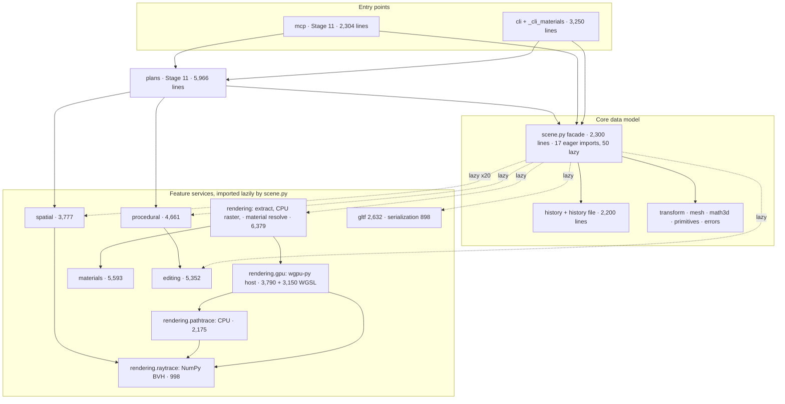
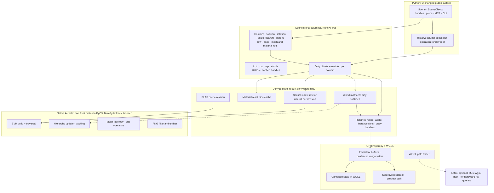

Contents

1. [1. The answer](#summary)
2. [2. How this was measured](#method)
3. [3. System map](#map)
4. [4. Where the time goes](#bottlenecks)
5. [5. Experiments](#experiments)
6. [6. Languages and GPU technologies](#languages)
7. [7. What other engines do](#engines)
8. [8. Architecture or language? Quantified](#arch-vs-lang)
9. [9. Misconceptions to retire](#myths)
10. [10. Target architecture](#target)
11. [11. Module-by-module recommendations](#modules)
12. [12. What must not break](#invariants)
13. [13. Migration plan](#migration)
14. [14. Top ten changes](#top10)
15. [15. What to benchmark next](#next)
16. [16. Risks](#risks)
17. [17. Decisions needed](#decision)
18. [References and reproduction](#appendix)

AETHER3D · ARCHITECTURE AND LANGUAGE AUDIT · 15 OCTOBER 2026

# Should Aether3D change languages?

**Scope** main 38697d5 (Stages 1–10) + PR #13 at 403581f (Stage 11, unmerged)**Machine** i9-12900H · RTX 4060 Laptop · Arch Linux**Evidence** 7 experiments, 11 implementations, every port checked against Aether3D's output

**Research only.** No source code was changed, no PR was opened or merged, and Stage 12 has not started. Every toolchain and experiment lives in a session scratchpad.

## 1. The answer

Keep Python as the engine's language. Fix the architecture first, then add one native language, Rust through PyO3, for a short list of scalar kernels. Treat hardware ray tracing as a separate, later decision.

The slow parts of Aether3D are slow because of how data is laid out and when it is recomputed. A warm 10,000-object GPU frame takes 111 ms, and the GPU works for 3.1 ms of it. Moving one object costs the same 115 ms because every frame rebuilds everything. Rewriting the same per-object, per-frame design in C++ or Rust would leave that O(N) work in place.

### Key findings

1. **Architecture beats language on the hot paths.** In NumPy on flat arrays, world matrices drop from 14.5 ms to 1.9 ms M and instance packing from 9.2 ms to 0.64 ms M. On a retained GPU buffer, updating one changed instance costs about 9 µs. Today the whole frame is repacked and a new 1.28 MB buffer is created (9.2 ms + 0.39 ms) M. Combined from measured parts, a frame with one changed object would take about 12 ms, or about 6 ms if only the image is read back, against 111 ms today E.
2. **Where the work is truly scalar, compiled code wins by an order of magnitude, with bitwise determinism.** One-thread BVH traversal runs 9–22× faster than today's NumPy wavefront tracer; on 20 threads it is 82–146× faster. Results are bit-identical in C, C++, Rust, Zig, Go, C# and Numba M. Mesh-topology construction is 22× faster in vectorized NumPy and 36× faster in Rust, with identical edge ids M. The PNG unfilter step is about 50× faster in C M.
3. **The compiler backend and data layout matter more than the language.** clang, Rust and Zig share the LLVM backend and land within 13% of each other. GCC-compiled C/C++ is 1.2–1.7× faster than them on the traversal kernel. Go reaches 0.24–0.37× of C, and C# Native AOT 0.40–0.63×. Embree's SIMD BVH8 is a further 1.6–3.8× faster than the best scalar port M.
4. **Binding cost is no reason to avoid native code.** A call through nanobind, PyO3, Cython or the CPython C API costs 11–13 ns with no arguments, the same as a Python function call. ctypes costs 80 ns with no arguments and 464 ns with three floats M.
5. **Hardware ray tracing is fast but out of reach from Python today.** On the RTX 4060, wgpu ray queries trace 1.45–4.73 G rays/s. Aether3D's own WGSL traversal manages 0.10–0.72 G rays/s, so hardware is 6.5–15.1× faster, with ≥99.998% of rays hitting the same triangle M. But wgpu-native's C API, which wgpu-py binds, has no acceleration-structure calls M. Hardware RT therefore needs a native Rust wgpu host. The current GPU path tracer also spends most of its time shading, not traversing R.
6. **Timing: phase it in.** After PR #13 merges, start with a performance-foundation phase that needs no new toolchain: retained render state, dirty tracking, caches, persistent GPU buffers and selective readback. Add the Rust crate only once parity tests and performance gates exist, starting with the CPU BVH. Defer the native GPU host until a product need justifies it.

### The numbers behind the recommendation

| What | Today | Best measured alternative | Factor | Basis |
| --- | --- | --- | --- | --- |
| GPU frame, 10k objects, 1280×720 (one object moved) | 115 ms | \~6 ms retained + image-only readback | \~20× | E2 components E |
| World matrices, 10k-object hierarchy | 14.5 ms | 1.91 ms NumPy flat · 0.09 ms native | 8× · 161× | E1 M |
| Instance packing, 10k | 9.2 ms | 0.64 ms NumPy flat · 0.078 ms C | 15× · 118× | E2 M |
| CPU closest-hit, sphere 1M tris, diffuse rays | 0.08 M rays/s | 6.3 M rays/s C ×20 · 24.8 Embree ×20 | 82× · 322× | E3 M |
| GPU traversal, sphere 1M, diffuse rays | 96 M rays/s (WGSL) | 1,446 M rays/s (ray query) | 15× | E7 M |
| Mesh topology, 200k tris (same edge ids) | 932 ms | 43 ms NumPy · 26 ms Rust | 22× · 36× | E5 M |
| PNG decode, 1080p render | 6.9–7.2 MP/s | 76–99 MP/s zlib + C unfilter | \~11–14× | E6 M |
| Warm raycast, 10k objects | 6.1 ms | \~1.7 ms after a cache fix (traversal only) | \~3.6× | profile M E |

## 2. How this was measured

Scope: `main` at 38697d5 (Stages 1–10, v0.10.0) plus the Stage 11 branch at 403581f (PR #13, open, not merged). Paths below are relative to `src/aether3d/`.

| Item | Value |
| --- | --- |
| CPU | Intel Core i9-12900H, 6 performance + 8 efficiency cores, 20 threads, L3 24 MiB |
| GPU | NVIDIA GeForce RTX 4060 Laptop GPU, Vulkan, driver 615.78.08 (Mesa lavapipe also present) |
| OS, memory | Arch Linux, kernel 7.2.9, 15 GiB |
| Python stack | CPython 3.14.8, NumPy 2.5.4, wgpu-py 0.32.0 on wgpu-native 29, Pillow 12.3.0 (lab venv only) |
| Toolchains (scratchpad only) | gcc 16.2.1, clang 23.1.1, Rust 1.99.1, Zig 0.17.0, Go 1.27.2, .NET 10.0.402 (Native AOT), Numba 0.68, Cython 3.3, nanobind 3.1, PyO3 0.30.1, cffi 2.1, Embree 4.4.1 release binaries, Rust wgpu 30.0.1 |

### Rules the experiments follow

- **Same algorithm, same data.** Every port reproduces Aether3D's own algorithm: the same arithmetic order, the same box and watertight triangle tests, and the same tie rules. Each one reads arrays exported from a real Aether3D scene.
- **Checked outputs.** Every port's output was compared with Aether3D's own output, and every comparison passed. Most are bitwise (world matrices, traversal hits and barycentrics, instance records, edge ids). Embree and the GPU kernels run in float32, so they are checked by agreement rate instead.
- **Timing.** One warm-up, then the median of 3–15 runs. Multi-threaded traversal was rerun with implementations interleaved in random order over 7 rounds, because laptop heat penalizes whatever runs later. GPU kernels were timed with timestamp queries.
- **Floating point.** FMA contraction is off everywhere, as it would have to be in production; E1 shows what changes when it is allowed.
- **Nothing touched the system.** Toolchains and packages went into the session scratchpad. No repository file changed, and no long CPU renders ran.

M measured in this auditR measured by the repository's own benchmarks or docsE estimate built from measured partsC external source

### What was not tested

- Swift, Julia, Java/Kotlin, D, Nim, Odin and Mojo: not installed, and none has a mainstream path to a small CPython extension wheel. They are assessed on architecture and ecosystem only (section 6), not on speed.
- macOS (Metal, Apple Silicon) and Windows (D3D12, MSVC). All numbers are Linux on one laptop, so cross-platform speed and the bitwise-parity claims still have to be confirmed on the other CI operating systems.
- The proposed retained frame was not built. Its time is assembled from measured components and labeled as an estimate.
- Hardware ray tracing inside the real path tracer. E7 measures traversal alone.

## 3. System map

Aether3D is about 54,157 lines of Python and 3,150 lines of WGSL, with no native code of its own. NumPy, wgpu-native and optional libraries do the native work. The layering is sound. `scene.py` eagerly imports only the core (errors, history, math3d, mesh, camera, light, settings, transform), and reaches the 50 feature imports lazily, inside methods. That keeps cycles out of import time, and it means a new store can sit under the facade without touching the feature packages' imports.

Edges summarize a static import scan (lab/m/imports.py). Line counts include docstrings and comments.

### Component map

| Subsystem | Lines | Language | Runs on | Data layout | Cost profile (10k objects unless noted) |
| --- | --- | --- | --- | --- | --- |
| `scene.py · transform.py · history.py` | 4,641 | Python | CPU, caller's thread | Array of structures: one SceneObject (17 slots) + Transform (float tuples) + cloned Appearance per object; dicts by id and name | 934 B/object; read position 28 ns; world_matrix 10.6 µs (walks parents); set position 4.0 µs M |
| `plans/` (Stage 11) | 5,966 | Python | CPU | Plan records → one batch create | 10k blocks in 89 ms ≈ 8.9 µs/object M |
| `mcp/ · cli.py` (MCP: Stage 11) | 5,554 | Python | CPU; MCP in its own process | JSON requests | One MCP plan: 102 ms vs 21.9 s for per-object calls R |
| `rendering/` (extract, CPU raster, materials resolve, settings) | 6,379 | Python + NumPy | CPU | Per frame: a list of RenderInstance objects built from SceneObjects | extract 47.9 ms + materials 17.1 ms per frame M |
| `rendering/gpu/` + WGSL | 3,790 + 3,150 WGSL | Python host, WGSL shaders | GPU through wgpu-py | New storage buffers every frame; cached meshes and textures; 28 B/pixel readback | upload 26.3 ms, GPU 3.1 ms, readback 7.8 ms M |
| `rendering/raytrace/` | 998 | NumPy | CPU, 1 thread | Structure of arrays: binary BVH (child, float32 child boxes, first/count), float32 triangles in leaf order | 0.08–0.43 M rays/s; 1M-triangle build 3.2 s M |
| `rendering/pathtrace/` (CPU integrator) | 2,175 | NumPy | CPU, 1–8 processes | Wavefront arrays | 0.7–3.2 M rays/s with 8 processes R |
| `rendering/gpu/wgsl/pathtrace.wgsl` | 1,625 | WGSL | GPU | One packed u32 buffer (header + node, box, triangle, instance regions) | 33–67 M rays/s full paths; 228 M camera + AO R |
| `materials/` | 5,593 | Python + NumPy (+ WGSL material.wgsl) | CPU and GPU | Node graphs; own PNG decoder | PNG decode 6.9–7.2 MP/s M |
| `editing/` | 5,352 | Python (positions in NumPy) | CPU | Hybrid: positions in arrays, topology in dicts, lists and sets per element | from_mesh 16.1 s for 200k triangles with attributes M |
| `procedural/` | 4,661 | NumPy | CPU | Vectorized modifiers; SHA-256 content cache | Subdivision level 1: 168 ms for 51k faces M |
| `spatial/` | 3,777 | Python + NumPy (uses raytrace) | CPU | Entry list + per-revision caches | warm raycast 6.1 ms M |
| `gltf/ · serialization.py` | 3,530 | Python + NumPy | CPU | JSON + binary buffers | save 0.42 s, load 0.45 s (5.3 MB); GLB export 80 ms M |

## 4. Where the time goes

### 4.1 The GPU frame is an O(N) rebuild

The 10,000-cube scene (one plan, one light, one camera) renders at 1280×720 on the RTX 4060. Stage times come from the renderer's own `stats["timings"]` M:

| Stage | ms | What runs | Where |
| --- | --- | --- | --- |
| evaluate | 0.6 | Procedural cache check | `rendering/scene_data.py` |
| textures | 17.1 | Material and texture resolution for every instance | `rendering/materials.py:174 resolve_materials` |
| extract | 47.9 | A RenderInstance per object, world matrices via per-level gathers from Python objects, a finiteness check and an f-string location per object | `rendering/scene_data.py:294, :190` |
| upload | 26.3 | pack_instances 9.2 ms, draw_order 2.9 ms (Python sort with key lambdas), new storage buffers | `rendering/gpu/resources.py:621, :561; renderer.py:233` |
| prepare | 0.3 | Command encoding | `rendering/gpu/renderer.py` |
| gpu | 3.1 | Shadow, scene and resolve passes | WGSL |
| readback | 7.8 | All outputs copied to a staging buffer and mapped: image, linear color, depth, object index, coverage (28 B/pixel) | `rendering/gpu/renderer.py:434` |
| **total** | **105.9** | Wall clock 111.1 ms unchanged; 114.6 ms with one object moved |  |

Bars to scale. The top bar is measured: the renderer's stage times add up to 103 ms, a little under its reported total (106 ms) and the wall-clock frame (111 ms). The other three bars are composed from measured parts in E1 and E2 with the assumptions in section 8; the materials stage is assumed cached at 0.5 ms.

A profile of `extract_render_scene` shows per-object Python work, not one hot function. The biggest self-time items are the loop body itself, 60k appearance getter calls, 10k `np.all(np.isfinite)` calls and 10k `repr` calls for location strings M. Making those statements faster would help, but the real fix is to stop doing per-object work for objects that did not change. The GPU's 3.1 ms shows that the passes themselves are not the problem.

### 4.2 The object model

| Measure (10k objects) | Value | Note |
| --- | --- | --- |
| Memory per object, history included | 934 B M | SceneObject + Transform + Appearance + dict entries |
| Read position | 28 ns M | Python attribute access |
| Read world_matrix | 10.6 µs M | Recomputed through the parent chain on every read |
| Set position (alone / in a transaction) | 4.0 / 3.5 µs M | Validation + history record |
| Create via plan | 8.9 µs/object M | 10k in 89 ms |
| Floor for any Python object design | 0.78 µs/object M | Slotted object + transform + id + dict insert; `uuid.uuid4()` alone is 0.65 µs (one `getrandom` syscall per id, `scene.py:77`) |
| Undo / redo of the 10k plan | 2.5 / 2.8 ms M | Already batched; fine |

The plan path is already lean: one validation pass, then one recorded operation (`scene.py:1065 _create_many`). A profile spreads the remaining \~8 µs/object above the floor over plan expansion, per-record validation (`_finite3`, unit-quaternion checks), history touches, appearance cloning and grid binding M. Each of these is a Python-level fix: batch ids, vectorized validation for expanded grids, a shared default appearance with copy-on-write. None needs a new language.

### 4.3 Spatial queries

A warm raycast at 10k objects takes 6.1 ms M. Every query, `SpatialIndex.accel` (`spatial/index.py:323`) rebuilds the list of usable entries and an N-element tuple key in Python. That is 200,020 `singular` calls for 20 queries, while the traversal itself is about 1.7 ms M. Caching the filtered list and key per index revision removes most of the cost, a small Python change. The first overlaps query after a change builds the index in about 175 ms M.

### 4.4 CPU ray tracing

`SceneAccel._trace` (`rendering/raytrace/accel.py:452`) is a vectorized wavefront state machine. Each NumPy iteration advances every active ray by one node. That is a clever way to use NumPy for an inherently scalar algorithm, but it pays for array temporaries and gathers at every step. It reaches 0.08–0.43 M rays/s on one thread with 9–52 node visits per ray M. The binned SAH build (`rendering/raytrace/bvh.py:172`) takes 3.2 s for 1M triangles M. The repository's own benchmarks show 8 processes give only 2.6–4.2× because the work is memory-bandwidth bound, and traversal is 58–67% of path-tracer time R.

### 4.5 Editing

Opening a 200k-triangle sphere with normals and UVs as an `EditableMesh` takes 16.1 s. With topology only it takes 0.93 s M. A profile on 25k triangles attributes 71% to quad reconstruction (`editing/topology.py:573 _join_pairs`). It computes 117k face normals one at a time, with NumPy on 3-vectors (`newell_normal` and `unit`, about 234k calls), each paying about a microsecond of call overhead. Face creation (`editing/core.py:996 _new_face`) takes 12% and shading inference 10% M. Bevel on 51k faces took 16.8 s M. These are per-element Python loops over dict-based topology, the pattern Blender keeps in C (BMesh).

### 4.6 Images

Decoding a 1080p render takes 289–300 ms in Aether3D and 25–35 ms in Pillow M. Both inflate with zlib, which takes 15–22 ms. The gap is the Paeth/Average unfilter, a strict left-to-right dependency that Aether3D vectorizes along anti-diagonals (`materials/images.py:360`). That takes about 270 ms, against 5–6 ms for a plain C loop M. Encoding a 1080p render takes 195 ms of NumPy filter selection plus 371 ms of zlib at level 6. zlib level 1 takes 56 ms for a 5% larger file M.

### 4.7 What is already fine

- Save and load: 0.42 s and 0.45 s at 10k objects (5.3 MB). GLB export: 80 ms M.
- Undo and redo of a 10k-object plan: 2.5 and 2.8 ms M.
- Procedural modifiers are vectorized NumPy with a content-addressed cache M.
- The GPU passes (3.1 ms) and the WGSL path tracer, which is 51–65× faster than 8 CPU processes R.
- Python start-up: importing Aether3D takes 135 ms M.

## 5. Experiments

### E1 · World matrices of a hierarchy

**Question.** How much of the 14.5 ms comes from the language, and how much from gathering data out of Python objects? **Setup.** The test uses a random forest with 10k and 100k nodes, depth ≤ 8 and parents before children. Positions, quaternions and scales come from the same arrays a columnar store would hold, and every port uses the same 4×4 arithmetic as `rendering/scene_data.py`. Aether3D's own function ran on a Scene built from identical records and matched the flat-array reference exactly.

| Implementation | 10k: ms | × today | 100k: ms | × today | Bitwise equal |
| --- | --- | --- | --- | --- | --- |
| **Aether3D today** `world_matrices(scene)` | 14.52 | 1× | 279.2 | 1× | reference |
| Cython 3.3 | 0.090 | 161× | 1.45 | 193× | yes |
| C clang -O3 (no FMA contraction) | 0.103 | 141× | 1.60 | 174× | yes |
| Zig 0.17 ReleaseFast | 0.105 | 138× | 1.67 | 167× | yes |
| Rust 1.99 (release, LTO) | 0.108 | 134× | 1.71 | 163× | yes |
| C gcc -O3 FMA contraction allowed | 0.114 | 127× | 1.71 | 164× | no (max diff 2.3e-13) |
| C gcc -O3 (no FMA contraction) | 0.127 | 114× | 1.88 | 149× | yes |
| Numba 0.68 | 0.143 | 102× | 2.09 | 134× | yes |
| C# .NET 10 Native AOT (x86-64-v3) | 0.204 | 71× | 2.56 | 109× | yes |
| Go 1.27 (cgo c-shared) | 0.221 | 66× | 2.76 | 101× | yes |
| numpy (Aether3D algorithm, flat arrays) | 1.908 | 8× | 32.40 | 9× | yes |
| pure Python | 29.7 | 0× | not run |  | yes |

**Reading.** Moving the same NumPy algorithm onto flat arrays gives 8× at 10k and 9× at 100k with no new language. Compiled code adds another 21×. Cython, C, Zig, Rust and Numba are within 1.6× of each other, and Go and C# within 2.5×. Allowing FMA contraction, which GCC does by default for GNU C when the target has FMA, changes results in the 13th digit. Every native kernel must be built with contraction off to keep CPU results reproducible. A ctypes call with no arguments cost 98–129 ns across the libraries M.

### E2 · Per-frame instance data: pack, upload, rebase

**Question.** What does it cost to keep the GPU instance buffer current with a full rebuild, with flat arrays, and with dirty-only updates? The record is `struct Instance` (32 floats, `rendering/gpu/resources.py:43`). Every flat-array packer's output was compared byte for byte with `pack_instances` and matched.

#### CPU side, 10k instances M

| Step | Time |
| --- | --- |
| world_matrices (today) | 13.4 ms |
| draw_order (today) | 2.9 ms |
| pack_instances (today) | 9.2 ms |
| pack all, NumPy on flat arrays | 0.635 ms |
| pack all, Numba | 0.098 ms |
| pack all, C | 0.078 ms |
| rewrite 1 / 10 / 100 / 1000 dirty records, NumPy | 6.4 / 7.2 / 13.8 / 75 µs |
| same, C | 7.3 / 7.0 / 7.7 / 16 µs |

#### GPU side, RTX 4060, 1.28 MB buffer M

| Operation | Time |
| --- | --- |
| create_buffer_with_data (today, per frame) | 387 µs |
| write_buffer, whole buffer | 237 µs |
| write_buffer, 1 record | 2.8 µs |
| 10 records: 10 writes vs 1 range | 28 vs 3.1 µs |
| 100 records: 100 writes vs 1 range | 296 vs 6.0 µs |
| Empty submit + wait | 99 µs |
| Camera rebase on GPU, 10k instances (kernel) | 4.35 µs |

**Precision of moving the camera rebase to the GPU.** Today each frame subtracts the eye from every model matrix in float64 on the CPU (`pack_instances`), so any camera move forces a full repack. Storing world translations as float32 high/low pairs and subtracting on the GPU was tested with objects 100 km from the origin and the camera among them. Max error was 9.5e-07 m, the same as today's CPU path (9.5e-07 m). Naive float32 had 7.7 mm of error M.

**Reading.** With flat arrays, NumPy is within 10× of C for full packs and within 1–5× for dirty updates. The GPU API rewards coalescing: 100 single-record writes cost 50× more than one range write. Persistent buffers, coalesced dirty ranges and GPU-side rebase remove nearly all upload cost for frames where little changed.

### E3 · BVH closest-hit traversal on the CPU

**Question.** What does each language gain on Aether3D's most important scalar kernel, with the same algorithm and data? **Setup.** Every port runs the per-ray state machine of `SceneAccel._trace`: the same two-level table, ulp-grown float32 boxes, float64 arithmetic, the Woop–Benthin–Wald watertight test, the same visit order and tie rules, and the same skip-triangle handling for bounce rays. The scenes come from `benchmarks/bench_raytrace.py`, and the arrays come straight from `SceneAccel.build`. The C++ row is the C file compiled by g++.

Log scale. Copper is today's NumPy tracer, blue is compiled ports on one thread, and teal is 20 threads. Embree uses float32 and SIMD BVH8 nodes, so it is not bit-identical.

One thread, M rays/s (× today's NumPy). Every compiled port produced the same t, instance, triangle and barycentrics as Aether3D, bit for bit.

| Workload | NumPy (current) | C (gcc -O3) | C (clang -O3) | C++ (g++) | Rust 1.99 | Zig 0.17 | Numba 0.68 | C# .NET 10 AOT | Go 1.27 | Embree 4.4.1 |
| --- | --- | --- | --- | --- | --- | --- | --- | --- | --- | --- |
| sphere 100k triscamera 640x480 · 307,200 rays · 15.8 visits/ray | 0.348 | 5.9617× | 4.1812× | 6.0217× | 4.0512× | 4.2312× | 5.4316× | 3.6210× | 1.915× | 13.438× |
| sphere 100k trisbounce (diffuse) · 131,300 rays · 39.6 visits/ray | 0.110 | 1.2712× | 1.009× | 1.3012× | 0.9909× | 1.0510× | 1.1711× | 0.5105× | 0.3803× | 4.1938× |
| 400 cube instancescamera 640x480 · 307,200 rays · 12.9 visits/ray | 0.383 | 8.3122× | 4.8813× | 8.2422× | 4.8213× | 5.1213× | 6.9218× | 4.2911× | 2.015× | 13.134× |
| 400 cube instancesbounce (diffuse) · 260,628 rays · 9.4 visits/ray | 0.434 | 6.8816× | 5.5713× | 7.0616× | 5.1312× | 5.7813× | 6.9116× | 3.488× | 1.965× | 13.130× |
| sphere 1M triscamera 640x480 · 307,200 rays · 18.1 visits/ray | 0.281 | 3.9014× | 2.7210× | 3.8914× | 2.609× | 2.7710× | 3.5913× | 2.479× | 1.455× | 10.939× |
| sphere 1M trisbounce (diffuse) · 131,312 rays · 52.1 visits/ray | 0.077 | 0.7209× | 0.5107× | 0.7209× | 0.5107× | 0.5307× | 0.6709× | 0.3204× | 0.2603× | 2.7035× |

20 threads, M rays/s (× one-thread NumPy). Ports interleaved in random order, median of 7 rounds; Embree measured separately.

| Workload | C (gcc) | Rust | Zig | Numba | C# AOT | Go | Embree | Bitwise |
| --- | --- | --- | --- | --- | --- | --- | --- | --- |
| sphere 100k triscamera 640x480 | 43.2124× | 30.287× | 32.794× | 28.983× | 21.662× | 16.648× | 134385× | yes |
| sphere 100k trisbounce (diffuse) | 10.495× | 8.1074× | 9.6087× | 9.0082× | 3.0027× | 3.5032× | 36.3330× | yes |
| 400 cube instancescamera 640x480 | 56.1146× | 36.796× | 40.5106× | 40.9107× | 29.878× | 17.846× | 127333× | yes |
| 400 cube instancesbounce (diffuse) | 49.6114× | 39.791× | 45.8106× | 47.7110× | 21.349× | 17.540× | 135310× | yes |
| sphere 1M triscamera 640x480 | 32.0114× | 23.584× | 25.089× | 21.777× | 15.154× | 13.548× | 99.2353× | yes |
| sphere 1M trisbounce (diffuse) | 6.3082× | 4.9064× | 5.4070× | 4.9064× | 2.1027× | 2.5032× | 24.8322× | yes |

Embree 4.4.1 (robust mode, same float32 vertices, rays rounded to float32, skip-triangle via a filter callback)

| Embree vs Aether3D float64 | Same hit/miss | Same triangle | Median relative t difference |
| --- | --- | --- | --- |
| sphere 100k tris · camera 640x480 | 100.0000% | 99.9985% | 4.9e-08 |
| sphere 100k tris · bounce (diffuse) | 99.9992% | 99.9985% | 7.0e-08 |
| 400 cube instances · camera 640x480 | 99.9974% | 99.9916% | 1.6e-08 |
| 400 cube instances · bounce (diffuse) | 100.0000% | 99.9987% | 2.2e-07 |
| sphere 1M tris · camera 640x480 | 100.0000% | 99.9970% | 4.8e-08 |
| sphere 1M tris · bounce (diffuse) | 99.9992% | 99.9939% | 7.0e-08 |

**Reading.**

- Every compiled port beats the NumPy wavefront by about an order of magnitude on one thread: GCC C/C++ 9–22×, clang, Rust and Zig 7–13×. Go and C# trail at 3–11× M.
- clang, Rust and Zig are within 13% of each other, and Numba is close (all LLVM). GCC is 1.2–1.7× faster than them, so on this kernel the compiler backend matters more than the language. Layout work of the kind Embree does (below) is worth more than that backend gap.
- Threads scale 7–10× from 1 to 20 (6 hyper-threaded P-cores and 8 E-cores sharing one memory system). The repository's NumPy path tracer gets 2.6–4.2× from 8 processes, which its docs attribute to memory bandwidth R. Native threads share one BVH and avoid NumPy's large temporaries, so they scale further.
- Embree is 1.6–3.8× faster than the best scalar port on one thread. That gain comes from data layout and SIMD (BVH8 nodes, float32, packet-friendly code), which any native language can adopt and NumPy cannot. Embree agrees on 99.99% of triangles but is not bit-identical. Replacing the float64 reference with it would change goldens, so it belongs behind an opt-in.
- Embree builds the 1M-triangle BVH in 59 ms (TBB, all threads). Aether3D's NumPy build takes 3.17 s M.

### E4 · The Python-to-native boundary

**Question.** Does calling native code from Python cost too much for a fine-grained API? Each module exposes `noop()` and `add3(a, b, c)`. Timings are the median of 7 × 1M calls from CPython 3.14; the empty loop costs 3.7 ns.

| Binding | noop() ns | add3(1.0, 2.0, 3.0) ns |
| --- | --- | --- |
| pure Python function | 13.8 | 30.3 |
| CPython C API (METH_NOARGS / METH_FASTCALL) | 11.8 | 28.0 |
| Cython 3.3 def | 10.9 | 25.9 |
| nanobind 3.1 | 11.2 | 30.5 |
| PyO3 0.30 | 13.2 | 26.9 |
| cffi 2.1 API mode (compiled) | 57.9 | 79.3 |
| cffi 2.1 ABI mode (dlopen) | 77.4 | 168.4 |
| ctypes | 80.2 | 463.9 |
| Numba 0.68 njit dispatch | 25.0 | 115.5 |

**Reading.** Compiled bindings cost the same as a Python call. ctypes and cffi's ABI mode are 5–15× slower because they convert arguments at run time. They are fine for one call per batch, but wrong for per-object calls. Numba's dispatcher costs 116 ns per call. Its first call of the traversal kernel spent 1.59 s compiling (another 0.96 s for the parallel variant), on top of 153 ms to import Numba, in every new process. That is acceptable in a lab and a poor fit for a library that AI agents start as short-lived processes M.

**Binary size and runtimes.** The traversal library is 19 KB in C/C++, 53 KB in Zig and 369 KB in Rust. In Go (2,046 KB) and C# Native AOT (1,400 KB) it carries a garbage-collected runtime into the Python process. The first C# build also aborted on entry, from `stackalloc` in an `[UnmanagedCallersOnly]` export, and needed a workaround M.

### E5 · Mesh topology construction

**Question.** Is editing slow because of Python or because of per-element data structures? The test builds the edge table of a 199,808-triangle sphere. Edge ids are numbered in first-use order, and each edge gets its list of faces in order, exactly what `EditableMesh._add_edge_use` produces. Every implementation was checked against Aether3D's own `_edge_verts` and `_edge_faces`.

| Implementation | Time | × today | Same edge ids and faces |
| --- | --- | --- | --- |
| EditableMesh.from_mesh, topology only (today) | 932 ms | 1× | reference |
| NumPy: weld (shared, already in Aether3D) + vectorized edges | 21.5 + 21.9 ms | 22× | yes |
| C, simple open-addressing table | 21.5 + 13.0 ms | 27× | yes |
| Rust, std HashMap (SipHash) | 21.5 + 7.7 ms | 32× | yes |
| Rust, std HashMap (multiplicative hasher) | 21.5 + 4.3 ms | 36× | yes |
| EditableMesh.from_mesh with normals, UVs and quads (today) | 16.1 s |  | the default path |

**Reading.** The ports build the edge table and each edge's face list; `EditableMesh` also fills per-vertex edge sets and per-face dictionaries, which a data-oriented design would hold as arrays too, so these factors compare the core work rather than every byte of today's structure. Topology vectorizes well in NumPy (22× end to end, 43× for the edge step alone). The welding step, already NumPy in Aether3D, then dominates. A good hash table counts for more than the language: my simple C table lost to Rust's standard SwissTable. The default path is 17× slower than topology alone because of per-face corner tuples, per-face normals and quad joining. Batched NumPy normals fix most of that; local operators such as bevel are the part that wants native code.

### E6 · PNG decode and encode

The test uses two showcase renders from `examples/output/`. Aether3D's decoder output equals Pillow's pixel for pixel (RGB equal, alpha 255), and the C unfilter equals Pillow's too.

| Image | Aether3D decode | Pillow decode | zlib + C unfilter | Aether3D encode (level 6) | Pillow encode (level 6) |
| --- | --- | --- | --- | --- | --- |
| castle_path.png1920x1080x3, filters N/S/U/A/P = 0/1/0/1016/63 | 300 ms6.9 MP/s | 35 ms60 MP/s | 22 + 4.9 ms76 MP/s | 568 ms3.33 MB | 519 ms3.39 MB |
| hero_gpu.png1920x1080x3, filters N/S/U/A/P = 0/1/156/510/413 | 289 ms7.2 MP/s | 25 ms82 MP/s | 15 + 5.8 ms99 MP/s | 260 ms1.99 MB | 146 ms2.01 MB |

**Reading.** Decoding is limited by one sequential kernel; about 50 lines of native code (or an optional Pillow fast path) fix it. Encoding is mostly zlib at level 6 in both libraries; a lower compression level for previews and a native filter step would cut it by more than half.

### E7 · GPU traversal: Aether3D's WGSL vs hardware ray queries

**Question.** What does hardware ray tracing buy over the traversal Aether3D runs today, and can Aether3D reach it? **Setup.** One Rust program (wgpu 30.0.1, Vulkan) runs two compute kernels on the same rays. The software kernel contains Aether3D's own `trace_ray` and helpers, copied verbatim from `rendering/gpu/wgsl/pathtrace.wgsl`. It reads a word buffer built exactly as `pack_scene_words` builds it (`rendering/gpu/pathtrace.py:169`), from the same SceneAccel. The hardware kernel uses `rayQueryInitialize` and `rayQueryProceed` on a BLAS/TLAS built by wgpu from the same float32 vertices. Rays are 1920×1080 camera rays plus diffuse bounce rays leaving the camera hits; GPU time comes from timestamp queries, median of 10.

Linear scale, to scale.

| Workload | WGSL software (today's code) | Hardware ray query | Speed-up | Same triangle as float64 ref (SW / HW) | BLAS + TLAS build |
| --- | --- | --- | --- | --- | --- |
| sphere 99k triscamera · 2,073,600 rays | 3.25 ms638 M rays/s | 0.451 ms4,598 M rays/s | 7.2× | 100.0000% / 100.0000% | 1.5 ms |
| sphere 99k trisbounce · 886,244 rays | 5.96 ms149 M rays/s | 0.396 ms2,239 M rays/s | 15.1× | 100.0000% / 100.0000% | 1.5 ms |
| 400 cube instancescamera · 2,073,600 rays | 2.89 ms717 M rays/s | 0.447 ms4,639 M rays/s | 6.5× | 99.9997% / 99.9998% | 0.7 ms |
| 400 cube instancesbounce · 1,760,576 rays | 2.80 ms629 M rays/s | 0.372 ms4,727 M rays/s | 7.5× | 100.0000% / 100.0000% | 0.7 ms |
| sphere 998k triscamera · 2,073,600 rays | 4.24 ms489 M rays/s | 0.510 ms4,068 M rays/s | 8.3× | 99.9986% / 99.9986% | 8.7 ms |
| sphere 998k trisbounce · 886,312 rays | 9.27 ms96 M rays/s | 0.613 ms1,446 M rays/s | 15.1× | 99.9982% / 99.9982% | 8.7 ms |

**Reading.**

- RT cores trace 6.5–15.1× faster than the WGSL traversal. The gain is largest for incoherent rays in large meshes, which is where path tracing spends its rays. Both kernels agree with the float64 CPU reference on ≥99.998% of rays, and with each other on ≥99.999% M.
- wgpu-py cannot use this. The wgpu-native 29 library it ships exports 228 C functions and none of them builds acceleration structures M. In Rust wgpu the API exists but is gated as experimental (`Features::EXPERIMENTAL_RAY_QUERY` plus an `ExperimentalFeatures` opt-in, and WGSL needs `enable wgpu_ray_query;`) M C.
- Expect less end-to-end. The production path tracer reaches 228 M rays/s on camera and AO rays but 33–67 M rays/s on full paths, because material evaluation dominates R. Traversal alone in E7 runs at 96–717 M rays/s in software. Hardware RT matters most after shading is restructured (wavefront or material sorting), which the repository's own notes already identify.

## 6. Languages and GPU technologies

### 6.1 Language families

Scores come from the measurements where they exist; otherwise the row says what was not measured. Performance alone does not separate C, C++, Rust and Zig: they share two compiler backends, and the gap between backends (up to 1.7× on one kernel) is smaller than the gap a better data layout opens (Embree, up to 3.8×). The deciding factors are memory safety for untrusted inputs, one predictable toolchain for wheels on three operating systems, and the GPU path. Rust leads on all three: wgpu is a Rust library, so a future hardware-RT host would share the kernel crate's language.

| Option | Kernel speed (E1/E3) | Python boundary | Packaging for 3 OSes × CPython 3.10–3.14 | Safety and determinism | 3D / GPU ecosystem | Verdict |
| --- | --- | --- | --- | --- | --- | --- |
| **Python + NumPy** (today) | Baseline. Vectorizable work is good; scalar work is 10–150× behind M | none | Pure wheels | Memory-safe; deterministic (no FMA contraction) | Rich (NumPy, trimesh, Pillow, wgpu-py) | KEEP for API, orchestration and vectorizable math |
| **Rust** (PyO3 + maturin) | LLVM tier: 0.58–0.78× of GCC C on traversal; fastest on hash-heavy topology M | PyO3 13 / 27 ns M | One toolchain; abi3 wheels (one per OS/arch for all supported CPythons); maturin builds them | Memory-safe by default (decoders, MCP inputs); never contracts FMA unless asked; threads without data races | wgpu (same WGSL, ray queries), naga, rayon, Embree via C API, meshoptimizer bindings | **Primary native language** |
| **C++** (nanobind + scikit-build-core) | GCC tier: fastest scalar port M; MSVC on Windows untested | nanobind 11 / 31 ns M | CMake + 3 compilers (GCC, clang, MSVC); more CI work | Manual memory safety; GCC's default for GNU C/C++ contracts FMA, so builds must pin -ffp-contract=off | Deepest: Embree, OptiX, OpenVDB, OpenSubdiv, USD | Alternative if Embree/USD/OptiX integration becomes central |
| **C** (C API / cffi) | Same as C++ M | C API 12 / 28 ns; cffi 58–80 ns M | Simple for tiny kernels | Manual; same FMA caveat | Embree's native API | No advantage over Rust or C++ |
| **Cython** | Top tier on the simple E1 loop M; not ported for E3 | 11 / 26 ns M | C compiler matrix | Manual (C semantics) | Good glue next to Python objects | Fine for small loops; weaker than Rust for big kernels |
| **Numba** | LLVM tier, 0.83–1.00× of GCC on traversal M | Dispatch 25 / 116 ns; 1.59 s first-call compile, 153 ms import M | Runtime JIT; llvmlite tracks CPython releases with a lag (3.14 support arrived in 0.63) C | Deterministic with fastmath off | Numerical; no GPU via wgpu | Lab tool, not a dependency |
| **Zig** | LLVM tier M | C ABI via a hand-written CPython module or ctypes | Excellent cross-compilation | Safer than C in Debug/ReleaseSafe; not 1.0, breaking releases C | Small | Not now |
| **C# Native AOT** | 0.40–0.63× of C M | C ABI exports; GC runtime in-process | 1.4 MB per library; we hit an AOT abort M | Managed | Small for 3D kernels | No |
| **Go** (cgo c-shared) | 0.24–0.37× of C M | cgo export, 40–60 ns per call on top C | 2 MB runtime with GC and signal handlers inside Python | Spec allows FMA fusion on some targets | Small | No |
| **Swift, Julia, Java/Kotlin, D, Nim, Odin, Mojo** | Not measured. Each compiles through LLVM (Swift, Julia, D/LDC, Odin, Mojo) or C (Nim), so E1/E3 suggest kernel speed would track that backend E | No mainstream way to ship a small CPython extension wheel; Julia and the JVM bring a whole runtime; Julia's trimmed static compiler is experimental C | Varies; most are heavy or immature for this use | Varies | Thin for this use | No: deployment, not speed, rules them out |

### 6.2 GPU technologies

| Technology | What it gives Aether3D | Python integration | Cost and risk | Verdict |
| --- | --- | --- | --- | --- |
| **WGSL on wgpu-py** (today) | Vulkan, Metal and D3D12 from one shader language; headless; validated by naga | Native Python package | No ray-tracing API in wgpu-native M | KEEP |
| **Rust wgpu host** | The same WGSL and backends, plus ray queries: 6.5–15.1× faster traversal M | Through the same PyO3 crate as the kernels | Experimental API; would take over device ownership from wgpu-py (two wgpu instances cannot share buffers) | DEFER |
| **Vulkan directly** (ash or C++) | Full RT pipelines, every extension | Native module | Large effort; loses Metal/D3D12 unless rewritten per API | No |
| **CUDA + OptiX** | Best-in-class NVIDIA path tracing (as in Cycles) | Native module | NVIDIA only; proprietary SDK terms C | No for core; possible optional plugin |
| **DX12 / DXR** | Windows hardware RT | Native module | Windows only; wgpu already covers D3D12 | No |
| **Metal / Metal RT** | Apple hardware RT | Native module | Apple only; better reached through wgpu if and when its ray queries cover Metal (untested here) | Through wgpu only |
| **HIP / HIP RT**, **SYCL** | AMD and Intel compute | Native module | Vendor-specific | No |
| **Slang** (shader language) | Modules, generics, autodiff; many targets | Offline compiler | WGSL and Metal targets are experimental C | DEFER |
| **NVIDIA Warp** (Python GPU kernels, Apache-2.0) | CUDA kernels written in Python | Python package | CUDA GPUs only; second GPU stack beside wgpu C | No |

### 6.3 Why Rust over C++, and when that would flip

- **For Rust.** The native code would parse untrusted data (PNG files, glTF, plans from MCP clients) and run multithreaded kernels; Rust's defaults prevent the memory and data-race bugs C++ leaves to review. maturin with abi3 gives one wheel per OS and architecture for every supported CPython. Floating-point contraction is never implicit. wgpu, the stack behind wgpu-py, is native Rust, so a future GPU host shares the kernel crate's language.
- **For C++.** GCC produced the fastest scalar traversal here, and the deepest 3D libraries (Embree, OptiX, OpenVDB, OpenSubdiv, USD) are C++. If Aether3D decides to build on several of them, nanobind + scikit-build-core is the better home.
- **Either way, pick one.** Two native languages would double CI, packaging and review cost for kernels that total a few thousand lines.

## 7. What other engines do

None of these engines got fast by swapping a scripting language for a compiled one at the API. They all separate the authoring model from a render-side, data-oriented mirror, track changes, and keep hot loops in a small compiled layer.

| Engine | Relevant design | Lesson for Aether3D |
| --- | --- | --- |
| **Blender** | C/C++ data (DNA) behind a Python API generated from RNA descriptions. The dependency graph evaluates changed data into copies (copy-on-evaluation) \[1\]. Meshes moved from arrays of structs to per-attribute arrays \[2\]. Bulk `foreach_get/foreach_set` took an image-pixel access from 2,900 ms to 29 ms \[3\]. Cycles runs one kernel source on CPU, CUDA, OptiX, HIP, oneAPI and Metal \[4\]. C | Keep Python handles as views over columnar data; add bulk array accessors; tag changes and evaluate only what depends on them. |
| **Unreal Engine** | The renderer mirrors game objects as scene proxies and primitive scene info \[5\]; per-primitive GPU data lives in buffers updated for changed primitives. Hot CPU loops in Chaos physics use ISPC \[6\]. C | A render-side mirror with dirty uploads; SIMD-friendly kernels for the few hot loops. |
| **Godot** | Scene nodes are front ends for servers addressed by opaque RIDs; heavy users call the RenderingServer directly, and MultiMesh draws many instances from one buffer \[7\]\[8\]. C | Stable ids into a flat service; instance buffers for repeated meshes, as Aether3D already batches draws. |
| **Bevy** | ECS columns; the renderer extracts components into a separate render world each frame (0.6) \[9\] and later moved to GPU-driven rendering (0.16) \[10\]. C | Extract only changed components; keep render data resident on the GPU. |
| **Unity** | DOTS jobs written in HPC#, a C# subset compiled by LLVM through Burst \[11\]. C | A small, restricted kernel layer, which for Aether3D means Rust kernels with NumPy fallbacks. |
| **OpenUSD Hydra** | A scene delegate reports per-prim dirty bits; render delegates pull only what changed \[12\]. C | A dirty-bit protocol between the store and each consumer (renderer, spatial index, exporters). |

## 8. Architecture or language? Quantified

The table lists each candidate change with the measurement behind it. Most of the frame-time win needs no native code.

| Change | Measured basis | Effect | Needs native code? |
| --- | --- | --- | --- |
| Persistent GPU buffers, coalesced range writes | create 387 µs vs write 1 record 2.8 µs M | Upload cost proportional to change | No |
| Retained render world with dirty tracking | extract 47.9 ms rebuilt every frame M | Unchanged objects cost nothing; one dirty object \~0.1 ms E | No |
| Columnar transforms + cached world matrices | 14.5 → 1.9 ms flat NumPy; 0.09 ms native M | Full recompute 8×; dirty subtrees only µs | Optional (saves another 1.8 ms at 10k) |
| Material resolution cache keyed by revision | 17.1 ms per frame M | \~0 when unchanged E | No |
| Camera rebase on the GPU (hi/lo float32) | kernel 4.4 µs, same precision M | Camera moves stop forcing a repack | No (WGSL) |
| Selective readback; preview without full readback | 7.8 ms at 720p; 13–60 ms at 1080p–4K R | Image-only: 1.1 ms at 720p E | No |
| Draw order by NumPy argsort, kept between frames | 2.9 ms Python sort M | Sub-millisecond, or zero when unchanged | No |
| Spatial query cache per revision | 6.1 ms query, \~1.7 ms traversal M | \~3.5× now | No |
| Native BVH traversal and build | 9–22×/thread; 82–146× at 20 threads M | CPU path tracer, spatial queries, CPU fallback | **Yes** |
| Native topology and edit operators | 36× topology M | Interactive editing of large meshes | Partly (NumPy alone gets 22×) |
| Native PNG unfilter | \~270 → \~5 ms M | 10× faster texture loading | **Yes** (or Pillow) |

### Composed frame estimates

These estimates add measured component times. The materials cache is assumed to cost 0.5 ms; command encoding and GPU passes are assumed unchanged. Python overhead for the dirty-update bookkeeping is not measured, so expect the real numbers to be somewhat higher. Even when every object moves, the columnar NumPy frame (15 ms) is 7× faster than today. Native code would shave about another 2.4 ms off that.

| Frame (10k objects, 1280×720) | Composition | Total |
| --- | --- | --- |
| Today, unchanged or one object moved | measured | 111–115 ms M |
| Retained, one object moved | evaluate 0.60 + materials (cached) 0.50 + extract (1 dirty object) 0.10 + upload (1 record) 0.01 + prepare 0.30 + gpu 3.10 + readback (all outputs) 7.80 | 12.4 ms E |
| Retained, one moved, image-only readback | as above, readback × 4/28 bytes | 5.7 ms E |
| Retained, one moved, preview without readback | as above, no readback | 4.6 ms E |
| Columnar, all 10k objects moved (NumPy only) | evaluate 0.60 + materials (cached) 0.50 + world matrices (NumPy, flat) 1.91 + pack all (NumPy, flat) 0.64 + write 1.28 MB 0.24 + prepare 0.30 + gpu 3.10 + readback (all outputs) 7.80 | 15.1 ms E |

### Does SoA or ECS fit Aether3D?

A full ECS (archetypes, systems scheduling) would turn the object-centric Python API, plans and MCP tools inside out. A columnar store behind the existing handles fits better, the way Blender's RNA sits over its data and Godot's nodes sit over RIDs:

- Every object keeps its UUID. A map from id to row index resolves it, and `SceneObject` stays the same Python object per id (cached) but reads and writes columns.
- Columns: position, rotation and scale (float64, as today), parent row, visibility and flags, mesh and material references. Rarely used components (camera, light, metadata) can stay as Python objects.
- Each column has a dirty bitset and a revision counter. The render world, world-matrix cache, spatial index and exporters consume dirty sets and clear their own copies.
- History records column deltas per operation; today's per-object touches map onto that. Undo restores rows, so ids and handle identity survive.

## 9. Misconceptions to retire

Python is why the renderer is slow.

The GPU passes take 3.1 ms of 111 ms. The rest is per-frame, per-object data handling that a retained design removes in Python (M section 4.1, E section 8).

Rewriting in Rust or C++ would make Aether3D N times faster.

Only where the algorithm is scalar (BVH, topology, PNG filters). For the frame, a native port of the same O(N)-per-frame design still does O(N) work per frame. Flat NumPy arrays already get world matrices 8× and packing 15× faster (E1, E2).

Rust is faster than C (or the reverse).

Same algorithm, same backend, nearly the same speed: clang, Rust and Zig land within 13%. Backends differ: GCC beat LLVM by up to 1.7× on traversal, and Rust's SwissTable beat a simple C hash table on topology (E3, E5).

Native code breaks determinism.

Seven languages reproduced Aether3D's float64 traversal bit for bit, on 1 to 20 threads. What breaks it is FMA contraction or fast-math, which GCC enables by default for GNU C when the target has FMA (E1, E3).

Crossing into native code is too expensive for fine-grained APIs.

nanobind, PyO3, Cython and the C API cost 11–13 ns per call, the same as a Python call. ctypes is the slow path, at 80–464 ns (E4).

Numba gives native speed without a native build.

It does give LLVM-tier speed (E3), but each new process pays 153 ms of import and 1.59 s of compile for one kernel, and llvmlite has to catch up with each CPython release.

The GPU path tracer already uses the RT cores.

It runs a software BVH in WGSL. Hardware ray queries would trace 6–15× faster, but wgpu-py exposes no acceleration-structure API (E7).

Hardware RT will make path tracing 10× faster.

Traversal, yes. Full paths are shading-bound (33–67 M rays/s against 228 M for camera and AO rays), so the end-to-end gain waits on restructuring shading.

Embree is a drop-in replacement for the CPU BVH.

It is 1.6–3.8× faster than the best scalar port, but it uses float32 and agrees on 99.99% of triangles, not 100%. It would change CPU goldens, so it belongs behind an opt-in.

Moving to SoA means breaking the public API.

Handles can stay the same Python objects with the same UUIDs; only their storage moves. Blender has kept its Python API stable through exactly this kind of storage change.

Threads in Python need free-threaded CPython.

Native kernels release the GIL and scale 7–10× on 20 threads today. The free-threaded 3.14 build is supported, but it does not make per-object Python work cheaper C.

## 10. Target architecture

The target keeps every public contract and changes what sits under it. It is reached in phases (section 13), and each phase leaves the engine shippable.

#### Contracts between layers

- The store owns truth. Derived state never writes back.
- Every consumer reads dirty sets since its last revision and is correct if it rebuilds everything, so "rebuild all" is always the fallback.
- Every native kernel has a NumPy twin. `AETHER3D_NATIVE=0` selects the twin, and CI checks both bit for bit.
- File format, ids and history semantics do not change.

#### Languages by layer

- **Python:** API, validation, plans, MCP, CLI, history, serialization, orchestration of derived state.
- **NumPy:** columns, vectorized updates, fallbacks and references.
- **Rust (one crate, abi3 wheels):** BVH, hierarchy, topology and edit operators, image filters.
- **WGSL:** all shaders, as today.
- **Later:** a Rust wgpu host if hardware RT is adopted.

## 11. Module-by-module recommendations

P1 is the first phase after Stage 11, P4 the last. Confidence describes how sure I am of the expected benefit: high means the benefit is measured directly, medium means it is composed from measurements, low means it is a judgment.

| Module | Verdict | Language | Evidence | Expected benefit · confidence | Complexity | Risk | Priority | Depends on |
| --- | --- | --- | --- | --- | --- | --- | --- | --- |
| `rendering/scene_data.py` | REARCHITECT | Python + NumPy | Rebuilds a RenderInstance per object every frame (47.9 ms); one moved object costs a full frame M | Frame 111 → \~12 ms (\~6 ms image-only) E · medium | High | Medium (render parity) | P1 | Dirty tracking (store or revisions) |
| `rendering/gpu/renderer.py, resources.py` | REARCHITECT | Python + WGSL | New buffers per frame (renderer.py:233); pack 9.2 ms; draw order 2.9 ms; 28 B/pixel readback M | Upload 26 ms → \<0.1 ms for small changes E · high | Medium | Low–medium | P1 | None; can start first |
| `scene.py, transform.py` | REARCHITECT | Python handles over NumPy columns | 934 B/object; world_matrix 10.6 µs per read via parents M | Enables O(changes) frames; world matrices 8× M · medium | High | High (identity, undo) | P2 | History adapter |
| `history.py, _history_file.py` | KEEP | Python | Undo/redo of 10k plan 2.5/2.8 ms M | Unchanged semantics; records become column deltas | Medium | Medium | with P2 | Store |
| `plans/` | OPTIMIZE | Python | 8.9 µs/object; floor 0.78 µs; uuid4 0.65 µs/id M | \~3–4 µs/object (batched ids, vectorized validation, shared default appearance) E · low | Low | Low | P2 | None |
| `mcp/, cli.py` | KEEP | Python | Protocol and orchestration; batch plans already 200× faster than per-object calls R | None needed | – | – | – | – |
| `spatial/index.py` | OPTIMIZE | Python, then the native traversal | O(N) filter + tuple key per query (index.py:323) is most of a 6.1 ms raycast M | \~1.7 ms now, \~0.1 ms with native traversal E · medium | Low | Low | P1 | None |
| `rendering/raytrace/` | MOVE TO NATIVE | Rust (NumPy kept as reference) | 0.08–0.43 M rays/s; native 9–22×/thread, bit-identical M | 9–146× for CPU tracing and queries M · high | Medium | Medium (cross-OS parity) | P2 | Native crate and CI |
| `rendering/pathtrace/ (CPU)` | DEFER | Rust, after raytrace | GPU path tracer is 51–65× faster R; CPU path serves CI, no-GPU machines, references | Large on CPU-only machines E · medium | High | Medium | P3 | Native raytrace |
| `rendering/gpu/wgsl/pathtrace.wgsl` | KEEP | WGSL | Shading-bound: 33–67 M rays/s full paths R | Wavefront or material sorting before HW RT | – | – | P3 | – |
| `Hardware ray tracing (new)` | DEFER | Rust wgpu host, or an upstream wgpu-native C API | 6.5–15.1× traversal; unreachable from wgpu-py M | Traversal 6–15×; end-to-end less (shading) E · medium | High | High (experimental API) | P4 | Native crate; shading rework |
| `CPU rasterizer (rendering/)` | KEEP | NumPy | Reference and fallback; GPU is 5–63× faster R | – | – | – | – | – |
| `rendering/materials.py` | OPTIMIZE | Python | resolve_materials 17.1 ms/frame for unchanged materials M | \~0 when unchanged E · high | Low | Low | P1 | Revisions |
| `materials/images.py (PNG decode)` | MOVE TO NATIVE | Rust kernel (Pillow fast path when installed) | Unfilter \~270 ms vs \~5 ms in C M | \~10× faster decode M · high | Low | Medium (fuzz the decoder) | P2 | Native crate |
| `rendering/png.py (encode)` | OPTIMIZE | Python (+ native filter) | Filter 195 ms + zlib-6 371 ms at 1080p M | Preview level 1: \~251 ms; with native filter \~61 ms E · high | Low | Low | P2 | – |
| `materials/ node evaluation (CPU)` | KEEP | NumPy | 53 ns–1.9 µs per point; GPU path in material.wgsl M | – | – | – | – | – |
| `editing/ (core, topology, bevel)` | REARCHITECT | NumPy arrays, then Rust operators | from_mesh 16 s at 200k tris; topology 22× in NumPy, 36× in Rust; bevel 16.8 s for 51k faces M | Open 200k-tri meshes in \<1 s; operators 10–100× E · medium | High | Medium–high (journal, diagnostics) | P3 | Native crate |
| `procedural/` | KEEP | NumPy | Vectorized, cached; subdivision 168 ms for 51k faces M | – | – | – | – | – |
| `gltf/` | KEEP | Python + NumPy | GLB export 80 ms at 10k M | – | – | – | – | – |
| `serialization.py (+ file format)` | KEEP | Python | Save 0.42 s, load 0.45 s at 10k M | Format unchanged | – | – | – | – |
| `WGSL shaders (scene, material, shadow)` | KEEP | WGSL | GPU passes 3.1 ms of 111 ms M | – | – | – | – | – |
| `inspection, diagnostics, errors, math3d, mesh, primitives` | KEEP | Python | Small, not on hot paths | – | – | – | – | – |

## 12. What must not break

| Must not change | Where the risk is | How the plan preserves it | Gate |
| --- | --- | --- | --- |
| Public API: Scene, SceneObject, plans, MCP tools, CLI | Store rework under the facade | Handles keep their methods and properties; the store is internal | Existing 2,006 tests unchanged; never weakened |
| Object identity | Rows move on delete and undo | UUID ids stay the key; a handle cache returns the same object per id; tombstones or a row map instead of renumbering ids | Property-based tests: identity across delete, undo, redo, save, load |
| Undo / redo | Column deltas replace per-object records | Same operation boundaries and labels; deltas restore exact float64 values | History replay tests on random edit scripts; bitwise state comparison |
| Determinism and the CPU reference | Native kernels, threads | No fast-math and no FMA contraction; fixed summation order; per-ray independence; NumPy twins | Bitwise parity of native vs NumPy on random scenes, on all three CI operating systems |
| File format (.aether, history file) | Columnar internals | Serializer reads and writes the same JSON from columns | Round-trip tests on files from v0.10/v0.11; byte-identical saves |
| Portability (Linux, macOS, Windows; CPython 3.10–3.14; no-wgpu and no-manifold installs) | A compiled extension | abi3 wheels per OS and architecture; pure-Python fallback when the extension is missing | A CI job with the extension absent; the existing optional-dependency jobs |
| Security (MCP redaction and sandbox, decoder limits) | Native parsing of untrusted data | Rust for decoders; ImageLimits checked before native calls; sizes validated at the boundary | cargo-fuzz targets for decoders; existing MCP security tests |
| Golden images | Kernel changes | CPU goldens stay bit-identical (float64 reference unchanged); GPU goldens keep their tolerances; Embree only as an opt-in | Golden suite on every PR |
| The 17 CI jobs | New build steps | Keep all 17. Add: a wheel build per OS, a native-off job, a parity job, and ratio-based performance gates (as in tests/timing.py) | CI green before any merge |
| Licenses (Apache-2.0, no GPL) | New dependencies | PyO3 and maturin (MIT/Apache-2.0), Embree (Apache-2.0), wgpu (MIT/Apache-2.0); cargo-deny license check | License check in CI |

## 13. Migration plan

Each phase lands as normal staged PRs into `main`, never stacked, each with tests, benchmarks and docs, and each mergeable on its own. Every new path ships behind a flag with the old path still tested, and the old path is removed only after a release in which the new one was the default with no regressions. Effort assumes one experienced developer working with AI assistance E.

| Phase | Scope | Parity tests | Performance gate (RTX 4060 laptop, 10k objects) | Rollback | Effort | Risk |
| --- | --- | --- | --- | --- | --- | --- |
| 0 · Guard rails | Benchmark suite in the repo (frame, query, creation, editing); parity harness; feature flags | Harness compares old and new paths on generated scenes | Baselines recorded; gates are ratios, not absolute times | Nothing to roll back | \~1 week | Low |
| 1 · Python quick wins | Spatial query cache; batched ids; NumPy draw order; material resolution cache; persistent GPU buffers with range writes; selective readback; PNG preview level | Pixel and result parity on goldens; query results identical | Raycast ≤ 2.5 ms (from 6.1); unchanged frame ≤ 80 ms (from 111) | Each change behind a flag for one release | 1–2 weeks | Low |
| 2 · Retained render world + columnar transforms | Store columns with dirty bitsets; world-matrix cache; render world with instance slots; GPU camera rebase; history column deltas | Bitwise world matrices; byte-identical instance records; identity and undo property tests | One moved object ≤ 15 ms with image-only readback; all moved ≤ 25 ms; creation ≤ 5 µs/object | AETHER3D_RETAINED=0 restores per-frame rebuild | 3–5 weeks | Medium–high |
| 3 · Native kernel crate | Rust + PyO3 + maturin, abi3 wheels for 3 OSes; BVH traversal and build, hierarchy, PNG filters, topology; NumPy twins kept | Bitwise vs NumPy twin on random scenes on every CI OS | Traversal ≥ 8× NumPy per thread on all E3 workloads; PNG decode ≥ 50 MP/s at 1080p | AETHER3D_NATIVE=0; wheel can be yanked; pure-Python path always tested | 4–6 weeks | Medium |
| 4 · Data-oriented EditableMesh | Array half-edge and corner layers; batched normals; Rust operators (bevel, extrude) | Topology, diagnostics and journal identical on the editing test corpus | from_mesh 200k tris with attributes ≤ 1 s; bevel 51k faces ≤ 1 s | Old EditableMesh kept for one release behind a flag | 4–8 weeks | High |
| 5 · Optional hardware RT | Rust wgpu host (or contribute BLAS/TLAS to wgpu-native's C API); ray queries in the WGSL path tracer after shading rework | Agreement with the software kernel (≥ 99.99% same triangle), image-level tolerances | Showcase path renders ≥ 2× faster end to end | Software traversal remains the default | 6–10 weeks | High |

### Modernize right after Stage 11, or phase it in?

**Phase it in, starting right after Stage 11 merges.** Phases 0 and 1 are small, need no new toolchain, and fix problems AI users of Aether3D feel directly: query latency, frame time and creation speed. Phase 2 is the real architectural change, and it is easier before more features are built on the per-frame extraction. Phase 3 should follow once the guard rails exist, because it adds a compiled extension to a 17-job matrix that is all pure Python today. Phases 4 and 5 can interleave with feature stages when there is a need. A big-bang migration would stall feature work for months and put identity, undo and goldens at risk all at once.

## 14. Top ten changes

| # | Change | Where | Evidence | Expected gain | Effort | Native? |
| --- | --- | --- | --- | --- | --- | --- |
| 1 | Retained render world with dirty tracking | `rendering/scene_data.py` | Full rebuild each frame; one move = 115 ms M | 111 → \~12 ms E | Weeks | No |
| 2 | Persistent GPU buffers, coalesced writes, GPU camera rebase | `rendering/gpu/renderer.py:233, resources.py:621` | 387 µs vs 2.8 µs; rebase 4.4 µs M | Upload 26 ms → \~0 E | Days | No |
| 3 | Selective readback and a preview path | `rendering/gpu/renderer.py:434` | 28 B/pixel read back every frame R | 7.8 → 1.1 ms at 720p; 55–60 ms saved at 4K E | Days | No |
| 4 | Columnar transforms and cached world matrices | `scene.py, transform.py` | 14.5 → 1.9 ms (E1) M | Frame and queries; enables 1–2 M | Weeks | No |
| 5 | Spatial query cache | `spatial/index.py:323` | O(N) per query M | 6.1 → \~1.7 ms E | Hours | No |
| 6 | Native CPU BVH (Rust), NumPy kept as reference | `rendering/raytrace/` | Bit-identical, 9–22×/thread M | 82–146× at 20 threads M | Weeks | Yes |
| 7 | Material resolution cache | `rendering/materials.py:174` | 17.1 ms per frame M | \~17 ms saved per frame E | Days | No |
| 8 | Vectorized from_mesh, then array half-edge | `editing/core.py:275, topology.py:573` | 16 s at 200k tris; topology 22× in NumPy M | 10–40× to open meshes E | Weeks | Later |
| 9 | Native PNG unfilter (or Pillow when installed) | `materials/images.py:331` | \~270 ms vs \~5 ms M | \~10× decode M | Days | Yes |
| 10 | Batched ids and vectorized plan validation | `scene.py:77, :1065` | uuid4 0.65 µs/id; 8.9 µs/object M | \~2× creation E | Days | No |

Ranked by expected benefit per unit of effort and risk. Seven of the ten need no native code.

## 15. What to benchmark next

1. A retained-frame prototype, to replace the composed estimates in section 8 with measurements, including Python bookkeeping for dirty sets.
2. Memory and access cost of a columnar store with cached handles (target: under 300 B/object, handle reads within 2× of today).
3. Native traversal inside the real CPU path tracer: showcase renders with native threads against today's 8 processes.
4. Embree as an opt-in: golden-image differences, and speed on Windows and macOS (including Apple Silicon).
5. Every native kernel on macOS and Windows: bitwise parity, speed, and MSVC vs clang-cl if C++ is ever chosen.
6. Hardware ray queries inside the WGSL path tracer (traversal swapped, shading unchanged) to measure the end-to-end gain before committing to a native GPU host.
7. Persistent buffers and selective readback on lavapipe, which is what CI runs.
8. Free-threaded CPython 3.14 with native kernels, against processes, for batch rendering.
9. Wheel build time and size in CI for the abi3 crate on all target platforms.
10. Untested languages only if a non-performance reason appears (for example a Swift or Kotlin host application).

## 16. Risks

| Risk | Likelihood | Impact | Mitigation |
| --- | --- | --- | --- |
| Identity or undo regressions in the columnar store | Medium | High | Handle cache; property-based identity and history replay tests; flag-guarded rollout |
| A compiled extension breaks the 3-OS × 5-Python matrix | Medium | Medium | abi3 wheels; pure-Python fallback job; build in CI before merge |
| Floating-point divergence across compilers or OSes | Medium | High | No fast-math or contraction; avoid libm transcendentals in parity paths; bitwise tests on every OS |
| Embree's float32 results change goldens | High if adopted | Medium | Opt-in only; float64 reference stays default |
| wgpu's experimental ray-query API changes | High | Medium | Defer; isolate behind an interface; consider upstreaming a C API |
| Native decoders become an attack surface | Medium | High | Rust; limits checked first; fuzzing in CI |
| Performance gates flake on shared CI runners | High | Low | Ratio gates with generous margins, GC paused, as tests/timing.py already does |
| Feature work stalls behind infrastructure | Medium | Medium | Phases 0–1 first and small; each phase shippable |
| Rust raises the contributor bar | Medium | Low | Small kernels with NumPy twins as executable specifications |

## 17. Decisions needed

Nothing has been changed. No source file was edited, no PR was opened or merged, Stage 12 has not started, and no migration implementation prompt has been written. To move forward I need your decisions on:

1. **Direction.** Keep Python as the engine's language, with a phased, architecture-first plan.
2. **Native language.** Rust through PyO3 and maturin as the single native language, or C++ through nanobind if you expect to build on Embree, OptiX or USD.
3. **First step after PR #13 merges.** Phases 0 and 1 (guard rails and Python-only quick wins), or a different order.
4. **Hardware ray tracing.** Deferred until shading is restructured, or prototyped earlier (benchmark 6 in section 15).

PR #13 (Stage 11) is still open and unmerged, waiting for your approval.

## References and reproduction

### References

Numbers in brackets in section 7 refer to this list; C marks other claims from it.

1. Blender developer docs: Depsgraph, copy-on-evaluation · [https://developer.blender.org/docs/features/core/depsgraph/](https://developer.blender.org/docs/features/core/depsgraph/)
2. Blender task T95965: mesh struct-of-arrays refactor · [https://developer.blender.org/T95965](https://developer.blender.org/T95965)
3. Blender commit: foreach_get/foreach_set for image pixels (2,900 ms → 29 ms) · [https://developer.blender.org/rB9075ec8269e7cb029f4fab6c1289eb2f1ae2858a](https://developer.blender.org/rB9075ec8269e7cb029f4fab6c1289eb2f1ae2858a)
4. Blender manual: Cycles render devices · [https://docs.blender.org/manual/en/dev/editors/preferences/system.html](https://docs.blender.org/manual/en/dev/editors/preferences/system.html)
5. Unreal Engine API: FPrimitiveSceneInfo · [https://dev.epicgames.com/documentation/unreal-engine/API/Runtime/Renderer/FPrimitiveSceneInfo](https://dev.epicgames.com/documentation/unreal-engine/API/Runtime/Renderer/FPrimitiveSceneInfo)
6. Intel: Unreal Engine's Chaos physics and ISPC · [https://www.intel.com/content/www/us/en/developer/articles/technical/unreal-engines-new-chaos-physics-system-screams-with-in-depth-intel-cpu-optimizations.html](https://www.intel.com/content/www/us/en/developer/articles/technical/unreal-engines-new-chaos-physics-system-screams-with-in-depth-intel-cpu-optimizations.html)
7. Godot docs: Optimization using Servers · [https://docs.godotengine.org/en/stable/tutorials/performance/using_servers.html](https://docs.godotengine.org/en/stable/tutorials/performance/using_servers.html)
8. Godot docs: Optimization using MultiMeshes · [https://docs.godotengine.org/en/latest/tutorials/performance/using_multimesh.html](https://docs.godotengine.org/en/latest/tutorials/performance/using_multimesh.html)
9. Bevy 0.6 release notes: pipelined rendering · [https://bevy.org/news/bevy-0-6/](https://bevy.org/news/bevy-0-6/)
10. Bevy 0.16 release notes: GPU-driven rendering · [https://bevy.org/news/bevy-0-16/](https://bevy.org/news/bevy-0-16/)
11. Unity manual: Burst compiler and HPC# · [https://docs.unity.com/en-us/engine/6000.3/manual/programming-environment/script-compilation/burst](https://docs.unity.com/en-us/engine/6000.3/manual/programming-environment/script-compilation/burst)
12. NVIDIA: Learn OpenUSD, Hydra · [https://docs.nvidia.com/learn-openusd/latest/beyond-basics/hydra.html](https://docs.nvidia.com/learn-openusd/latest/beyond-basics/hydra.html)
13. wgpu documentation: ray tracing extensions · [https://wgpu.rs/doc/wgpu/documentation/extensions/ray_tracing/index.html](https://wgpu.rs/doc/wgpu/documentation/extensions/ray_tracing/index.html)
14. Wald et al., Embree: A Kernel Framework for Efficient CPU Ray Tracing (2014) · [https://www.sci.utah.edu/\~wald/Publications/2014/embree/embree.pdf](https://www.sci.utah.edu/~wald/Publications/2014/embree/embree.pdf)
15. nanobind benchmarks · [https://nanobind.readthedocs.io/en/latest/benchmark.html](https://nanobind.readthedocs.io/en/latest/benchmark.html)
16. PyO3 user guide · [https://pyo3.rs](https://pyo3.rs)
17. PEP 779: criteria for supported status of free-threaded Python · [https://peps.python.org/pep-0779/](https://peps.python.org/pep-0779/)
18. Numba 0.63 release notes (Python 3.14) · [https://numba.readthedocs.io/en/stable/release/0.63.0-notes.html](https://numba.readthedocs.io/en/stable/release/0.63.0-notes.html)
19. Go issue 42469: cgo call overhead · [https://go.dev/issue/42469](https://go.dev/issue/42469)
20. Microsoft Learn: Native AOT interop and native libraries · [https://learn.microsoft.com/dotnet/core/deploying/native-aot/interop](https://learn.microsoft.com/dotnet/core/deploying/native-aot/interop)
21. Julia 1.12 highlights (juliac --trim, experimental) · [https://julialang.org/blog/2025/10/julia-1.12-highlights/](https://julialang.org/blog/2025/10/julia-1.12-highlights/)
22. Zig still has no 1.0 release (byteiota) · [https://byteiota.com/zig-still-wont-ship-1-0-thats-the-point/](https://byteiota.com/zig-still-wont-ship-1-0-thats-the-point/)
23. Phoronix: Modular open-sources Mojo (secondary source) · [https://www.phoronix.com/news/Modular-Mojo-Open-Source](https://www.phoronix.com/news/Modular-Mojo-Open-Source)
24. Khronos: Slang initiative (WGSL and Metal targets experimental) · [https://www.khronos.org/news/press/khronos-group-launches-slang-initiative-hosting-open-source-compiler-contributed-by-nvidia](https://www.khronos.org/news/press/khronos-group-launches-slang-initiative-hosting-open-source-compiler-contributed-by-nvidia)
25. NVIDIA developer forum: OptiX in commercial software · [https://forums.developer.nvidia.com/t/optix-use-in-commercial-software/222703](https://forums.developer.nvidia.com/t/optix-use-in-commercial-software/222703)
26. heise: NVIDIA Warp under Apache 2.0 · [https://heise.de/-10381872](https://heise.de/-10381872)

### Reproducing the experiments

All scripts and raw results are in the session scratchpad under /tmp/claude-1000/-home-murisi/ec865d53-4fc5-46c7-bf1b-36a46255ac66/scratchpad/lab. Run Python scripts from the repository root with `PYTHONPATH=src` and the lab interpreter lab/venv/bin/python.

| Experiment | Scripts | Results |
| --- | --- | --- |
| Subsystems | m/subsystems.py, m/prof_extract.py, m/imports.py | m/subsystems.json, m/imports.json |
| E1 world matrices | e1/bench_e1.py, e1/aether_world.py; kernels world.c, world.zig, rust/, go/, cs4/ | e1/e1.json |
| E2 packing and upload | e2/bench_e2_cpu.py, e2/bench_e2_gpu_precision.py, e2/pack.c | e2/e2_cpu.json, e2/e2_gpu_precision.json |
| E3 CPU traversal | e3/e3common.py, bench_e3.py, bench_mt_interleaved.py, bench_cpp.py, bench_embree.py; trace.c, rust/, trace.zig, go/, cs/, trace_numba.py, embree_bench.c | e3/e3_results.json, e3_mt_interleaved.json, embree_results.json |
| E4 boundary | e4/bench_ffi.py, e4/prof_create.py; capi.c, cy_mod.pyx, nb_mod.cpp, pyo3/ | e4/ffi.json |
| E5 topology | e5/bench_e5.py, e5/prof_from_mesh.py; topo.c, rust/ | e5/e5.json |
| E6 PNG | e6/bench_e6.py; unfilter.c | e6/e6.json |
| E7 GPU traversal | e7/export.py, e7/rtbench (Rust), e7/check.py | e7/e7_runs.jsonl, e7/data/agreement.json |

Generated from the measurement files by report/build_report.py in the session scratchpad.